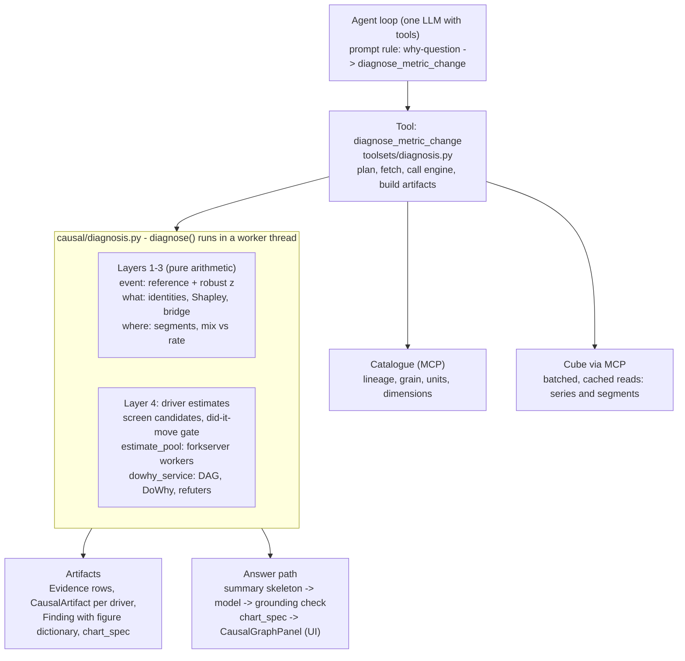
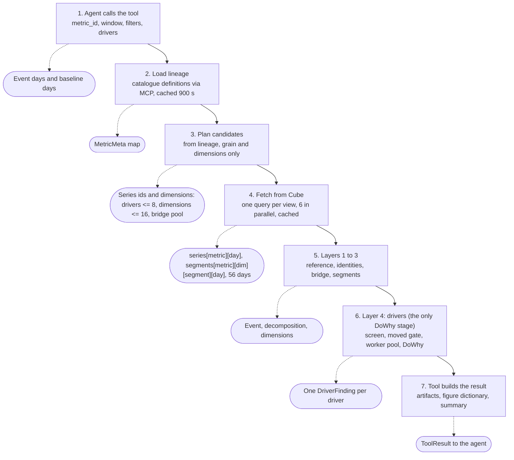

# Seleric Diagnosis (DoWhy) Engine – HLD, LLD, Data Flow & Causal Method

> **Update 2026-10-16.** This document describes the engine as it was before the rebuild. The rebuild (plan: `REBUILD_PLAN_2026-10-15.md`) has begun and changes three things you will meet when reading the code:
> - `seleric_swarm/diagnosis/` is a new, strictly typed package (ports, graph loader, trace, run record and replay, registries, shared anomaly detector). The anomaly primitives and `Referencer` that this document places in `causal/diagnosis.py` now live in `diagnosis/detect/`, and `causal/diagnosis.py` imports them back under the old names. Their behaviour is unchanged (bit-exact parity tests).
> - `diagnose_metric_change` now runs under an investigation: it emits ordered `diag.*` events on the mission stream (carried under the single payload key `investigation`) and returns the `investigation_id`. The analysis itself is unchanged.
> - Layers 1-4 below are still the legacy implementation; Phase 2 of the plan turns them into operators.
> Operations: the running stack is built from `~/work/agent_dowhy_deploy` (see plan D-42), not from the shared `gaurav` checkout.


As of 2026-10-14 · generated from the code at `e9a2ca6`. A copy lives in a Claude Doc; this file is the repo copy.

## 1. Summary

The "DoWhy engine" is `diagnose_metric_change`, one agent tool that answers "why did metric X change?" in four separate layers, and only the last layer uses DoWhy. Layers 1–3 are exact arithmetic and robust statistics; layer 4 is a time-series causal estimate on an explicit DAG, followed by refuters and rule-based labelling. Each layer has its own standard of evidence and is reported separately, so an accounting split is never presented as a behavioural cause.

**Code state described here:** `/opt/seleric/Seleric_Agent`, branch HEAD `e9a2ca6` (2026-10-14, "slim: Phase 5 … diagnosis drivers estimated in a worker process pool"). The causal modules are committed; the uncommitted working-tree changes are docs and `office-ui` only. The running `seleric_agent-api-1` container carries the same module set, including `estimate_pool.py`.

| Layer | Question | Method | Evidence standard |
| --- | --- | --- | --- |
| 1. Event | Is the change real? | Level-adjusted same-weekday reference, robust z-score against the metric's own history | Statistical (median/MAD) |
| 2. Decomposition | What changed? | Data-verified accounting identities, Shapley split, exact additive bridge | Exact arithmetic, `basis="identity"` |
| 3. Localisation | Where did it change? | Segment split by catalogue dimension; mix vs rate effect; Simpson's paradox check | Exact arithmetic + noise-calibrated flags |
| 4. Drivers | Why did it change? | DoWhy backdoor regression on an explicit time-series DAG, HAC/HC3 interval, five refuters, Granger-style direction tests | Causal labels: `supported_cause`, `likely_contributor`, `correlation`, `insufficient_evidence` |

Two design rules shape everything below. First, nothing in the engine names a metric, dimension, value or business threshold: candidates come from the semantic catalogue (lineage, grain, dimensions) and the data accept or reject them. Second, the verdict vocabulary is conservative: a same-day association with no lead/lag or on/off-shift evidence is labelled `correlation`, never a cause.

**Scope limits worth knowing up front:** drivers are estimated only for short events of up to 7 days, read against the metric's usual days. Any window longer than 7 days, or one with an equal-length comparison period, is a period comparison: it stops at layers 2–3 and estimates no drivers (the tool docstring still says two weeks; the code constant `_USUAL_MAX_DAYS` is 7). The estimator is linear OLS with one-day lags, and the DAG is assumed, not learned.

**Files:**

- `src/seleric_swarm/causal/diagnosis.py` (2,994 lines): the pure engine, layers 1–4 and the narrative.
- `src/seleric_swarm/causal/dowhy_service.py` (698 lines): the DoWhy boundary, `estimate_time_series_effect`.
- `src/seleric_swarm/causal/estimate_pool.py` (87 lines): parallel worker processes for driver estimates.
- `src/seleric_swarm/causal/graph_chart.py` (172 lines): turns the DAGs into a UI chart spec.
- `src/seleric_swarm/toolsets/diagnosis.py` (1,700 lines): the agent tool; plans, fetches, calls the engine, writes artifacts and the answer skeleton.

## 2. High-level design

The design separates planning and fetching (the tool, which talks to the catalogue and Cube) from reasoning (a pure engine over already-fetched series), so the calculation can be unit-tested without any service.



(The engine returns a report to the tool, which builds the artifacts and the answer summary.)

The agent calls one tool. The tool reads lineage from the catalogue, fetches about 100 daily series and per-segment series from Cube through MCP, and passes plain dictionaries to the engine. Layers 1–3 are arithmetic; layer 4 sends one estimation job per surviving driver to a pool of worker processes, each running DoWhy and statsmodels.

**Components**

| Component | Location | Responsibility |
| --- | --- | --- |
| Agent loop | `agent/` | Decides to call the tool, writes the answer, grounding check |
| Tool | `toolsets/diagnosis.py` | Plans candidates from the catalogue, fetches, calls the engine, builds artifacts and the answer skeleton |
| Engine | `causal/diagnosis.py` | No I/O. Reference, identities, bridge, Shapley, segment splits, driver screening, classification, narrative |
| DoWhy boundary | `causal/dowhy_service.py` | `estimate_time_series_effect`: frame, DAG, identification, estimate, interval, direction tests, refuters |
| Worker pool | `causal/estimate_pool.py` | Runs the estimates of one diagnosis in parallel processes |
| Dimension planning | `exploration/space.py` | Which dimensions to segment by (hierarchy first) |
| Chart builder | `causal/graph_chart.py` | Unions the per-driver DAGs into a `causal_graph` chart spec |
| Policy constants | `toolsets/policy_config.py` | All `DIAG_*` thresholds |

**External dependencies:** the Seleric semantic catalogue and Cube, both through the MCP gateway (`McpSemanticPort`, `metrics_query` with a per-turn query cache and a `causal_queries` budget); Python libraries `dowhy` (≥ 0.14), `statsmodels`, `networkx`, `scipy`, `numpy`, `pandas`.

**Design principles that recur in the code**

- **No hardcoding.** No metric name, dimension, value or business threshold appears in the engine; a unit test scans the engine source for catalogue names.
- **Lineage proposes, data verify.** A catalogue formula only suggests an identity or a rate chain; it is accepted only if it reproduces the series on every history day.
- **Layers are reported separately** and carry their own evidence basis.
- **Conservative labels.** Absent lead/lag or intervention evidence, a significant association stays `correlation`.
- **Fail soft.** Any estimation failure becomes `insufficient_evidence` with a reason, never a fabricated effect.

## 3. Data flow

Data moves one way: arguments become a window, the window and the catalogue become a plan, the plan becomes about 100 daily series, the series become a report, and the report becomes artifacts and a text summary.



**Shapes of the data**

| Stage | In | Out |
| --- | --- | --- |
| Window | `event_start`, `event_end`, `compare_*` | `event_days`, `baseline` (maybe empty), `partial` days, history start = event start − 56 days |
| Lineage | MCP `fetch_metrics` batches of 10 | `dict[metric_id, MetricMeta]` |
| Fetch | `metrics_query` args with `grain="day"`, scope filter, brand injected where supported | `series: dict[metric, dict[date, float]]`; `segments: dict[metric, dict[dimension, dict[segment, dict[date, float]]]]` |
| Engine | `DiagnosisInput` | `DiagnosisReport` (dataclasses, serialised with `asdict`) |
| Estimation job | `outcome`, `treatment`, `others`, `days` (history only), names, α, tolerances | `TimeSeriesEffect` (effect, SE, p, CI, adjustment set, DAG edges, refutations, direction evidence, naive association) |
| Result | Report plus fetched series | Evidence rows per cited metric-day, `CausalArtifact`, `Finding`, `chart_spec`, `summary` |

**What each stage reads from where**

- The **estimation sample** for layer 4 is the history before the event only (56 days, about 55 usable rows). The event days are never in the regression; the effect is learned from history and then applied to how far the driver moved at the event.
- The **reference** for layers 1–3 comes from the same series' normal history days. Segment series and component series each use their own level-adjusted references, with the outcome's level factors shared where the split must stay exactly additive.
- A **period comparison** replaces those references with the comparison period, day for day.
- Evidence rows are written only for the metrics and days the report cites (event days, reference days, the previous period), each with its source query, so the answer's numbers can be traced.

**Where time goes.** The tool records `phase_ms` for plan, fetch_series, fetch_segments, fetch_chain_segments, engine, evidence and levers in the trace. Code comments give two reference points: before batching, a diagnosis issued 182 single-measure queries (74 s of server time in a 2026-10-13 profile); the estimate pool runs seven driver estimates in 2.0 s instead of 9.5 s serially. The 2026-10-04 notes give 15–25 s for the tool when drivers that did not move are skipped.

## 4. Low-level design

### 4.1 Tool contract

`diagnose_metric_change(metric_id, event_start, event_end, claimed_direction, filters, search_breadth, compare_start, compare_end, drivers)` in `toolsets/diagnosis.py`. It is registered in `agent/local_tools.py::build_local_tools` as one of four helper tools, wrapped by `_tracked` (timing, trace step with `phase_ms`, quotable figures, and a switch of the model to the low write-up effort once it returns).

| Parameter | Meaning |
| --- | --- |
| `metric_id` | Catalogue metric to explain; unknown ids are rejected up front |
| `event_start`, `event_end` | Window to explain, inclusive of both days; default is yesterday |
| `claimed_direction` | `up` or `down` as the user asserted; checked against the data (`premise`) |
| `filters` | Scope of the outcome (for example one channel or campaign); list values with more than one entry are pooled and the tool says so |
| `compare_start`, `compare_end` | Explicit comparison period; turns the run into a period comparison when it has the same length as the event |
| `drivers` | Catalogue ids the user named as suspects; each is fetched, reported and tested where possible |
| `search_breadth` | 0, 1 or 2; each step adds 2 candidate drivers and 4 dimensions and costs about 7–15 s |

### 4.2 Tool pipeline (`_diagnose`)

1. **Window.** Event days are the inclusive range. A day not yet complete (`d >= today`) is dropped when complete days remain; an all-partial window is refused by the engine. `compare_*` or a window over 7 days sets `baseline` (the equal-length period just before, or the given one). The comparison must end before the event starts.
2. **History.** `DIAG_HISTORY_DAYS` = 56 days of daily data before the event are fetched for every series.
3. **Lineage.** `_all_definitions` loads every catalogue definition through the MCP semantic port in batches of 10, cached 900 s per process. `lineage_from_definitions` turns them into `MetricMeta` (aggregation, view, `depends_on`, grain, unit).
4. **Planning** (nothing named, all from lineage and catalogue):
   - identity metrics: the outcome's `depends_on`, plus every ratio built on the outcome and that ratio's other components;
   - chain metrics: `rate_chain_proposals` for the outcome and its additive identity metrics;
   - drivers: `_plan_drivers` takes additive metrics that are not descendants of the outcome, not date-twins, and do not share its unit tokens; ranks by lineage hub score then shared dimensions; round-robins across views; cap is `DIAG_MAX_DRIVERS` (8) + 2 per `search_breadth`; user-named additive drivers go first;
   - dimensions: `space.plan_dimensions` drops scope and time dimensions and orders by hierarchy level (coarsest first), then enumerated dimensions, then by how many views model them; cap 16 + 4 per `search_breadth`;
   - bridge pool: every additive metric with the outcome's unit that supports the brand scope;
   - funnel ends, change-log counts (only when `filters` is set) and the outcome's own unit-count metric.
5. **Fetch.** `_fetch_all` first runs `_prefetch_daily`, which groups metrics of the same catalogue view with the same window, scope and dimension into one multi-measure Cube query (up to 24 measures, concurrency 6) and stores each metric's slice under its single-measure cache key. Individual `metrics_query` calls then hit the cache. A filter the metric cannot take is dropped (or mapped to the conformed sibling dimension); a dropped filter on a driver or bridge term excludes that series rather than using a whole-account figure.
6. **Segments.** Per-dimension daily series for the outcome (and for the rate's weight and numerator when the outcome is a ratio) are fetched, concurrently with the series for additive outcomes. Phase B fetches segments for each verified rate chain. Results over 6,000 rows or with fewer than 2 segments are skipped; empty dimension values become a `(not set)` segment so splits still add up.
7. **Engine.** Builds `DiagnosisInput`, spends one `causal_queries` budget unit per candidate driver (dropping drivers when the budget runs out), and runs `engine.diagnose` in a thread.
8. **Artifacts.** Evidence rows for every cited metric and day, one `CausalArtifact` per estimated driver, a `chart_spec` of the DAGs, then the named-driver text, ratio split, funnel ladder, change-log lines and lever lines.
9. **Result.** A `Finding` whose `metrics` dict lists every number the answer may cite (so the grounding check can trace it), and a `ToolResult` whose `summary` is the plain-language answer skeleton. The full report is in `provenance.source_metadata["diagnosis"]`; `phase_ms` records plan, fetch_series, fetch_segments, fetch_chain_segments, engine, evidence and levers.

### 4.3 Engine data model (`causal/diagnosis.py`)

| Type | Role |
| --- | --- |
| `MetricMeta` | Lineage facts per metric: aggregation, view, `depends_on`, grain, unit; `entity_tokens` = grain words minus calendar and scope words |
| `DiagnosisInput` | Outcome, event days, all series, lineage, segments (metric → dimension → segment → day → value), candidate drivers, partial days, claimed direction, denominators, numerators, baseline days, bridge candidates |
| `EventWindow` | Event days, history days, per-day reference days, excluded outliers, reference kind, per-reference level factors |
| `Identity` | `outcome = k × Π factor^exponent` with constant `k`, dispersion, day count, `approximate` flag |
| `EventSummary` | Actual, reference, delta, z-score, `premise`, `strength`, previous-period comparison, sampling info |
| `DecompositionTerm`, `BridgeTerm` | One factor of an identity or one signed term of the additive bridge, with event, reference, contribution, share of change |
| `SegmentMove`, `DimensionFinding` | One segment's move; one dimension's verdict (`localised`, `broad_based`, `simpsons_paradox`, specificity, coverage) |
| `DriverFinding` | Classification, status, effect per unit, CI, p-value, contribution, DAG edges, adjustment set, refutations, direction evidence, assumptions |
| `DiagnosisReport` | Verdict, headline, everything above, assumptions, data-quality notes, `unexplained_share`, narrative lines |

### 4.4 Engine functions by layer

| Layer | Functions |
| --- | --- |
| Reference and significance | `seasonal_profile`, `_seasonal_profile`, `_has_weekly_pattern`, `Referencer` (`level_before`, `refs`, `trimmed`, `factors`), `reference_days`, `_period_shift_z`, `_err`, `_transform`, `fit_calendar` |
| Decomposition | `discover_identities`, `_verify`, `rate_chain_proposals`, `discover_rate_chains`, `discover_bridge_tree` with `_BridgeSpace`, `shapley`, `_decompose`, `_chain_step`, `_bridge` |
| Localisation | `_analyse_additive_dimension`, `_analyse_rate_dimension`, `_analyse_ratio_dimension`, `_specificity`, `_typical_specificity`, `_abs_noise` |
| Driver screening | `descendants`, `unit_count_metric`, `_lockstep_correlation`, `_residual_correlation` |
| Driver estimation | `dowhy_service.estimate_time_series_effect`, `estimate_pool.estimate_many`, `_classify_driver` |
| Output | `_headline`, `_narrative`, `_bridge_lines`, `build_causal_graph_spec` |

### 4.5 Thresholds (`toolsets/policy_config.py`)

| Constant | Value | Used for |
| --- | --- | --- |
| `DIAG_HISTORY_DAYS` | 56 | Daily history fetched before the event |
| `DIAG_REFERENCE_WEEKS` | 4 | Same-weekday reference days per event day |
| `DIAG_EVENT_Z`, `DIAG_EVENT_Z_NOTABLE` | 2.0, 1.5 | Unusual and notable event |
| `DIAG_OUTLIER_Z` | 3.0 | History day treated as abnormal |
| `DIAG_IDENTITY_TOLERANCE` | 0.01 | Dispersion allowed in an exact identity |
| `DIAG_APPROX_IDENTITY_TOLERANCE` | 0.1 | Dispersion allowed in a cross-system rate chain |
| `DIAG_BRIDGE_TOLERANCE`, `_MAX_TERMS`, `_DEPTH`, `_BUDGET_S` | 0.005, 6, 4, 8 s | Additive bridge search |
| `DIAG_COMEASURE_R`, `DIAG_UNIT_COUNT_R`, `DIAG_COMEASURE_CV` | 0.95, 0.90, 0.02 | Drop a driver that measures the same events |
| `DIAG_TREATMENT_CLUSTER_R` | 0.9 | Group inseparable candidate drivers |
| `DIAG_ALPHA` | 0.05 | Interval and test level |
| `DIAG_REFUTER_TOLERANCE` | 0.25 | Relative effect drift allowed by stability refuters |
| `DIAG_MAX_DRIVERS`, `DIAG_MAX_DIMENSIONS` | 8, 16 | Search size at breadth 0 |
| `DIAG_MIN_ROWS_PER_COVARIATE` | 3 | Estimation rows needed per regressor |
| `DIAG_PLACEBO_SHIFTS` | 60 | Circular-shift placebo draws |
| `DIAG_BROAD_BASED_MAX` | 0.3 | Specificity at or below which a change is broad-based |
| `DIAG_MIN_DIMENSION_COVERAGE` | 0.9 | Share of the outcome a dimension must account for |
| `MIN_OBSERVATION_ROWS` | 8 | Minimum rows for any fit |

### 4.6 Parallel estimation (`estimate_pool.py`)

Each driver estimate costs 1–2 s of CPU (the module docstring measures seven estimates at 9.5 s serial, 2.0 s in processes, 16 s in threads because of the GIL). `estimate_many` runs them in a `ProcessPoolExecutor` on a `forkserver` context whose workers pre-import numpy, pandas, statsmodels, networkx and dowhy. Worker count is `DIAGNOSIS_WORKERS`, default `min(6, CPUs − 1)`; 0 or 1 disables the pool. `warm()` starts every worker at API start-up in a daemon thread (`api/conversations.py`). Any pool failure resets the pool and falls back to serial in-process estimation with identical numbers.

### 4.7 Legacy code that is not on the live path

- `DoWhyService.estimate` (the first half of `dowhy_service.py`) adjusts for every co-measured metric with `proceed_when_unidentifiable=True`. A repository search finds no caller outside that file; the 2026-10-04 audit replaced it because mediators and colliders became "confounders".
- `config/diagnostic_policies.yaml` describes a `CAUSALLY_SUPPORTED` retention policy for an `agents.diagnostic` package that no longer exists in `src/`. Its thresholds (for example `max_causal_candidates: 6`) do not drive the current engine.

## 5. How the causal analysis works

The engine answers four different questions with four different tools, and it only calls the last one "causal". Sections 5.1–5.3 are what the engine calls *what* and *where*; 5.4 is *why*.

### 5.1 Layer 1: is the change real?

**Reference.** For each event day the engine builds a reference from the metric's own normal days, not from the day before. `Referencer` takes up to 4 recent normal same-weekday days (or the 7 nearest normal days when the history shows no weekly pattern), scales each by how the trailing 7-normal-day level changed since then (factor clipped to 0.2–5), drops the highest and lowest when four or more remain, and averages the rest. The level factor lets a recent regime change (a budget cut, a recovery after an outage) carry through instead of averaging two regimes.

**Same-weekday or nearest days.** `_has_weekly_pattern` compares each day with the median of its centred 7-day window (log scale for non-negative series) and runs a Kruskal–Wallis test across weekdays at `DIAG_ALPHA`. Only a significant weekday effect switches on same-weekday references. A halved click-through rate scored z = −1.3 against same-weekday references and z = −5 against the nearest days, which is why the history decides.

**Abnormal days.** History days whose deviation from their own reference is 3.0 robust standard deviations or more are flagged as abnormal and excluded from references. The flagging is iterated up to six times, re-referencing without the flagged days each pass, so a long outage cannot widen "normal" until it hides itself.

**Significance.** The event's error against its reference is taken on a log scale (relative error when the series can go negative). Its z-score is that error minus the median, divided by the MAD-based scale, of the errors of every past window of the same length that touched no abnormal day. `unusual` needs |z| ≥ 2.0 and the delta in the same direction; `notable` needs |z| ≥ 1.5.

**Premise check.** `claimed_direction` is compared with the real direction. The result `premise` is `confirmed`, `contradicted`, `not_unusual`, `not_stated` or `vs_previous_only` (the asked direction holds against the day before but not against the usual level). Only `no_unusual_change` is the verdict for a change that is neither unusual nor notable (not for period comparisons); the lower layers still run so the answer can show what moved.

**Period comparison.** With a baseline, day *i* of the event is referenced on day *i* of the comparison period, so sums and ratios of sums are exactly the comparison period's. Significance is a Mann–Whitney rank test of the two periods' daily values, and the engine states that days are not independent, so it is a guide.

### 5.2 Layer 2: what changed (exact accounting)

**Identities.** `discover_identities` proposes products and ratios from lineage: pairs from the outcome's `depends_on` (`a/b`, `a·b`) and, in reverse, ratios built on the outcome. `_verify` computes `k = median(y / Π x^e)` over the history and accepts the identity only if the median relative deviation is at most 1% and no single day deviates more than 10%. A factor that is itself derived from the outcome is allowed only as a per-unit rate beside additive volumes, so "Y = ltv / (ltv / Y)" is rejected. The accepted identity is split with **exact Shapley values** (`shapley`), which are order-independent and add up to the change. Each additive factor uses its own level-adjusted reference; the one non-additive factor is solved from the identity so the split stays exact (a mean of daily ratios is not a ratio of sums).

**Additive bridge.** For an additive outcome, `discover_bridge_tree` searches for an exact signed sum of other same-unit metrics, up to 6 terms and 4 levels deep, within 0.5% of the metric's typical size on every history day. It is exhaustive, not greedy: each candidate's daily vector and the random projections (4 projections, fixed seed) of every signed sum of up to 3 terms are indexed once, and a match between two half-sums is found by sorted lookup, then verified on the full vectors. A metric equal to the target on its own is a twin and excluded. Netting (subtracting) is allowed only at the top, because the data alone cannot tell a part from a whole that contains it; every deeper line is split into a plain sum of parts. The search has an 8 s wall-clock budget. `bridge_residual` is what the top-level terms leave unexplained.

**Rate chain.** The lead additive term can be rebuilt as `k × rate × base` when lineage proposes a per-base rate, the rate stays within \[0, 1\], the data agree within 10%, and `k` is between 0.5 and 2. Two systems counting the same events (an order ledger and a web tracker) agree only approximately, so these are always labelled approximate. Shapley then splits the lead term between the rate and the base, and the segment analysis is repeated on that rate.

Terms from this layer carry `basis="identity"` (or `approximate identity`). They say what moved, and the engine never presents them as causes.

### 5.3 Layer 3: where it changed (localisation)

For every planned dimension the engine splits the change by segment, using one of three exact forms:

| Outcome type | Split | What it reports |
| --- | --- | --- |
| Additive | Segment delta against its own reference | Segment z = delta ÷ (segment noise × √n), significant at |
| Rate (weighted average) | Mix effect plus within-segment rate effect | Verified first: segments must rebuild the total rate on reference days (median error under 5%) |
| Ratio of two sums | `(R1 − R0) = Σ (dNₛ − R0·dDₛ) / D1` | Used when the weighted-average form fails, for example sales on a campaign with no spend |

For rates, the mix effect is `(share₁ − share₀) × (mean segment rate − overall reference rate)`, priced against the overall reference so a segment that gained volume at a low rate carries the mix effect. **Simpson's paradox** is flagged when the aggregate moves one way, the within-segment effect does not, and the mix effect is larger. A dimension is `localised` when segments that moved beyond their own noise carry at least 50% of the change while holding under 50% of normal volume; it is `broad_based` when the specificity (the share of change not explained by every segment scaling proportionally) is at most 0.3. A dimension whose segments cover under 90% of the outcome, or add to more than 100%, is reported as a slice, not as the change.

### 5.4 Layer 4: why it changed (DoWhy)

**Candidates.** The tool supplies up to 8 additive, non-descendant, different-unit metrics from the catalogue. The engine then removes any candidate that is not an upstream driver, in this order, recording the reason on the `DriverFinding` with `status="excluded"`:

1. it is the outcome, or computed from it (post-outcome variable);
2. it is an arithmetic component in the decomposition or the bridge;
3. it has fewer than 8 history points;
4. it shares unit tokens with the outcome's grain;
5. it moves in lockstep on normal days with a component of the outcome (r ≥ 0.95) or with the count of the outcome's own units (r ≥ 0.90);
6. it moves in lockstep with the outcome (r ≥ 0.95) or with rate × weight;
7. its ratio to the outcome is nearly constant (coefficient of variation under 2%).

Steps 4–7 exist because a driver that counts the same events as the outcome (web-funnel purchases against orders) was once reported as "the cause" of a sales drop. Candidates whose calendar-adjusted residuals correlate at r ≥ 0.9 are marked inseparable and share one estimate in the verdict.

**Did it move?** For each remaining driver the engine computes the driver's own profile and z-score. The driver counts as having moved if, on the day before the event or an event day, it sat at least one typical deviation from its reference in the direction that would explain the event. A driver that did not move is not estimated: it gets `status="ruled_out"`, `ruled_out_because="did_not_move"`. This is what keeps the tool at 15–25 s.

**The causal model.** For each driver X and outcome Y, `estimate_time_series_effect` estimates the same-day total effect of X on Y on the 56-day pre-event history (the event is not in the sample). The graph it states and gives DoWhy is:

```text
calendar (trend, day-of-week dummies Tue..Sun) -> X[t], Y[t]
Y[t-1]                                         -> X[t], Y[t]    (blocks feedback)
X[t-1]                                         -> X[t], Y[t]    (carry-over)
Z[t-1] for each other candidate Z              -> X[t], Y[t]    (lagged only)
X[t]                                           -> Y[t]          (the effect)
```

Every adjustment variable is pre-treatment, so no mediator or collider can enter the backdoor set. Contemporaneous other metrics are deliberately excluded because they may sit on the X → Y path. `CausalModel.identify_effect()` returns the backdoor set; `estimate_effect` runs `backdoor.linear_regression`. If there are too few rows for the full adjustment set (at least `max(8, 3 × (covariates + 2))`), the function sheds covariates in a fixed order: other candidates' lags first, then the calendar, never the outcome and treatment lags. If the treatment barely varies (std near 0 or fewer than 3 distinct values), the status is `insufficient`.

**Estimate and uncertainty.** The point estimate is DoWhy's effect, checked to equal the OLS coefficient. The standard error is the larger of HC3 and small-sample-corrected HAC (Newey–West), with a t interval. A Monte Carlo at n ≈ 55 with about 10 controls found plain Newey–West covered the true effect only 87–90% of the time, HC3 95–97% and corrected HAC about 92%, so the maximum keeps coverage at or above nominal. A naive same-day association (slope, p-value, correlation) is recorded beside it to show what a correlation-only engine would have said.

**Direction evidence** (`temporal.direction`), checked in this order:

1. `feedback`: yesterday's outcome predicts today's driver (p < 0.05) given calendar and the driver's own lag.
2. `temporal`: yesterday's driver predicts today's outcome (p < 0.05) and the reverse does not hold.
3. `intervention`: after removing calendar effects, at least two abrupt jumps in X (at least 3 robust SDs of its day-to-day change) were followed by Y moving the predicted way by at least 1.5 robust SDs, with none contradicting and none preceded by Y already moving.
4. `assumed`: same-day association only.

**Refuters.** Five checks, each recorded with its numbers:

| Refuter | Source | Passes when |
| --- | --- | --- |
| `random_common_cause` | DoWhy | Effect drifts at most 25% and keeps its sign |
| `data_subset_refuter` | DoWhy | Same, on 80% subsets |
| `time_shift_placebo` | Engine | Effect beats up to 60 circular shifts of X (p = (1 + exceed) / (1 + draws) < 0.05). Shifts keep autocorrelation and seasonality and break timing |
| `future_treatment_placebo` | Engine | X\[t+1\] does not significantly explain Y\[t\] given X\[t\] (p ≥ 0.05, or its coefficient under half the effect) |
| `influential_days_removed` | Engine | After dropping days with Cook's distance above 4/n, the effect keeps its sign and drifts at most 50% |

**Classification** (`_classify_driver`, rule-based, first match wins):

| Label | Condition |
| --- | --- |
| `correlation` | Adjusted CI includes 0 (the reason notes whether the raw association vanished after adjustment) |
| `correlation` | Direction is `feedback` |
| `correlation` | `time_shift_placebo` or `future_treatment_placebo` failed |
| `correlation` | Direction is only `assumed` (same-day association) |
| `supported_cause` | All five refuters pass, the driver moved, and its contribution has the event's sign, with `temporal` or `intervention` direction |
| `likely_contributor` | Same, but a non-placebo refuter failed or the contribution did not align |
| `insufficient_evidence` | The estimate could not be produced (too few rows, no variation, DoWhy failure) |

**Status and contribution.** Classification describes X → Y in general; status says whether X explains this event. Status is `ruled_out` if the CI includes 0, if X did not move, or if X moved the opposite way; otherwise `implicated`. The contribution is `β × dx`, where `dx` is the driver's total departure from its own reference over the event (summed for an additive outcome, averaged for a rate), with CI `[lo, hi] × dx` and a share of the outcome's change. Contributions are estimated one driver at a time, so linked drivers overlap and must not be summed; inseparable clusters are counted once toward `unexplained_share`.

**Verdict.**

| Verdict | Condition |
| --- | --- |
| `no_unusual_change` | Neither unusual nor notable, and not a period comparison |
| `explained` | A `supported_cause` exists and the unexplained share is under 50% |
| `partially_explained` | A `supported_cause` with a large unexplained share, or only `likely_contributor`s |
| `located_cause_not_identified` | No implicated driver, but a decomposition, bridge, chain or localised dimension exists |
| `root_cause_not_identified` | Nothing above |
| `insufficient_data` | Partial event day, missing data, or too little history for a normal-day profile |

### 5.5 Assumptions the engine writes into every driver finding

- No unmeasured same-day common cause of X and Y beyond day-of-week, trend and yesterday's values.
- Y does not cause X within the same day.
- The effect is linear in the observed range and stable over the history window.

## 6. Agent integration

Since the slim-loop rebuild (Phases 0–5, October 2026) the agent is one tool-calling loop, not a planner/executor pipeline. The diagnosis engine is one of its tools; the model decides to call it from the prompt and from the tool docstring.

**How it is invoked.** `agent/prompt.py` instructs the model that for a "why" question it should, in its first turn, call `escalate` together with `diagnose_metric_change` (independent calls run in parallel), name any drivers the user suggests in the `drivers` argument, and use `metrics_query` or `metrics_drilldown` only to confirm or extend the result. If the metric did not move the way the user says, the answer says that first. The model is told to report the four labels faithfully and never upgrade one, and that when the tool refuses it should fall back to `compare_period` plus drilldowns, labelling the causes as hypotheses.

**What the model sees.** `_tracked` returns a slim view of the `ToolResult`: the `summary` text, warnings and an error code. The bulky structured report stays server-side. The summary is built by `_summary` as a plain-language answer skeleton: the narrative lines from the engine, one `CHECKS` line per implicated driver (which refuters passed, in business words, and how direction was established), the lever lines, `DATA NOTES`, and a fixed `REPORTING RULES` line. Those rules say that only "a cause" may be described with caused/drove/because of, that arithmetic shares are not causes, that every number must come from the result, and that ids, z-scores and field names must not appear.

**Reasoning effort.** After the tool returns, `_tracked(..., raises_effort=True)` switches the model to `AGENT_WRITEUP_EFFORT` (low): the engine already did the causal reasoning and the remaining steps only report it.

**Grounding.** `_finding_metrics` registers every figure the answer may cite under a dotted key (`event.delta_pct`, `decomposition.<metric>.share_of_change`, `bridge.<metric>.contribution`, `driver.<metric>.effect_ci_0`, `previous_day.<metric>` and so on). `agent/grounding.py` checks each figure in the final answer against the tool results of the turn; unmatched figures go back for one corrective pass, and anything still failing ships with a "Not verified against the data" note.

**Artifacts.** Each estimated driver produces a `CausalArtifact` with the evidence tier `_CAUSAL_TIER` maps from the label (`supported_cause` → `CAUSALLY_SUPPORTED`, `likely_contributor` and `correlation` → `ASSOCIATION`, `insufficient_evidence` → `OBSERVATION`), the effect estimate, the refutation checks and the evidence ids. A `Finding` carries the headline and the figure dictionary. `build_causal_graph_spec` unions the per-driver DAGs into a `causal_graph` chart spec, rendered by `office-ui/src/components/CausalGraphPanel.tsx`; when no driver was estimated it draws the accounting identity instead and says so in the chart's warning.

**Other callers.** `exploration/engine.py` emits a `FollowUp` for `diagnose_metric_change` (windows of up to 14 days, with the observed direction and scope) whenever `explore_data` finds a period change, so exploration can hand an unusual move to the engine.

**Failure handling.**

| Situation | Result |
| --- | --- |
| Unknown metric, no definition, no daily data | Refusal (`INSUFFICIENT_EVIDENCE`), model falls back to other tools |
| Comparison period overlaps the event | Refusal (`UNSUPPORTED_QUERY`) naming the dates |
| Event day still in progress | Dropped when complete days remain; if all are partial the engine returns `insufficient_data` |
| A driver or bridge term cannot take the scope filter | Left out of this scope, noted in `DATA NOTES` |
| Fewer than 8 usable rows, or a driver that barely varies | That driver is `insufficient_evidence` with a reason |
| DoWhy raises | Logged with traceback; that driver is `insufficient_evidence` |
| Worker pool failure | Pool reset, estimates run serially in-process |
| No citable evidence produced | Refusal |

`deps.call_counts` records `diagnosis_ok` or `diagnosis_failed` after each call. In the current source those keys are written but no other module reads them; they appear to be left over from the pre-slim-loop answer gate (the wrapper's docstring says they let the answer's why-part be held to the diagnosis).

## 7. Assumptions, limitations and research questions

The items in 7.1 and 7.2 follow from reading the code. The items in 7.3 come from the project's own audit notes (`docs/audits/2026-10-08_diagnosis_live_replay.md`, archived open-gap files) and were not re-tested for this document.

### 7.1 What DoWhy actually contributes

- The DAG is **assumed, not learned**: every adjustment variable is declared a parent of both X and Y. The backdoor set DoWhy returns is therefore the whole adjustment list, and the point estimate is an OLS coefficient (the code logs a warning if DoWhy's value differs from it). DoWhy supplies the stated graph, identification bookkeeping, the estimand string and two of the five refuters (`random_common_cause`, `data_subset_refuter`).
- The load-bearing safeguards are engine-side: pre-treatment-only adjustment, the conservative interval, the two time-series placebos, the direction tests, the "did it move" gate and the co-measure exclusions. A study of what the engine would conclude without DoWhy would mostly test the first of these.
- The legacy `DoWhyService.estimate` path, which adjusted for all co-measured metrics, is still in the file but unused.

### 7.2 Modelling limits

| Limit | Consequence |
| --- | --- |
| Same-day total effect with one-day lags only | Delayed or distributed effects (ad spend working over several days) are not modelled; they are absorbed into lags or into the residual |
| Linear, constant effect over about 55 rows | No saturation, interaction or regime change inside the history window |
| Small sample against many covariates | With 7 calendar terms, 2 own lags and up to 7 other-driver lags, the row requirement (3 per covariate) often forces shedding. The adjustment set differs by driver and is reported in `adjustment_set`, but a smaller set means weaker control |
| Unmeasured confounders | Only calendar, trend and yesterday's values are controlled. A promotion, price change or external event that moves X and Y together on the same day is invisible |
| Granger-style direction | "Past X predicts Y" is predictive precedence, not proof of causation. The `intervention` label rests on at least two abrupt shifts |
| No multiple-testing correction | Up to about 10 drivers are each tested at α = 0.05; the refuters reduce, but do not remove, false positives |
| Contribution interval | `[lo, hi] × dx` carries the uncertainty in β only, not in `dx` or in the reference |
| Drivers estimated one at a time | Contributions of linked drivers overlap; inseparable clusters (r ≥ 0.9) are counted once but not separated |
| Co-measure exclusions are threshold rules | A true cause that moves in near lockstep with the outcome (r ≥ 0.95) is excluded, as intended for same-event counters, but the threshold is a judgement |
| Drivers only for short events | Period comparisons (over 7 days, or with an equal-length comparison) give exact splits by component and segment, but no estimated drivers |
| Estimation sample includes abnormal days | Outage and launch days supply the variation that identifies an effect, and also dominate it. The influential-days refuter is the only guard |

### 7.3 Open items from the project's audit notes

- **"Why" often stops at "where".** The verdict `located_cause_not_identified` localises a launch or a change but does not read the change log as intervention evidence. The tool now adds change-log lines when `filters` scope the outcome, but the engine does not feed them into classification.
- **Driver planning has no causal order beyond lineage.** For a delivery rate such as click-through, candidates downstream of clicks (sessions, purchases, net sales) can still be proposed. The 2026-10-08 audit asked for a causal ordering so only upstream metrics are candidates.
- **Snapshot attributes used as history splits.** Current-state dimensions such as campaign status make "PAUSED 1.97% → 0.32%" lines artefacts; the catalogue has no flag to exclude them.
- **Period mode** does not separate an outage from a deliberate cut, and the 6,000-row segment cap can drop the finest dimensions for 60–90-day pairs.
- **Rate segments** merge null and empty values into `(not set)` by summing: exact for additive metrics, approximate for rates (guarded by the reconstruction check).
- **Docstring drift.** The tool docstring says windows over two weeks are compared with the previous period; the code threshold is 7 days.

### 7.4 Test coverage

Unit tests under `tests/unit/`: `test_diagnosis_engine.py` (25), `test_time_series_effect.py` (8 synthetic series: weekly seasonality, mediator, collider, reverse causality, shared trend, a true effect, a lagged common cause, a constant treatment), `test_diagnosis_levers.py` (9), `test_diagnosis_live_20261008.py` (7), `test_diagnosis_tool.py` (4), `test_estimate_pool.py` (3). One test, `test_engine_source_hardcodes_no_catalogue_names`, checks that the engine source names no catalogue metric.

### 7.5 Questions worth researching

1. How much of the label quality comes from the pre-treatment DAG, and how much from the placebo and direction tests? An ablation on synthetic series with known effects would show it.
2. Would distributed-lag or adstock terms change which drivers reach `supported_cause` for advertising spend?
3. Do the `intervention` and `temporal` direction tests agree with each other when both are available?
4. Can the change log and launch events be treated as instruments or as intervention evidence in the classification, not only as narrative?
5. What is the false-positive rate of `supported_cause` across the roughly 10 drivers tested per run, and does a family-wise correction change the labels?
6. Is a causal order derivable from lineage and date basis so that candidate drivers are only upstream metrics?
