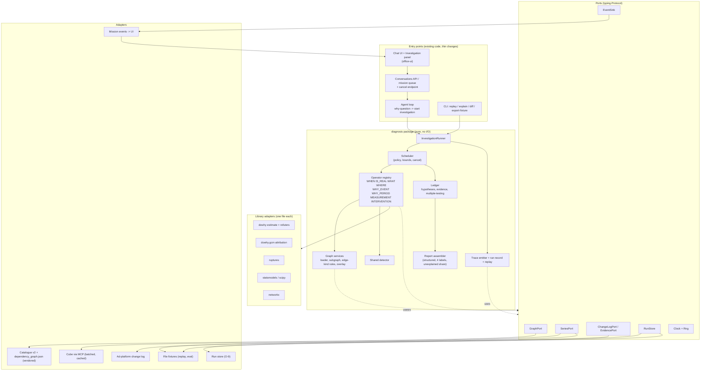
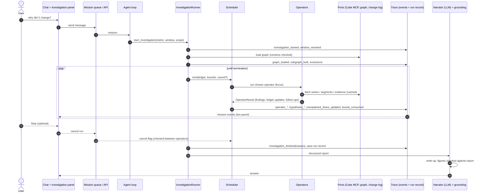
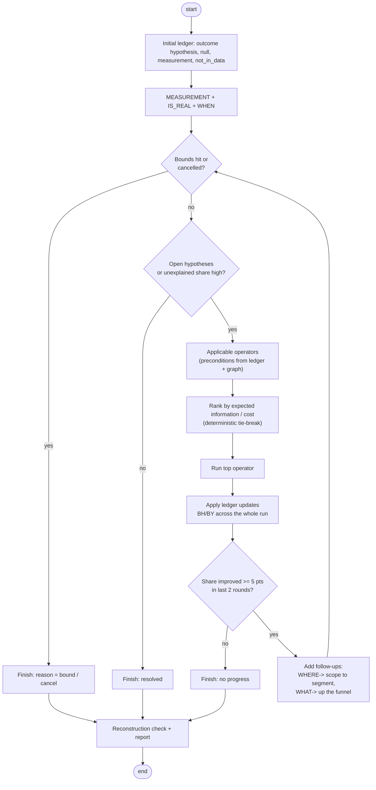
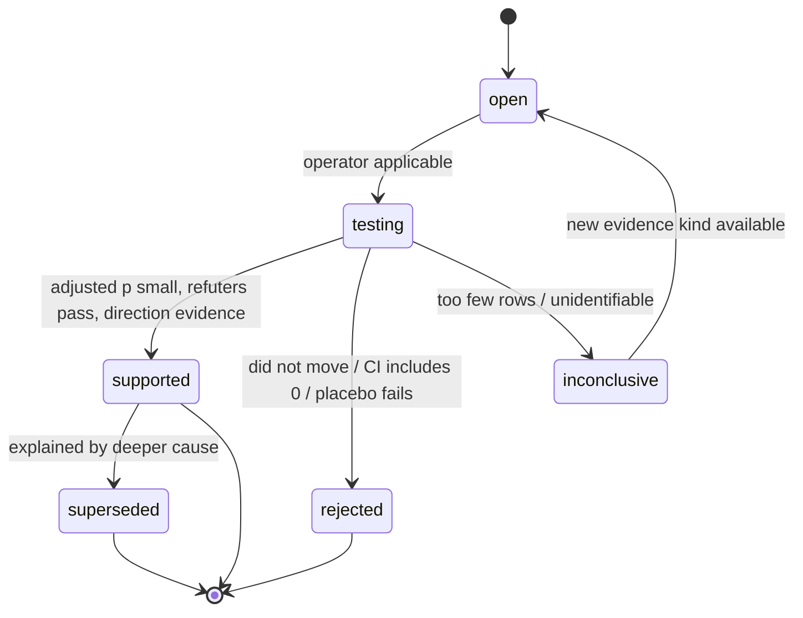
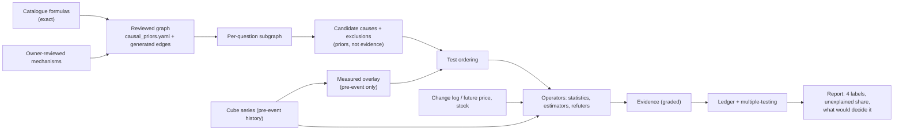
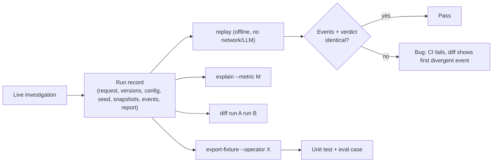

# Diagnosis engine rebuild: master plan (living document)

**File of record after approval:** `/opt/seleric/Seleric_Agent/docs/DoWhy/REBUILD_PLAN_2026-10-15.md` (this plan replaces its content; step S0 below). Companion: `docs/DoWhy/RESEARCH_REPORT_2026-10-15.md` (evidence and sources, frozen).
Created 2026-10-15; revised same day with library docs (§5.5) and architecture (§5.6-5.10). Status (2026-10-16): **plan approved; Phases S, 0 and 1 done and deployed (see §1, §6 Gate 1 status, D-42); Phase 2 done, NOT deployed, NOT committed (staged; D-39) (see §6 Gate 2 status); Phase 3 next.** Committed on `DoWhy`: `4329c39` and `ce4001b` (owner: 'commit', 2026-10-16); not pushed.
Contents: §0 how to resume · §1 dashboard · §2 context · §3 decisions · §4 open questions · §5 architecture (5.1 shape, 5.2 trace, 5.3 debuggability, 5.4 graph, 5.5 library docs, 5.6 HLD, 5.7 LLD, 5.8 proposed decisions, 5.9 runtime flow + flowcharts, 5.10 coding practices) · §6 phase checklists · §7 eval · §8 libraries · §9 verification · §10 risks · §11 findings log · §12 session log · §13 paths.

---

## 0. How to use this file across sessions

**Resume protocol (do this at the start of every session):**
1. Read §1 (status dashboard) and the last 3 entries of §12 (session log). 
2. Read §11 (findings log) entries newer than the last session.
3. Open the first unchecked task in the lowest-numbered unfinished phase (§6). Do not start a phase whose predecessor gate (§6 "Gate") is unchecked.
4. Work on branch `DoWhy` in the worktree `~/work/agent_dowhy` (D-26, supersedes D-22), never in `/opt/seleric/Seleric_Agent` (the shared `gaurav` tree, which teammates edit). Stage by explicit path, never `git add -A` or a whole directory. Run tests and the eval with the live venv and `PYTHONPATH=<worktree>/src` (the worktree has no `.venv` of its own); score only from a clean `git archive <commit>` export.

**Interview rule (owner, 2026-10-15): when execution reaches a decision that cannot be taken from this plan, the code, the data or a standing rule (D-17), do not guess and do not pick silently: interview the owner.**
- Use AskUserQuestion with 2-4 concrete options, a recommended first option, and the evidence that makes the choice matter. Ask before building on either branch, not after.
- Typical triggers: a threshold or penalty with no data-backed default, a business meaning (what counts as a "cause", which metric is the outcome), a licence or dependency addition, a change to a label/output contract, a scope change, a deploy or push, anything irreversible or outward-facing, two plan items that conflict, or a plan assumption that the data contradicts.
- Not triggers (decide, record in §11, continue): naming, file layout inside the agreed package, test structure, anything the plan already rules on.
- Record the answer as the next `D-n` in §3 (or tick the `O-n` in §4) and log it in §12 the same day. If the owner is unreachable, park the item as blocked in §1/§12 and continue with unblocked work; never apply a default to a question the owner has not answered.

**Tracking rule (owner, 2026-10-15): this file is the tracker and must be updated as work happens.**
- After **every** finished task (not only at session end): tick its box with evidence, update the §1 dashboard row, add any new fact to §11, and commit the doc in the same commit as the code/data it describes. A task whose doc update is missing is not done.
- Starting a task: note it in §12 as `in progress` so a crash or handover shows where work stopped.
- Code review/merge is refused if the diff changes a phase's deliverables without touching this file.

**Update rules (every session, before ending):**
- Tick `[x]` only for work that is done **and verified** per §9. Put the evidence (command, run id, commit) after the box: `[x] P1.3 ... (abc1234, tests 12/12)`.
- Add every new fact, surprise, wrong assumption or measurement to §11 as a dated entry. Do not bury them in the checklist.
- Any new business/design decision: stop the item, ask the owner (AskUserQuestion, with evidence), record it in §3 as the next `D-n` and in §12, then continue.
- Append a session entry to §12 (what was done, what is next, blockers). Update the dashboard (§1).
- Never edit §3 rows retroactively; supersede with a new row that names the old one.

---

## 1. Status dashboard

| Phase | Name | Status | Gate passed | Commit / evidence |
| --- | --- | --- | --- | --- |
| S | Setup (branch gaurav, plan file, baselines) | [x] done | [x] 2026-10-15 | graph vendored; golden-6 live run |
| 0 | Eval harness + baseline | [x] done | [x] 2026-10-15 | `eval/diag/`; baseline `670e018`; 49 eval tests |
| 1 | Ports, graph adapter, shared detector, trace + run record + replay | [x] done (partly: see carve-outs) | [x] 2026-10-16 | staged tree `d488cd1d`, uncommitted; 973 tests; golden 6: 5/6 checks; live trace verified |
| 2 | Operator split | [x] done offline (live smoke pending a redeploy; O-12 parked) | [x] offline 2026-10-16 | staged tree `2993f436`, uncommitted; tool output identical on 18 cases; suite scores equal to the Phase 0 baseline; 4 operator fixtures; engine replay byte-identical |
| 3 | Graph-driven candidate planning, explain, diff | [ ] | [ ] | |
| 4 | WHEN, period, drift, weight overlay | [ ] | [ ] | |
| 5 | Ledger, scheduler, deep mode, live panel, cancel | [ ] | [ ] | |
| 6 | RiskLoc (conditional) | [ ] decision pending Phase 0 data | [ ] | |
| 7 | Offline discovery audit | [ ] | [ ] | |
| D | Deploy (hard gate, rollback tag) | [ ] | [ ] | |

Current phase: **3** (graph-driven candidate planning, explain, diff) is next; Phase 2 is complete and staged on `DoWhy`, not committed and **not deployed** (D-39: commit when told). **Running stack (unchanged): api, recovery and business-state-cron run the Phase 1 build from the staging tree `~/work/agent_dowhy_deploy` (D-42).** Open before Phase 3: owner ruling on O-12 (fetch behind the series port) and O-13 (delete `config/diagnostic_policies.yaml`).

---

## 2. Context and objective

**Why:** "Why did X change" answers must be correct, deep, and honest. Current engine (`causal/diagnosis.py` 2,994 lines + `causal/dowhy_service.py` + `toolsets/diagnosis.py` 1,700 lines) is a sound four-layer design (event reality, exact decomposition, localisation, DoWhy drivers) but: candidates come from lineage heuristics and correlation thresholds, not the reviewed dependency graph (`grep dependency_graph src/` is empty); drivers only for events ≤ 7 days; period comparisons get no drivers; anomaly logic is duplicated four times; the change log is narrative only; one shot per question (no recursion); and nothing is replayable or inspectable. Failures so far (TH-383, near-tautology causes, sign inversions, window pin) were over-confident or shallow answers.

**Objective:** given "metric X moved on window W (scope S)", return the smallest set of explanations the data support, each with an evidence grade, the **unexplained share**, and **what data would decide the rest**. Correct cause when findable; "located, not identified" when not; never a confident wrong cause. A person acts; the engine suggests ranked levers and automates nothing.

**Success is measured, not felt (§7):** top-k hit rate on planted causes AND false-attribution rate on null/hidden/measurement worlds, each against the Phase 0 baseline of today's engine.

---

## 3. Decisions (append-only)

| ID | Ruling | Source |
| --- | --- | --- |
| D-1 | Always deep; no wall-clock target; bounded by evidence plus safety bounds (D-2/D-19) | owner |
| D-2/D-19 | Stop when unexplained share improves < 5 points over 2 consecutive rounds, or all open hypotheses resolved. Safety bounds: depth 4, branching 3, 60 operator runs, 400 `causal_queries`, 20 min wall clock. Hitting a bound is reported as such. Change only by new ruling | advisor default, **accepted by owner 2026-10-15** |
| D-3 | Scheduler is deterministic engine code; LLM only narrates the final structured result | owner + research |
| D-4 | Deep missions run on the mission queue with stage events; own timeout class (current `MISSION_TIMEOUT_S=300` / ~150 s turn cannot hold D-1); agent prompt rule changes to "start investigation, stream stages" | owner + code |
| D-5 | Day-one question shapes: short event, period-vs-period, slow drift, filtered scope | owner |
| D-6 | One global reviewed graph, owner reviews; per-brand data overlay only | owner |
| D-7 | Discovery libs (causal-learn, tigramite) offline audit only; never in answer path | owner |
| D-8 | One shared anomaly detector; migrate diagnosis + exploration; business_state and forecasting get thin adapters, behaviour unchanged | owner |
| D-9 | Build on catalogue v2 behind ports; Cube v3 = new adapter + regenerated graph | owner |
| D-10 | Pricing/inventory: define evidence port now; adapters when views exist in serve/Cube v3 | owner |
| D-11 | Keep 4 labels (`supported_cause`, `likely_contributor`, `correlation`, `insufficient_evidence`); add `unexplained_share`, `what_would_decide_it` | owner |
| D-12 | Acting = report + ranked lever suggestions; no automation | owner |
| D-13 | Big-bang worktree deploy (no shadow run) so the eval is a **hard pre-deploy gate**; rollback image tagged first | owner + advisor |
| D-14 | Eval data: brand 20 only. Truth = injection into real series + independent records + null worlds; unknown real incidents get stability checks, not accuracy | owner + advisor |
| D-15 | Multiple-testing control (Benjamini-Hochberg) over the whole investigation ledger | advisor |
| D-16 | Weight overlays fitted on pre-event windows only; enforced by a test | advisor |
| D-17 | Standing rules: no hardcoded metric names/keywords, no regex in new code; verify with live runs cross-checked in ClickHouse; run only the golden 6 + relevant items (never golden 30) | memory |
| D-18 | Live investigation panel in chat from the moment a question routes to diagnosis: full-detail stream (graph generated/traversed, depth/branch, hypotheses, operators, queries, weights, bounds, unexplained share), WHEN to WHY | owner |
| D-20 | Panel is expandable (collapsed row that expands) with a Cancel/Stop button; stop is cooperative (checked between operators), emits `investigation_cancelled`, returns partial ledger, narration says stopped early | owner |
| D-22 | Work on branch `gaurav` only, in `/opt/seleric/Seleric_Agent`; no worktree, no `diag-v4` branch. Supersedes O-2 and the "worktree deploy" wording in D-13 (the eval gate and rollback tag remain) | owner 2026-10-15 |
| D-26 | DoWhy work moves to branch **`DoWhy`** in worktree **`~/work/agent_dowhy`**; `gaurav` is left as it was at `d56cc2f` (= origin/gaurav). Supersedes D-22. Moved 2026-10-15: the 19 unpushed DoWhy commits were re-applied onto `d56cc2f` (hashes changed); a teammate's six uncommitted test files that an earlier `git add tests` had swept into one commit were left out and restored to the shared tree as their working-tree edits. Commits on `DoWhy` are made when the owner says so | owner 2026-10-15 |
| D-23 | Eval fixtures (raw brand-20 daily series + campaign names, 5.3 MB) are kept **in git** on the repo, as `eval/diag/fixtures/`. Asked 2026-10-15 because `docs/47_CONVERSATION_DATA_POLICY.md` covers chat data only | owner 2026-10-15 |
| D-24 | RiskLoc (Phase 6): **no-go for now**, on the P0.9 evidence (re-run on one year of data at the owner's request: no real cross-dimension gain on 52 events, patterns at two or more dimensions indistinguishable from chance; drops under-sampled). Phase 6 stays unstarted; revisit with a higher-volume brand or a drop-rich fixture. The owner asked for the year-long test and has not yet confirmed the go/no-go | evidence + owner request |
| D-25 | Noise-floor rule: planted changes below 2 robust sigmas of the outcome's own variability (`DETECTABLE_Z = 2.0`) are scored apart and 'no unusual change' counts as correct for them; top-k is measured on the detectable worlds | owner 2026-10-15 |
| D-27..D-34 | Owner approved P-1..P-8 of §5.8 as written, 2026-10-15 (O-10): D-27=P-1 package `seleric_swarm/diagnosis/` + deprecated shim; D-28=P-2 import contract in CI; D-29=P-3 registries; D-30=P-4 determinism by construction; D-31=P-5 no CausalPy in service image; D-32=P-6 no tigramite in service image; D-33=P-7 Phase 7 audit = falsify_graph + constrained FCI; D-34=P-8 `fdr_by` default | owner 2026-10-15 |
| D-35 | Live investigation data travels in **one bounded dict under the payload key `investigation`**, added to the public-event allowlist in `conversations/privacy.py` (with a test); no other diagnosis key is allowlisted | owner 2026-10-16 |
| D-36 | Trace event payload cap **4 KB** per event, enforced by the emitter; bulk data stays in the run record and is fetched by id | owner 2026-10-16 |
| D-37 | Commit policy confirmed: commits on `DoWhy` **only when the owner says so** (confirms D-26; overrides the per-task commit wording of §0). Ticked boxes cite the test run and file paths until a commit exists | owner 2026-10-16 |
| D-38 | Graph version (O-11): **derive locally** (document fingerprint + live catalogue cross-check); nothing is changed in Agent Core | owner 2026-10-16 |
| D-39 | Commit policy, refining D-37: **commit the finished Phase 1 work now (one local commit on `DoWhy`), then commit again only when the owner says**; engine-file tasks (P1.4, P1.5b) therefore wait for a go-ahead each time, and a go-ahead lets me export the commit and re-score | owner 2026-10-16 |
| D-40 | Run records (O-9) are stored in the **existing artifact store** (`state/artifacts.py` + `persistence/v3_artifacts.py`), keyed by mission and investigation id; snapshot inline or compressed per the size measured in P1.7 | owner 2026-10-16 |
| D-41 | Run-record retention (O-8): **90 days**, raw brand series allowed in the record (needed for offline replay), deleted with the thread | owner 2026-10-16 |
| D-43 | Owner, 2026-10-16, after the deploy: 'commit'. Phase 1 committed as `ce4001b` (supersedes the 'no commit' instruction of earlier that day for this work; D-39 still applies afterwards: further commits only when told). Not pushed | owner 2026-10-16 |
| D-42 | **Deployment, 2026-10-16 (owner: 'stop it and run from this code, take a pull from gaurav'):** `gaurav` 430dbd0 applied as a staged patch onto the DoWhy worktree (no merge commit, no history change); the running stack was built from `/opt/seleric/Seleric_Agent`, which carries a peer session's uncommitted work (answer visuals), so a snapshot of those files was overlaid in the build (checked: none also differs in the worktree) rather than dropped. Staging dir `~/work/agent_dowhy_deploy` (worktree tree `d488cd1d` + overlay + the host-local `.env`, `docker-compose.override.yml`, `prompts/`); `api`, `recovery`, `business-state-cron` recreated with `docker compose -p seleric_agent` from there; voice and datastores untouched. **The compose project's working dir is now the staging dir: do not run compose for `seleric_agent` from the live dir, it would replace this build with one without the diagnosis package.** Rollback: `seleric_agent-{api,recovery,business-state-cron}:rollback-20261016b` (the images that ran before). The peer session (seleric-35) agreed and stopped building from the live dir | owner 2026-10-16 |
| D-44 | Owner, 2026-10-16 (session 5): **commit the staged Phase 2 now** (one local commit on `DoWhy`, not pushed; D-39 applies afterwards) | owner 2026-10-16 |
| D-45 | Owner, 2026-10-16: **redeploy Phase 2 now** from the staging dir for the Gate 2 live smoke (rollback tag first; D-42 rules on the overlay of the live dir's uncommitted files apply) | owner 2026-10-16 |
| D-46 | Owner, 2026-10-16: **O-12 now**: the tool's fetch phase moves behind `SeriesPort` before Phase 3 (overrules the 'leave for Phase 5' recommendation), so a live investigation becomes replayable | owner 2026-10-16 |
| D-47 | Owner, 2026-10-16: **O-13: delete** `config/diagnostic_policies.yaml` (unused by any code) | owner 2026-10-16 |
| D-21 | Debuggable by design (§5.3): run record, offline deterministic replay, step mode, explain-why-not, no swallowed failures, run diff, fixture export, one correlation id | owner |

## 4. Open questions (owner rulings needed; each names the phase it blocks)

- [x] ~~O-2~~ superseded by D-22: gaurav only, no worktree.
- [ ] **O-3** Long-term graph delivery: vendored `dependency_graph.json` now; image artifact or MCP resource later (blocks D)
- [ ] **O-4** Review cadence/owner for `causal_priors.yaml` changes (blocks Phase 3 sign-off)
- [ ] **O-6** tigramite licence is **GPL-3.0 (confirmed from its repo, 2026-10-15)**. Ruling needed: allowed only as an isolated offline job (separate process/image, never imported by the service image), or not at all (blocks Phase 7). causal-learn is MIT.
- [x] ~~**O-12**~~ do it now (D-46). (raised 2026-10-16, Phase 2) The live tool still fetches outside the ports, so a *live* investigation is traced but not replayable; the engine itself replays byte-identically from a record (`legacy_engine` runner). Moving the fetch phase behind `SeriesPort` now means a gather step with the tool's plan as its request (about 300 lines out of `toolsets/diagnosis.py`, guarded by the oracle); leaving it means fetch becomes an operator in Phase 5, when the scheduler requests series itself. Recommendation: leave it for Phase 5 (Phase 3 rewrites the plan that a gather step would carry). Blocks nothing in Phases 3-4.
- [x] ~~**O-13**~~ delete (D-47). (raised 2026-10-16) `config/diagnostic_policies.yaml` is confirmed unused by code (no loader in `src/`, `scripts/`, `tests/`, `eval/`), but `toolsets/policy_config.py` says the policy YAML files stay on disk until the swarm_v2 callers are gone. Delete it, or keep it until that note is lifted? Left in place.
- [x] ~~O-9~~ existing artifact store (D-40).
- [x] ~~O-10~~ P-1..P-8 approved as written 2026-10-15 → D-27..D-34. Phase 1 unblocked.
- [x] ~~O-11~~ derive locally (D-38).
- [x] ~~O-8~~ 90 days, raw series allowed (D-41).
- [x] ~~O-1~~ bounds accepted (D-19). [x] ~~O-5~~ expandable + Cancel (D-20). [x] ~~O-7~~ graph = `/opt/seleric/Seleric_Agent_Core/doc/dependency_graph` (explorer titled "Seleric Metric Graph")

---

## 5. Architecture

### 5.1 Target shape

```
ports:      GraphPort  SeriesPort  ChangeLogPort (+ evidence kinds: lever, price, stock, incident)
detect:     one robust detector (median/MAD, reference-aware)
operators:  WHEN (ruptures) | IS_REAL | WHAT (identities, bridge, Shapley) | WHERE (segment splits; RiskLoc iff justified)
            | WHY_EVENT (graph-derived DAG + DoWhy + refuters + intervention evidence)
            | WHY_PERIOD (dowhy.gcm distribution_change on the graph) | MEASUREMENT (co-measure divergence)
graph:      candidates from reviewed edges; r/CV thresholds demoted to data checks that raise a measurement hypothesis
ledger:     hypotheses {status, evidence, tests}; BH over all tests; unexplained share; residual "not in the data"
scheduler:  deterministic; picks next operator from ledger state; D-2 bounds; cooperative cancel
trace:      typed ordered events for everything above (§5.2) -> mission events -> UI; persisted in the run record
output:     structured report -> LLM narrates -> existing grounding check (agent/grounding.py)
```
Existing layer 1-3 maths and the 4-label classification are kept behind operator interfaces and must reproduce today's output before they change (Phase 2 gate).

### 5.2 Trace events (D-18)
Envelope: `investigation_id, seq, ts, depth, branch, parent_id, kind, schema_version, payload`. Kinds: `investigation_started, window_resolved, graph_loaded(graph_version,catalogue_version), subgraph_built(nodes,edges,excluded+reason), node_visited, edge_traversed(kind,sign,lag,tier,prior,overlay), operator_started/finished(inputs,query_count,duration,result_digest), operator_failed(type,msg,traceback,inputs_digest), query_issued(cache_hit), hypothesis_opened/tested/resolved(status,evidence,p_raw,p_bh), refuter_result, exclusion(metric,reason_code,check_value), unexplained_share_updated, bound_consumed, investigation_cancelled, investigation_finished(termination_reason), narration_started`. Transport = existing mission events (`api/async_missions.py`, `conversations/event_mapping_v1.py`, `agent/progress.py::emit_progress`); verify each in P1.1.

### 5.3 Debuggability (D-21) requirements and owner phase
1. Run record (P1): question, resolved window/scope, graph+catalogue versions, subgraph, thresholds+bounds, library versions, seeds, full trace, **fetched series snapshot** with source query + fingerprint. Engine decisions depend on nothing outside it.
2. Offline deterministic replay (P1, hardened P2): `replay <id>`; no network/LLM/Cube; byte-identical events + verdict; divergence fails CI.
3. Step mode (P5): `replay --step`, `--break-on <operator|hypothesis|edge>`; panel "inspect this event".
4. Explain-why-not (P3): `explain <id> --metric M`; every exclusion/prune has a reason code.
5. No swallowed failures (P1): operator exceptions are `operator_failed` events shown in the panel; answer-level fail-soft to `insufficient_evidence` stays.
6. Run diff (P3): `diff <a> <b>`.
7. Fixture export (P2): `export-fixture <id> --operator X`; same format as eval cases.
8. Correlation (P1): `investigation_id` on every log line, Langfuse trace, mission event, artifact.
9. Retention (O-8).

### 5.4 Graph usage and weights
- Per question: **subgraph** = outcome accounting tree + ancestors along mechanism edges (feedback only at lag ≥ 1) + segment dimensions. Uses `confidence, sign, lag_days, tier` from the graph.
- Edge-kind use: composition/ratio_component/declared_input → layers 2-3 (never causes); twin/co_measure/subset/allocation → exclusion rules + measurement hypotheses; mechanism/feedback → candidate-cause DAG.
- Three artefacts, kept separate: reviewed prior strength (YAML); measured per-brand overlay (effect, lag, stability, n, window, timestamp, **pre-event only**, D-16); question-time ranking score (orders tests, never evidence).
- Graph file facts (2026-10-15): 233 metrics, 464 edges (twin 198, composition 76, ratio_component 66, mechanism 37, declared_input 36, co_measure 27, allocation 12, subset 9, feedback 3); ~40 metrics on mechanism edges; ids are catalogue v2 ids.

### 5.5 What the official docs say (read 2026-10-15; each item changes a design choice)

| Library (docs read) | Fact from the docs / source | Consequence for the design |
| --- | --- | --- |
| **DoWhy 0.14 core** (pywhy.org user guide) | Four steps: model → identify → estimate → refute. Identification: backdoor, frontdoor, IV, ID algorithm. Refuters listed: Graph Refutation, Placebo Treatment, Dummy Outcome, Random Common Cause, Data Subsample, **Sensitivity Analysis** (simulation, partial-R² for linear estimators, Riesz for non-linear). Python ≥3.9,<3.14, **MIT**; hard deps include `econml`, `causal-learn ≥0.1.4.4`, `cvxpy`, `numba`, `numpy>2.0` | We use 2 of 6 refuters (+3 in-house). **Sensitivity analysis targets exactly our weak spot (unmeasured confounding)** → evaluate in P4. Container already has dowhy 0.14, causal-learn 0.1.4.8, statsmodels 0.15, scipy 1.15.3, networkx 3.6.1, numba 0.67, Python 3.12 (`econml` shows as not installed: verify what dowhy actually needs at import) |
| **DoWhy GCM `distribution_change`** (source) | `distribution_change(causal_model, old_data, new_data, target_node, invariant_nodes=None, num_samples=2000, difference_estimation_func=auto_estimate_kl_divergence, independence_test=kernel_based, conditional_independence_test=kernel_based, mechanism_change_test_significance_level=0.05, mechanism_change_test_fdr_control_method="fdr_bh", auto_assignment_quality=None, return_additional_info=False, shapley_config=None)`. Attributes the change of the **marginal distribution of the target** (KL by default, not the mean) to upstream nodes via Shapley; fits old/new models itself; tests which mechanisms changed (kernel tests, BH-corrected); random subsampling → **non-deterministic unless seeded**; assumes **same graph structure** in both periods | Usable for period-vs-period if each day is a sample. Days are **not i.i.d.** (weekday, autocorrelation): include weekday as a root node or deseasonalise first, and report it as an assumption. For a *mean* attribution supply a custom `difference_estimation_func`. Seed everything for replay (D-21). Kernel tests are O(n³): fine at n ≈ 30-90 days |
| **DoWhy GCM `attribute_anomalies`** (source) | Needs a fitted `InvertibleStructuralCausalModel` (additive-noise mechanisms so noise is recoverable). Default scorer `MedianCDFQuantileScorer`. Default output is an information-theoretic score on a **log scale, typically ≤ 0**; `attribute_mean_deviation=True` gives deviations. Monte-Carlo Shapley (`num_distribution_samples=3000`, `shapley_config`) | Single-anomalous-day attribution is possible. Contributions are not "percent of change"; the narration layer must map them to the structured report, never quote raw IT scores. Cost scales with node count: keep subgraphs small (we do) |
| **DoWhy GCM generally** (user guide, file list) | Input is a DAG + tabular DataFrame; "causal sufficiency" (no unmodelled confounders); no time-series module in `dowhy/gcm` (files: anomaly*, distribution_change*, falsify.py, confidence_intervals*, whatif.py, unit_change.py, …); **`falsify.py` exists (graph falsification)** | Time dependence must be handled by us (lag columns / weekday nodes). **`falsify_graph` can test the reviewed graph against data → use it in the Phase 7 audit instead of, or before, running discovery** (verify its API in P7). `unit_change.py` / `whatif.py` are candidates for lever "what if" later (not now, D-12) |
| **ruptures** (docs; BSD-2) | Offline change-point detection: Pelt, Binseg, BottomUp, Window, Dynp, KernelCPD; costs L1, L2, Normal, Rbf, Linear, AR, Rank, custom. Pelt: `model`, `min_size`, `jump`, `predict(pen=…)`; avg cost O(C·K·n). **Docs give no rule for choosing the penalty** | Penalty must be **calibrated on the eval suite** (planted onsets), not guessed. Run on the log, deseasonalised series; `min_size` ≈ a week. Wrap behind `ChangePointDetector` so it can be swapped. Tiny dependency: acceptable in the service image |
| **causal-learn** (docs; **MIT**; already installed transitively) | PC, FCI, GES, LiNGAM, CD-NOD, GRaSP, BOSS, Granger. `fci(data, independence_test_method='fisherz', alpha=0.05, depth=-1, background_knowledge=None, max_path_length=-1)` returns a PAG; KCI is cubic in n. **`BackgroundKnowledge.add_node_to_tier(node, tier)`: edges may only point from lower to higher tiers; `add_forbidden_by_node` / `add_required_by_node`** | **Our funnel tiers (0 intervention … 10 profit) map one-to-one to causal-learn tiers**, and `causal_priors` mechanisms map to required edges, co-measures/allocations to forbidden edges: the audit can run constrained discovery with the reviewed graph as background knowledge. Caveat from source: re-adding a node to a tier does not remove it from the old one |
| **tigramite** (repo) | **GPL-3.0**, v5.2. PCMCI (no contemporaneous links, no hidden vars), PCMCI+ (stationarity, no hidden vars), LPCMCI (time-series PAG), RPCMCI, J-PCMCI+; CI tests ParCorr/GPDC/CMIknn; **no sample-size guidance**; numba/numpy soft pins | Licence ruling O-6. Even permitted, all variants assume stationarity, which our regime-shifting brands violate → offline audit only (D-7) |
| **CausalPy** (docs; Apache-2.0) | Bayesian-first (PyMC), also sklearn/OLS. ITS, synthetic control, DiD, IV, etc. Requires **Python 3.12+, PyMC 6, PyTensor 3, ArviZ 1.x, numba**; first sample has a compile delay; a crashed numba worker can look like a **silent hang**; docs state it is **"not meant for automated black-box answers"** | Too heavy and too risky for the answer path. **Implement a small interrupted-time-series operator in-house on statsmodels (OLS + HAC) behind an `InterventionEstimator` Protocol**; keep CausalPy as an optional offline cross-check in the eval harness only |
| **RiskLoc** (paper arXiv:2205.10004 + repo; MIT) | Per leaf needs **actual v and forecast f**; deviation `ds = 2(f−v)/(f+v)`; two-way partition (cutoff from the opposite-side extreme after trimming 5 unique values each end), weights by distance, risk `r1 − r2`, layer-by-layer search, stops when remaining EP < `t_pep · EP(R0)`. Defaults `t_r=0.5`, `t_pep=0.02`. Derived measures: apply `h()` to aggregated fundamentals (paper evaluates with the original EP, extended EP adds ~7% F1). **Assumes anomalous leaves share one sign (conflicting signs cancel)**, forecasts reasonably accurate. Repo is a CLI over CSV, not a package | Our shared detector's per-leaf reference = RiskLoc's f. **Mix shifts (one segment up, another down) violate the same-sign assumption** → run RiskLoc per sign or keep our mix/rate split; P0.9 must test this. For ratio metrics run on numerator and denominator (fundamentals) then apply `h` |
| **PyRCA** (docs) | Modules: `outliers` (StatsDetector), `graphs.causal` (PC, GES, FGES, LiNGAM), `analyzers` (HT, RCD, ε-diagnosis, random walk, Bayesian network), `simulation`. Licence/maintenance not on the docs page | Dev-only cross-check on the eval suite; its `simulation` module may help generate DAG worlds |
| **statsmodels 0.15** (docs) | `multipletests` offers `fdr_bh` (Benjamini-Hochberg: independent / positively correlated tests) and `fdr_by` (arbitrary dependence). `cov_hac` (Newey-West): default `nlags = floor(4(T/100)^(2/9))`, Bartlett; docs say it was **"verified only for nlags=0"**; small-sample correction is "a guess" | Our hypotheses share series so tests are dependent → **default to `fdr_by` unless the eval shows `fdr_bh` holds** (decide in P5.1). The docs independently confirm our earlier Monte-Carlo finding that plain HAC under-covers: keep `max(HC3, corrected HAC)` and keep the ability to swap |

### 5.6 High-level design (HLD)

**Style:** ports-and-adapters (hexagonal). A pure `diagnosis` core (domain types, operators, graph services, ledger, scheduler, trace) depends only on `ports` (Protocols). Everything that touches the world (Cube via MCP, catalogue, change log, mission events, run store, clock, RNG) is an adapter. Third-party analysis libraries sit behind one thin adapter file each. The existing agent loop, grounding check, UI and mission queue are *consumers* of the core, not part of it.



**Responsibilities**
| Component | Owns | Must not |
| --- | --- | --- |
| `InvestigationRunner` | one investigation's lifecycle: build context from request, loop scheduler, assemble report, persist record | call a library or port directly |
| `Scheduler` | choose next operator from ledger state; enforce D-2 bounds; poll cancel flag; emit `bound_consumed` | contain statistics |
| `Ledger` | hypotheses, evidence links, test results, BH/BY correction across the whole run, unexplained share, reconstruction check | fetch data |
| `Operator` | one question (WHEN, IS_REAL, WHAT, WHERE, WHY_EVENT, WHY_PERIOD, MEASUREMENT, INTERVENTION): pure function of its inputs + ports; returns `OperatorResult` + events | mutate the ledger directly (returns proposed updates) |
| `Graph services` | load/validate graph, build subgraph, apply edge-kind policy, read overlay | decide causality (they supply priors) |
| `Trace` | typed events, run record, replay | alter engine behaviour |
| `Report assembler` | structured result for the narrator and the UI | call the LLM |

### 5.7 Low-level design (LLD)

**Package layout (proposed, P-1)** under `src/seleric_swarm/diagnosis/`; existing `causal/diagnosis.py` (2,994 lines) is decomposed into it in Phase 2 and left as a deprecated shim until Gate 5.

```
diagnosis/
  domain/        types.py (Window, Scope, MetricRef, Series), hypothesis.py, evidence.py, report.py, errors.py, config.py
  ports/         graph.py series.py evidence.py events.py runstore.py runtime.py   (Protocols only)
  detect/        detector.py reference.py
  graph/         loader.py subgraph.py edge_policy.py overlay.py version.py
  operators/     base.py registry.py when.py is_real.py what.py where.py why_event.py why_period.py measurement.py intervention.py
  ledger/        ledger.py multitest.py reconcile.py
  scheduler/     scheduler.py policy.py bounds.py cancel.py
  trace/         events.py emitter.py record.py replay.py schema_versions.py
  report/        assemble.py levers.py
  libs/          dowhy_estimate.py dowhy_gcm.py changepoint.py hac.py     (only place third-party analysis libs are imported)
  adapters/      catalogue_graph.py cube_series.py changelog_ads.py mission_events.py runstore_*.py fixtures.py
  cli/           __main__.py replay.py explain.py diff.py export_fixture.py
```

**Core interfaces (sketch; frozen dataclasses / Protocols, fully typed):**
```python
class Operator(Protocol):
    kind: ClassVar[str]
    version: ClassVar[str]
    def applicable(self, ctx: InvestigationContext, focus: Focus, ledger: LedgerView) -> Applicability: ...   # preconditions + cost estimate
    def run(self, ctx: InvestigationContext, focus: Focus, ports: Ports) -> OperatorResult: ...              # pure w.r.t. ports; seeded

@dataclass(frozen=True)
class OperatorResult:
    findings: tuple[Finding, ...]            # facts with evidence basis (identity | statistical | causal)
    proposed: tuple[LedgerUpdate, ...]       # open/test/resolve hypotheses
    follow_ups: tuple[Focus, ...]            # e.g. WHERE -> located segment
    cost: Cost                               # queries, ms
    events: tuple[Event, ...]

class GraphPort(Protocol):
    def load(self) -> Graph: ...                         # nodes, typed edges, tiers, versions
class SeriesPort(Protocol):
    def daily(self, req: SeriesRequest) -> SeriesResult: ...      # value series + source query + fingerprint
    def by_dimension(self, req: SegmentRequest) -> SegmentResult: ...
class EvidencePort(Protocol):
    kind: ClassVar[str]                                  # lever | price | stock | incident
    def events(self, scope: Scope, window: Window) -> Sequence[DatedEvidence]: ...
class EventSink(Protocol):
    def emit(self, event: Event) -> None: ...
class RunStore(Protocol):
    def save(self, record: RunRecord) -> None: ...
    def load(self, investigation_id: str) -> RunRecord: ...
class Runtime(Protocol):
    def now(self) -> datetime: ...
    def rng(self, stream: str) -> numpy.random.Generator: ...   # derived from the run seed
    def cancelled(self) -> bool: ...
```
- `Focus` = (metric/node, scope, window, depth, branch, parent hypothesis). `InvestigationContext` = request, resolved window/scope, graph, subgraph, config (typed, versioned), bounds, seed.
- **Config:** one typed `DiagnosisConfig` (pydantic or frozen dataclass) replacing scattered `DIAG_*` constants in `toolsets/policy_config.py` (kept as defaults source during migration); serialised into the run record.
- **Hypothesis state machine:** `open → testing → {supported | rejected | inconclusive}`; `supported` carries an evidence grade → the 4 labels; any hypothesis can be `superseded` (merged into a parent). The residual hypothesis `not_in_data` is always present and receives the unexplained share.
- **Evidence basis tiers** (kept from the current engine): `identity` (exact accounting), `statistical` (robust tests), `causal` (graph + estimator + refuters), `prior` (graph only, never counted as evidence).
- **Subgraph algorithm:** start at the outcome; add composition/ratio_component parents (accounting tree); BFS backwards over `mechanism` edges to depth *k* (config), over `feedback` edges only with lag ≥ 1; for each candidate node apply `EdgePolicy` (twin/co_measure/allocation/subset → exclusion with reason code or measurement hypothesis; tier order must be non-decreasing toward the outcome at lag 0); attach `confidence`, `sign`, `lag_days`, overlay weight. Output is a `Subgraph` + list of `Exclusion(reason_code, check_value)`; both are emitted as events.
- **Scheduler loop:** see flowchart in §5.9. Next-operator choice = highest `expected_information / cost` among applicable operators, where information = expected reduction in unexplained share + hypothesis uncertainty, computed from ledger state and graph prior strength; ties broken by a fixed deterministic key. **No randomness, no LLM.**
- **Termination:** (a) all non-residual hypotheses resolved, or (b) unexplained share improved < 5 points for 2 consecutive rounds, or (c) a safety bound hit (depth 4, branching 3, 60 operator runs, 400 queries, 20 min), or (d) cancel. The reason is the `investigation_finished` payload.
- **Multiple testing:** every test p-value registered in the ledger; correction applied to the whole family at each reporting step (`fdr_by` default pending P5.1 eval; `fdr_bh` if validated); labels use adjusted p.
- **Reconstruction check:** accepted causes' predicted contributions are summed and compared with the observed change; residual → `not_in_data` share and a `what_would_decide_it` entry (which missing evidence kind would resolve it: price, stock, incident log, finer dimension).
- **WHEN:** log-transform + deseasonalise (reuse detector reference), `ruptures.Pelt` (`model` l2 or rbf, `min_size` ≈ 7 days), penalty from a calibration table fitted on eval onset cases (not a guess); output onset date with a bootstrap interval, and regime boundaries used by WHY_EVENT to exclude other regimes from the estimation sample.
- **WHY_EVENT:** existing time-series DAG estimator (calendar + lag-1 pre-treatment adjusters, `max(HC3, corrected HAC)`, 5 refuters, direction tests) but the candidate set and lag windows now come from the subgraph; plus DoWhy **sensitivity analysis** evaluated as a sixth check (P4).
- **WHY_PERIOD:** `dowhy_gcm.distribution_change` on the subgraph, days as samples, weekday as a root node, seeded, custom `difference_estimation_func` for mean attribution; results mapped to the same 4 labels only if mechanism-change test is significant after correction, otherwise `correlation`/`insufficient_evidence`.
- **INTERVENTION:** for each dated lever in `ChangeLogPort`: interrupted time series with a control set from graph non-descendants (OLS + HAC in `libs/hac.py`); evidence strongest when onset ≈ lever date (WHEN) and effect sign/lag match the edge prior.
- **MEASUREMENT:** compares every co-measure/twin group declared in the graph; divergence beyond the group's tolerance opens a measurement hypothesis (tracking loss, ingest failure) *before* any behavioural cause is accepted.
- **Run record schema (versioned):** `{schema_version, investigation_id, created_at, request, resolved{window,scope}, versions{graph,catalogue,engine,libs}, config, seed, subgraph, snapshots[{series_id, source_query, fingerprint, data_ref}], events[...], report}`; `data_ref` points to compressed blobs; replay uses `adapters/fixtures.py`.
- **Event envelope** as in §5.2, `schema_version` bumps are additive; the UI ignores unknown kinds.

### 5.8 Proposed design decisions (confirm by approving this plan; recorded as D-n once approved)
| ID | Proposal | Why (docs/source) |
| --- | --- | --- |
| P-1 | New package `seleric_swarm/diagnosis/` with the layout above; `causal/diagnosis.py` becomes a deprecated shim until Gate 5 | 2,994-line module cannot be extended safely; hexagonal layout makes v3/Cube swaps adapter-only |
| P-2 | Dependency rule enforced in CI (import-linter or equivalent): `domain` ← `ports` ← `operators/graph/ledger/scheduler/trace` ← `adapters/cli`; only `libs/` imports dowhy, gcm, ruptures, statsmodels, networkx | one-file swap per library; keeps the existing no-catalogue-names test meaningful |
| P-3 | Operators, evidence kinds, edge-kind policies, detectors, estimators and refuters are **registries** (register a class; no scheduler edits) | extensibility: new operator/evidence = new module + fixture + eval case |
| P-4 | Determinism by construction: `Runtime.rng(stream)` derived from the run seed; no `random`/global numpy RNG; wall-clock only via `Runtime.now()` | GCM mechanism tests and ruptures calibration are stochastic or parameter-sensitive; replay (D-21) needs byte-identical results |
| P-5 | CausalPy is **not** added to the service image; in-house OLS+HAC interrupted time series behind `InterventionEstimator`; CausalPy allowed in eval tooling only | docs: Python 3.12+/PyMC 6/numba, silent-hang risk, "not for automated black-box answers" |
| P-6 | tigramite never in the service image; if allowed (O-6), runs in a separate offline job image | GPL-3.0 |
| P-7 | Phase 7 audit = `falsify_graph` (gcm) + constrained causal-learn FCI using graph tiers/required/forbidden edges as background knowledge; PyRCA dev-only | docs: causal-learn tiers map to our funnel tiers; falsification exists in gcm |
| P-8 | Multiple testing default `fdr_by` (arbitrary dependence) until the eval shows `fdr_bh` is safe | statsmodels docs: BH assumes independent/positively correlated tests |

### 5.9 Runtime flow and flowcharts

**Sequence (one deep investigation):**


**Scheduler loop:**


**Hypothesis life cycle:**


**Data and trust flow (what each source is allowed to do):**


**Replay / debug flow:**


### 5.10 Coding practices (apply to every phase; enforced in CI where noted)
1. **Match surrounding code** (comment density, naming, idiom) per repo convention; module docstrings state purpose and the evidence basis, as `causal/diagnosis.py` does.
2. **Types everywhere:** `mypy` strict on `seleric_swarm/diagnosis/`; frozen dataclasses for domain values; `typing.Protocol` for ports; `ruff` clean (`make lint`, `make typecheck`).
3. **Pure core:** no I/O, no globals, no wall-clock, no unseeded RNG in `domain/operators/graph/ledger/scheduler`; I/O only via ports (P-2, P-4). Import contract test in CI.
4. **Small, single-purpose modules** (target < 400 lines per file, functions < 60 lines); one operator per file; no module-level mutable state.
5. **Registries and strategies over `if/elif`:** new operator/evidence/edge-policy/estimator/refuter/detector = new class + registration (P-3). Open for extension, closed for modification of the scheduler.
6. **Config as data:** typed `DiagnosisConfig`, versioned, recorded; no magic numbers in code; every threshold has a name, unit and rationale comment.
7. **Version everything that crosses a boundary:** event, run record, graph, overlay, config: `schema_version` + additive-only changes + migration function for records.
8. **Fail loudly in the trace, softly in the answer:** typed errors in `domain/errors.py`; operator failure → `operator_failed` event + `insufficient_evidence`, never silent.
9. **Library isolation:** third-party analysis libraries imported only in `libs/*` and lazily; each wrapper has a contract test against its Protocol and records the library version in the run record.
10. **Contract tests for ports:** one test suite per Protocol run against every adapter (Cube, file fixture, future Cube-v3), so an adapter swap cannot silently change semantics.
11. **Test pyramid:** pure unit tests per operator from exported fixtures; property tests for invariants (Shapley shares sum to the change, BH monotone, replay idempotent, subgraph acyclic); synthetic-truth tests (known-effect recovery, null → no cause); eval suite as the gate; one live smoke per phase.
12. **Standing rules (D-17):** no hardcoded metric names/keywords, no regex in new code, verify with live runs cross-checked in ClickHouse, never the golden 30.
13. **Concurrency:** CPU-heavy estimation in the existing forkserver pool (`causal/estimate_pool.py`); operators are re-entrant; no shared mutable state across threads; cancel is polled, never `Thread.kill`.
14. **Observability:** structured logs carrying `investigation_id`; every external call a `query_issued` event with cache-hit flag; durations on every operator.
15. **Docs-as-code:** each operator and port has a short README block in its module docstring (inputs, outputs, evidence basis, failure modes, reason codes); this plan's findings log is updated in the same PR.

---

## 6. Phases and checklists

Conventions: IDs `Pn.m`. "Reuse" lists existing code to build on (paths relative to the worktree). Every phase ends with its **Gate**; the gate includes the §9 verification protocol. New tests go under `tests/unit/causal/` (new dir) unless stated.

### Phase S: Setup
- [x] S0 Plan saved to `docs/DoWhy/REBUILD_PLAN_2026-10-15.md` (2026-10-15, replaces the first version; uncommitted in the live dir at the owner's request). Commit it on the new branch once S1 exists.
- [x] S1 Per D-22 work on `gaurav` in the live dir (HEAD d56cc2f). A `diag-v4` worktree was created and removed the same day at the owner's request; nothing from it was kept.
- [x] S2 `uv run --no-sync pytest -q tests/unit -k "diagnosis or time_series or estimate_pool or exploration"` → 70 passed, 637 deselected, 33.7 s (2026-10-15, gaurav d56cc2f). Unit suite is 707 tests in total (engine doc's 819 is stale). Used `--no-sync` so the shared `.venv` is not changed.
- [x] S3 Vendored to `src/seleric_swarm/causal/data/dependency_graph.json` (Core e37eecc, sha256 d973ad1a…) + `PROVENANCE.md` with the `causal_priors.yaml` hash. The graph file has no catalogue version field (see §11). No push to Agent Core.
- [x] S4 Running container `seleric_agent-api-1` uses image id `45fb775f3ba2` (`seleric_agent-api:latest`, created 2026-10-15 14:54 IST, container started 09:26 UTC). Latest rollback tag on host: `rollback-20261015a` (`da2e6e6f8b79`), i.e. the build before the current one. Phase D must tag a new rollback from the then-running image.
- [x] S5 `make eval` (golden 6, live API :8090, concurrency 1) ran 2026-10-15: 6 of 6 completed, p50 38 s / p90 50 s, checks 3 of 5 pass; failing checks Q4 (definitions not fetched via the catalogue; `net_roas` reference windows 0.8427 and 0.8589 not matched by the answer, which called ROAS 'flat ~0.83') and Q5 (no comparison against last week's windows). Results `eval/regress/results/diag-s5-20261015/`. This is the live agent baseline, not the offline engine baseline (P0.8). The harness at `/tmp/dev/src` from the older memory note was not needed: the offline runner covers it.
**Gate S (passed 2026-10-15):** gaurav test baseline runs; baseline unit-test count recorded in §11.

### Phase 0: Eval harness + baseline (no engine code touched)
Goal: a repeatable suite that scores any engine version; today's engine scored first.
Reuse: `eval/regress/*` (run_regression.py, regression.json, agent6_checks.py), `tests/unit/test_time_series_effect.py` (synthetic-series pattern), `tests/unit/test_diagnosis_live_20261008.py` (recorded live fixtures), `scripts/record_catalogue_fixture.py`.
- [x] P0.1 Case format: `eval/diag/case_format.py` (loader + validator, schema_version 1), cases in `eval/diag/cases/<id>.json` (id = file name), template `eval/diag/cases/_example_spend_cut.json.example`, tests `tests/unit/test_diag_eval_cases.py` (9 passed, ruff clean). Cases carry `kind` (injection|record|null|adversarial|stability), `cause_class` (findable|hidden|measurement|none) with an allowed `expected` outcome, request (event/period/drift), world fixture id + sha256, injections, truth causes with planted shares, `must_not_attribute`, allowed unexplained-share range. Same format `export-fixture` will write (D-21 item 7). Committed 2f81927.
- [x] P0.2 Fixture `eval/diag/fixtures/brand20_daily_2026-10.json` (5.3 MB, sha256 recorded inside): 2026-07-17..2026-10-14 (90 days), 72 of 74 graph-chosen metrics daily (metric set derived from the vendored graph: mechanism/feedback edge endpoints + 1-hop accounting neighbours; the other two, `avg_seconds_to_checkout` and `avg_seconds_to_purchase`, are declared not populated by the semantic layer and are recorded under `unavailable`), segmented by campaign_name / channel / payment_bucket / ad_platform where supported (204 metric×dimension series), 98 source queries logged, catalogue_version `1635beb77932` and graph sha256 stored. Tools: `snapshot.py` (build), `world_fixture.py` (load + sha verify + case pin), `crosscheck.py`. **ClickHouse cross-check: ad_spend, impressions (`serve.fct_paid_media_daily`) and orders (`serve.commerce_orders`, placement cohort, non-test) match on all 90 days, 0 differences.** Tests `tests/unit/test_diag_eval_fixture.py` (3). Still to cross-check when cases need them: net_sales and the funnel/session metrics.
- [x] P0.3 Injection library `eval/diag/inject.py` (pure, deterministic; 25 tests in `tests/unit/test_diag_eval_inject.py`, including invariants on the real fixture for spend-cut, orders-drop, drift and break). Types: `scale` (whole metric or one segment; `ramp_days` for slow drift; `until`), `measurement_break`, `shift_mix` (moves a share of a volume metric between two segments of a dimension and carries listed metrics at each segment's own rate; the volume total is unchanged, carried totals and ratios move), `launch` (adds a new segment with stated volume and carried rates; dilutes a ratio). `effects` hops must be mechanism edges of the vendored graph and inside the edge's lag range, else refused; `off_graph: true` plants a hop the graph lacks and records it. A real change also moves every in-fixture `co_measure`/`twin` partner, subsets proportionally and a superset by a subset's delta; a break moves only the measured metric. Additive compositions kept exact by component deltas; ratios rebuilt from `ratio_components` and never injected directly; inconsistent segment sets dropped and listed. No noise. Elasticity is a planted parameter per case, never estimated; the circularity guard is the adversarial cases.
- [x] P0.4 Cases (18 JSON files in `eval/diag/cases/`, written by `make_cases.py`; names from the data; ~7 min to regenerate). Findable: spend cut on one platform, clicks cut on one platform, orders cut in one channel, slow drift, period vs period, filtered scope, off-graph cause, mix shift between platforms (CTR), launch of a low-click campaign. Adversarial: measurement breaks (`funnel_purchases`, `sessions`), hidden orders cut (account-wide, one channel), premise false, null ordinary day (chosen without the engine). Records: `rec_ad_outage_2026_09`, `rec_roas_30d_vs_30d`; unknown cause: `stab_net_sales_2026_10_02`. **Each plant is calibrated by bisection to a stated outcome change and labelled with `signal_z`: the change in robust sigmas of the outcome's own variability** (18-day lookback, relative to its median). A first version moved net sales 0.4% (tested nothing); a second used sizes the engine rightly called ordinary (CTR -15.6%, z -1.1). Cases with `signal_z < 2` (3 of 11 plants: conversion drop 1.4, mix shift 1.8, hidden channel 1.1) are reported apart and 'no unusual change' counts as right for them. Net sales on brand 20 is so volatile (daily robust sd about 36%) that only about -40% or more over 3 days exceeds 2 sigma. Still not covered: *mechanism reversed* (needs an injector op against an edge's sign) and *cause absent from the catalogue* (impossible inside a catalogue fixture; the hidden cases stand in).
- [x] P0.5 Independent records (final): `rec_ad_outage_2026_09` (spend zero 2026-09-15..19, verified in ClickHouse and in the fixture), `rec_roas_30d_vs_30d` (2026-09-08..10-07 vs 2026-08-09..09-07: spend 2.20M → 1.11M reproduced in ClickHouse; the audit's margin figures (0.716 → 1.005) were restated since, today 0.68 → 0.92; the truth used is the dimension where the change sits, ad platform Meta (about 66% of the ROAS gain by an exact ratio-of-sums split recomputed now), not a formula-specific share), `stab_net_sales_2026_10_02` (unknown cause, stability only). **Dropped with reason, not deferred:** Amazon SP 0-row ingest (the semantic layer has no Amazon metric: nothing to measure), AWARENESS-03OCT launch (INR 720 of spend in total: too small to move any outcome; the launch-dilution mechanism is covered by `inj_launch_low_click_campaign`). The fixture was extended with the 7 ratio components the engine needed (`contribution_margin`, `pnl_net_sales`, ...) without re-fetching existing values (checked identical); contribution margin matches ClickHouse on all 90 days.
- [x] P0.6 Scorer `eval/diag/score.py` (13 tests): top-1/top-3 over named causes, `named`/`listed`/`missed` per planted cause (with `same_quantity_group` equivalence), localisation hit against an uninjected control run (plus the engine's own flag), false attribution (tolerance: planted cause, its group, nodes both downstream of it and upstream of the outcome; none for a measurement break; count of false named causes reported), correct verdict per expected outcome (premise-false must be called contradicted when detectable), `decomposition_ok` (mix/rate dominance when stated, else top segment differing from the control; `discriminating: false` cases shown, not counted), unexplained share in range, detectable vs below-noise apart, stability cases never scored, findable and non-findable never pooled, crashes counted. Stability (`--stability`): window and plant onset shifted together -2/-1/+1 days, oldest 25%/50% of history removed, 2 repeats. Ordinary-day sweep (`--null-sweep`).
- [x] P0.7 Offline runner `eval/diag/runner.py` (tool path): `WorldMcp` serves `catalogue_get_metrics` and `metrics_query` (series, one dimension or one equals filter, day grain, Cube-shaped rows, absent day = no row) from the injected world; the **real** `toolsets/diagnosis.py::diagnose_metric_change` plans, fetches and analyses against it, no LLM, no network. 5 tests. Refuses findable cases whose injection never reaches the outcome. `run_suite.py` refuses to score when the engine files differ from HEAD (it did, on 2026-10-15, because of a teammate's uncommitted edit to `toolsets/diagnosis.py`); scores are taken from a clean `git archive <commit>` export in a scratch directory with `.eval_commit`, which makes them independent of the shared tree; results record HEAD, dirty paths and fixture sha. Timing: 18 cases about 2 min (CI budget < 10 min met); with `--stability --null-sweep` about 25 min (nightly). Scripts need an `if __name__ == "__main__"` guard (forkserver). L1 `diagnose()`-direct level and a live-API mode were not needed (the tool path is the engine users reach); live goes through `make eval`.
- [x] P0.8 **Baseline of today's engine**, engine commit `c9254662b1cabddf866202a3919314bfc1fef2f7` (clean export; scorer at the same commit; an earlier scoring at `670e018` was replaced after a review found validity gaps, below), 18 cases, 0 crashes, results `eval/diag/results/c9254662b1cabddf866202a3919314bfc1fef2f7/{scores,reports}.json`. **Detectable findable worlds (n=8): top-1 0.0, top-3 0.0, named 0.0** (the engine never calls a planted cause `supported_cause` or `likely_contributor`: lag-0 association cannot show direction), listed-or-named 0.375, false named causes 0. **Localisation to the planted segment, credited only if it tops the planted dimension and does not top it in an uninjected control run: 1 of 3** (launch yes; spend cut and clicks cut no, because Meta (78% of spend) tops with or without the plant; the engine's own `localised` flag was true only for launch and mix shift). Below the noise floor (n=3): 'no unusual change' in 1 of 3. Not findable (n=6): 4 false named causes in 1 case (`adv_break_sessions`: `ad_spend`, `funnel_purchases`, `new_customers`, `order_pnl_net_sales` named for a planted tracking loss), correct verdict 0.667 (`adv_premise_false_increase`, a +45% rise, is answered 'no unusual change' instead of calling the premise contradicted). Decomposition by mix dominance / new segment: 2 of 2 correct; the ROAS split is non-discriminating (Meta is simply the largest platform) and is shown, not counted. Unexplained share reported in 1 of 18 cases. **Stability:** repeats identical (deterministic); window and plant shifted together by 1-2 days keeps the verdict in 87.5% (top-3 overlap 0.83); **a history shortened by 25% or 50% keeps it in 100%**. (A first run deleted random history days and reported 57%: that was an artefact, since the engine reads an absent additive day as zero.) **Ordinary-day sweep: 11 of 28 recent days (39%) raised as unusual**, none with a named cause. Scorer rules after review: a named cause is tolerated only if it is the planted cause, in its group, or both fed by it and feeding the outcome (side branches are false); a measurement break tolerates none; a detectable premise-false world needs `premise == contradicted`.
- [x] P0.9 RiskLoc decision test (`eval/diag/riskloc_probe.py`; leaf fixtures `brand20_leaf_net_sales_2026-10.json` (90 days) and **`brand20_leaf_net_sales_1y.json` (2025-10-15..2026-10-14, the owner asked for a year: 2,435 leaves, 9,721 cells, 337 scored days)**: net sales by channel × ad platform × payment bucket × new-customer flag × campaign; results `eval/diag/results/p0_9_riskloc_probe_*.json`). **Result on the year: still no-go.** (1) On the engine's planted single-dimension worlds the top segment of the planted dimension carries 0.81-0.98 of the change (period spend cut 0.70 and the real outage 0.63 spread over platforms). (2) **52 real event days** (net sales robust z at least 2, found without the engine; 49 upward, 3 downward): one segment (`is_new_customer=1` or `ad_platform=meta`) carries at least 0.70 of the change on 49 of 52; median share of the best pattern **0.82 at one dimension, 0.59 at two, 0.42 at three**; a two-dimension pattern is within 0.05 of the single-dimension one on 1 of 52 and better on 0 of 52. (3) Event concentration at two and three dimensions (median 0.48, 0.35) sits below the ordinary-day 90th percentile (0.57, 0.43), so such patterns are not distinguishable from chance. (The 90-day run: 5 events, same picture.) Caveats: one brand; the events are almost all upward spikes (promotions), so cross-dimension structure in *drops*, the usual question, rests on 3 events; mixed-sign cases (P6.1b) untested; planted cross-dimension worlds would be cross-dimensional by construction. The main eval fixture is still 90 days; a year-long version of it (same builder) is the way to get more detectable drops if wanted.
**Gate 0 (passed 2026-10-15; 2-sigma rule confirmed (D-25); RiskLoc go/no-go D-24 awaits the owner's reading of the year-long result, it does not block Phase 1):** suite runs end to end offline in CI time budget (target < 10 min, adjust in §11); baseline committed; no case is scored by an unverifiable label.

### Phase 1: Ports, graph adapter, shared detector, trace + run record + replay
Reuse: `causal/diagnosis.py` (`Referencer`, `reference_days`, `_period_shift_z`, `MetricMeta`, `lineage_from_definitions`), `exploration/insights.py`, `services/business_state/detectors.py::robust_zscore`, `forecasting/quality.py`, `agent/progress.py::emit_progress`, `api/async_missions.py` event list, `conversations/event_mapping_v1.py`, `agent/limits.py` (budget counters incl. `causal_queries`), `exploration/space.py`.
- [x] P1.1 (findings in §11, 2026-10-15 session 3) Verify transport: read how `emit_progress`, mission `events`, and `map_mission_event` carry custom event kinds; note limits (payload size, ordering, filtering of "private reasoning fields") in §11. Decide payload size policy (digest + fetch-by-id for big payloads).
- [x] P1.2 Ports: (DONE 2026-10-16: `diagnosis/ports/{graph,series,evidence}.py`, adapters `catalogue_graph.py` (vendored file), `fixtures.py` (eval fixture format, sha-verified), `cube_series.py` (wraps `toolsets/diagnosis.py::_fetch_all`, engine files untouched); `SeriesPort.fetch` is **async and batch** (the live path is async and batches per view), not the sync `daily`/`by_dimension` of the sketch; `GraphPort` also carries `where.hierarchies` (for WHERE); the `ChangeLogPort` adapter `changelog_ads.py` is deferred to Phase 4 INTERVENTION, the `EvidencePort` protocol is in place; the file and Cube adapters read identical numbers (parity test); uncommitted per D-26; live venv, `PYTHONPATH=$PWD/src pytest tests/unit/diagnosis` 27 passed, whole unit suite 767 passed / 21 skipped, ruff clean, `mypy src` clean (200 files)) `GraphPort` (nodes: id, label, view, unit, aggregation, grain, date_axis, tier, same_quantity_group; typed edges), `SeriesPort` (daily series by id × scope × dimension, with source query + fingerprint), `ChangeLogPort`/evidence kinds. Adapters: catalogue-v2/Cube-MCP (wrap `toolsets/diagnosis.py::_fetch_all`/`_prefetch_daily`), file-backed (for replay and eval).
- [x] P1.3 Graph loader: (DONE 2026-10-16: `graph/loader.py`; the graph file has no catalogue version, see §11; whole-graph reject only for unsupported schema, builder errors, edge totals disagreeing with `counts`, malformed node, empty live catalogue; unknown edge kind, malformed edge, dangling edge, node missing from or drifted in the live catalogue become `GraphIssue`s and the part is excluded; `renames` hook (id map applied to nodes, edges, groups, ratio parts; collisions refused; graph version stays the digest of the document as written); `adapters/catalogue_graph.py::facts_from_definitions` turns `catalogue_get_metrics`-shaped definitions (live or in a fixture) into the facts the graph is checked against; the issues become trace events when the emitter exists (P1.5, bullet added there); uncommitted per D-26; live venv, `PYTHONPATH=$PWD/src pytest tests/unit/diagnosis` 27 passed, whole unit suite 767 passed / 21 skipped, ruff clean, `mypy src` clean (200 files)) validates `schema_version` and `catalogue_version`; rejects stale/mismatched; id-rename map hook for Cube v3. Test: stale graph is rejected; unknown id surfaces as an event, not a crash.
- [x] P1.4 Shared detector module (e.g. `causal/detect.py` or a neutral `analytics/` home): median/MAD + reference-aware; parity-tested against `Referencer` behaviour and `robust_zscore`. Migrate diagnosis layer 1 and `exploration/insights.py`. Thin adapters for `business_state` and `forecasting/quality.py` with unchanged outputs (golden tests before/after). (DONE 2026-10-16, uncommitted: `diagnosis/detect/detector.py` holds the four rules that existed, named and written once: diagnosis `robust_center_scale` (MAD x 1.4826, population-sd fallback, flat floor 1e-9), business-state `robust_score`/`rescore` (median/MAD band), forecasting `modified_z` (0.6745 x dev / MAD, MAD 0 -> 1.0), exploration `prediction_t` (exact prediction interval; kept on purpose, a median/MAD scale 'ran anti-conservative' at 5-6 windows); `detect/reference.py` holds `Referencer`/`prior_days` moved verbatim from `causal/diagnosis.py`. The four callers delegate (names unchanged: `_robust_center_scale`, `robust_zscore`, `_rescore_against_expected`, `RobustZScoreResult`, `insights.prediction_t`, the Q_OUTLIER rule). **Parity:** `test_detector_parity.py` (9 tests) compares each primitive with the original code copied verbatim, bit for bit, on 400 randomized/flat/tied/negative/outlier samples at three thresholds. **Engine regression:** the 18 cases + 8 controls scored from a clean export of the staged tree (`git write-tree` + `git archive`, no commit) show **0 differences in any verdict, driver, status, label or segment** against the committed baseline c925466; headline aggregates equal; the only differences are float noise of at most 1.6e-8 relative on 774-810 leaves, **which the unchanged baseline commit also shows against its own earlier run (729 leaves, 0 non-float): parallel estimator workers are not bit-reproducible run to run**, so the Phase 0 comparison needs a tolerance (use 1e-6 relative on floats).)
- [x] P1.5a Trace schema, emitter, transport, graph events (DONE 2026-10-16): `domain/events.py` (envelope, canonical text, round trip), `trace/events.py` (kind registry with required payload keys, `register_kind` for new operators, 22 kinds of §5.2 plus `graph_issue`), `trace/emitter.py` (gap-free `seq` under a lock, refuses unknown kinds and missing keys without taking a number, **4 KB cap (D-36): an oversized payload goes out as a stub {ref, bytes, digest, keys} and the full payload is kept in `Emitter.overflow` for the run record**, a failing sink is recorded in `sink_failures` and does not stop the run), `ports/events.py::EventSink`, `trace/graph_events.py` (P1.3 `GraphIssue`s and `excluded_nodes` -> `graph_loaded` + `exclusion`/`graph_issue` events, parent-linked; with the fixture's 81 definitions that is 152 visible exclusions), `adapters/mission_events.py` (`diag.<kind>` through `emit_progress`, whole envelope under the one key `investigation`, D-35), `conversations/privacy.py` allowlist +1 key (`investigation`), test that other keys are still stripped; uncommitted per D-37; live venv `PYTHONPATH=$PWD/src`: `tests/unit/diagnosis` 35 passed, with `tests/contract` 78 passed / 2 skipped, ruff clean, `mypy src` clean (206 files))
- [x] P1.5b (PARTLY, 2026-10-16, uncommitted) Wire the emitter into the existing engine layers: `adapters/legacy_trace.py::LegacyTrace` + `trace/active.py` (context-variable emitter, `report_failure`); `toolsets/diagnosis.py` is now a wrapper over `_diagnose` that opens an investigation (id `inv_<12 hex>`), emits `investigation_started`, `window_resolved`, `graph_loaded` + `exclusion`/`graph_issue` (the reviewed graph checked against the live catalogue definitions), one `query_issued` per series/segment fetch (with cache hit), operators `fetch_series`, `fetch_segments`, `fetch_chain_segments`, `analyse`, `levers` (start/finish/failed, queries parented to their operator even when two fetches run concurrently: parent is context-local), one `hypothesis_resolved` per tested driver with its `refuter_result`s, `unexplained_share_updated`, `investigation_finished` with the verdict; the `investigation_id` is also returned on the tool result (`provenance.source_metadata`). Failures that used to be silent now emit `operator_failed` at three sites: definitions fetch (`toolsets/diagnosis.py`), robust calendar fit fallback (`causal/diagnosis.py`), estimator pool fallback (`causal/estimate_pool.py`). **Not done:** the ~12 `except Exception` sites inside `causal/dowhy_service.py` (refuters recorded as `passed: false, error:` in the driver result, which now surfaces as `refuter_result.error`; collinearity check; naive association; influence refuter) are unchanged: they run in worker processes where a context variable does not reach, and Phase 2 turns them into operators. Tests `test_legacy_trace.py` (5): ordered gap-free trace, one id, operators nest, every query owned by an operator, 233-minus-catalogue exclusions, log lines carry the id, calling the body directly emits nothing, a failing event stream does not change the answer.
- [x] P1.6a Correlation id primitives, DONE 2026-10-16 (`trace/correlation.py`: `investigation_scope(id)` binds the id in structlog context variables (the logger the service configures with `merge_contextvars`) and on every stdlib `LogRecord` as `investigation_id` (record factory, idempotent); `with_investigation(metadata)` adds it to the dict that `observability.tracing.traced_span`/`mission_metadata` take, as the plain key `investigation_id` (no `tags=`/`session_id=` kwargs, Langfuse 4.16); `trace/run.py::execute` opens the scope for every run, record or replay; the run-record artifact carries it in `provenance.source_metadata`; events carry it in the envelope; concurrent investigations do not see each other's id (tested).)
- [x] P1.6b (PARTLY, 2026-10-16) Correlation id in the live path: `LegacyTrace.activate()` opens `investigation_scope` (structlog + `LogRecord.investigation_id`) and tags the active OpenTelemetry span (`investigation_id` and `langfuse.observation.metadata.investigation_id`); the id is on every event and on the tool result. **Verified live:** events and ids reached Postgres. **Not verified:** the deployed log formatter does not print `investigation_id` (0 hits in container logs), so the stdlib log lines carry it only as a record attribute; and whether the Langfuse trace shows the attribute was not looked at (needs a Langfuse login). Printing it needs a formatter change (logging config), not made.
- [x] P1.7 Run record persistence + `replay` CLI (offline, seeded). Needs O-8. Test: replay of a recorded fixture reproduces events + verdict exactly. (DONE 2026-10-16: `domain/record.py::RunRecord` (self-contained JSON: request, versions {engine, graph, catalogue, libs}, config, seed, series snapshots as gzip+base64 blobs with source query and fingerprint, ordered events, overflowed payloads, recorded clock readings and cancel checks, report); `trace/run.py`: `record_run` and `replay` share one `execute` path, so a replay can differ only through its inputs; `RecordingSeriesPort`/`RecordingRuntime` write down what crossed the ports, `ReplaySeriesPort`/`ReplayRuntime` serve it back (a request the run never made, or more clock/cancel reads than recorded, is a `ReplayDivergence`, never a guess); edited series data is refused by fingerprint; the first differing event or report is printed; stores `runstore_memory/file/artifacts` (artifact store per D-40: derived artifact `diagnosis_run_record`, evidence ids = series fingerprints, scoped to mission/thread so thread deletion removes it); `python -m seleric_swarm.diagnosis.cli replay <record.json>` exits 0 identical / 1 diverged / 2 unreadable. **Proven on a probe runner** (reads a series, bootstrap interval from a seeded stream, clock timing, cancel check, an oversized event): replay is byte-identical on events, report and overflow, also through text; cancelled run replays as cancelled; each kind of divergence is reported. **Not yet proven on the real engine**: the legacy engine does not run through the ports, so Gate 1's 'replay byte-identical' for the engine itself arrives with the operator split (Phase 2); `RUNNERS` is empty in production until operators register. Size (D-40): 79 total series = 81 KB, 224 segmented series = 1.5 MB, a typical investigation (~80 totals + ~15 segmented) about 180 KB compressed, so snapshots stay inline in the artifact payload; uncommitted at the time of ticking; live venv: `tests/unit tests/api tests/contract` 919 passed / 24 skipped (`tests/unit/diagnosis` 79 passed / 1 skipped), ruff clean, `mypy src` clean (229 files))
- [x] P1.8 Keep the engine-source test (DONE 2026-10-16: old test untouched; `tests/unit/diagnosis/test_import_contract.py::test_package_source_hardcodes_no_catalogue_names` scans every string constant of the new package (AST, no regex) against all graph metric ids; uncommitted per D-26; live venv, `PYTHONPATH=$PWD/src pytest tests/unit/diagnosis` 27 passed, whole unit suite 767 passed / 21 skipped, ruff clean, `mypy src` clean (200 files)) that forbids catalogue names (`test_engine_source_hardcodes_no_catalogue_names`); extend it to ports/graph code. No regex in new code (D-17).
- [x] P1.9 Package skeleton (DONE 2026-10-16: package, 13 sub-packages with docstrings, `py.typed`; leaf modules are created by the task that needs them rather than as empty files; strict flags listed as a `seleric_swarm.diagnosis.*` override in `pyproject.toml` (mypy has no per-module `strict`); proven by an untyped probe file failing; uncommitted per D-26; live venv, `PYTHONPATH=$PWD/src pytest tests/unit/diagnosis` 27 passed, whole unit suite 767 passed / 21 skipped, ruff clean, `mypy src` clean (200 files)) `src/seleric_swarm/diagnosis/` per §5.7 (P-1) with empty-but-typed modules, `py.typed`, and `mypy --strict` configured for the package only.
- [x] P1.10 Import-contract test (DONE 2026-10-16: AST-based pytest, no new dependency (import-linter exists in the venv but is not a declared dependency); layers domain < ports,libs < core < adapters,cli; only adapters/cli leave the package; analysis libs only in libs/ (also causalpy, tigramite, causallearn); the checker tests itself on a synthetic tree (this caught a bug in the first version, see §11); **where it is enforced:** GitHub Actions (`.github/workflows/ci.yml`: ruff, mypy, full pytest) fails on a violation when the branch is pushed or a PR is opened; `Jenkinsfile.eval` also runs `tests/unit` but, per the maintenance memory, that Jenkins lacks `uv`, so it enforces nothing today; locally `make test`; uncommitted per D-26; live venv, `PYTHONPATH=$PWD/src pytest tests/unit/diagnosis` 27 passed, whole unit suite 767 passed / 21 skipped, ruff clean, `mypy src` clean (200 files)) in CI (P-2): `domain` ← `ports` ← core ← `adapters/cli`; only `libs/*` may import dowhy, dowhy.gcm, ruptures, statsmodels, networkx. Fails the build on violation.
- [x] P1.11 `Runtime` port (DONE 2026-10-16: `ports/runtime.py` (`now`, `rng(stream)`, `cancelled`), `adapters/runtime.py::SeededRuntime` (stream key from sha256, not the process-salted `hash()`; two literal values are pinned in a test so a scheme change that would break replay is caught), `domain/config.py::DiagnosisConfig` (all 29 `DIAG_*` statistics + `Bounds` per D-19 + `StopRule` + `multiple_testing='fdr_by'` D-34 + `payload_cap_bytes=4096` D-36; validated, versioned `schema_version`, `to_dict`/`from_dict`/`fingerprint`, unknown keys refused); a parity test asserts every `DIAG_*` constant in `policy_config.py` is carried and equal, so the two copies cannot drift while both exist; **determinism is enforced**: an AST test fails the build if any non-adapter layer calls `datetime.now`/`time.time`/`perf_counter`, imports `random` (libs excepted) or draws from `numpy.random` other than a seeded generator, and it tests itself on a synthetic violating tree; the `DIAG_*` constants in `policy_config.py` are NOT yet changed to import from the config (Phase 2); uncommitted per D-37; live venv, `tests/unit tests/api tests/contract` 899 passed / 24 skipped (`tests/unit/diagnosis` 58 passed / 1 skipped), ruff clean, `mypy src` clean (220 files)) (clock, seeded `rng(stream)`, cancel flag) and `DiagnosisConfig` (typed, versioned); migrate `DIAG_*` constants in `toolsets/policy_config.py` as defaults; config serialised in the run record (P-4).
- [x] P1.12 Operator / EvidencePort (DONE 2026-10-16: `domain/registry.py::Registry` (class decorator, refuses a missing or duplicate `kind`, lists by kind so order never depends on import order); instances: `operators/registry.py::OPERATORS` with `applicable_operators` / `all_verdicts`, `graph/edge_policy.py::EDGE_POLICIES`, `ports/evidence_registry.py::EVIDENCE`; operator contract + minimal `Focus/Applicability/Finding/LedgerUpdate/OperatorResult/InvestigationContext` types (provisional in detail); a dummy operator is registered in a local registry and selected and run with no scheduler code; nothing registers itself on import. **Detector, Estimator and Refuter registries are not created yet**: their Protocols arrive with the shared detector (P1.4) and the Phase 2/4 operators, and they use the same `Registry`; uncommitted per D-37; live venv, `tests/unit tests/api tests/contract` 899 passed / 24 skipped (`tests/unit/diagnosis` 58 passed / 1 skipped), ruff clean, `mypy src` clean (220 files)) / EdgePolicy / Estimator / Refuter / Detector **registries** (P-3) with a registration test ("a dummy operator registers and is scheduled without scheduler changes").
- [x] P1.13 Library adapters (DONE 2026-10-16: `libs/{hac,dowhy_estimate,dowhy_gcm,changepoint,versions}.py`, lazy imports, typed `LibraryUnavailable`/`LibraryFailed`; contract tests on data with a known answer (HAC slope 2.0 and SE equal to a direct statsmodels call; back-door effect 3.0 where the naive slope is biased above 4; GCM puts the whole change on the shifted node, 12.0 vs planted 3x4, reproducible, global RNG/n_jobs/progress state restored); **`ruptures` is not installed**, so the change-point test is skipped and the module raises `LibraryUnavailable`; `ruptures>=1.1` must be added to `pyproject.toml`/`uv.lock` and the image before Phase 4 (BSD-2, already in §8; not added now because the live venv is shared and the lock cannot be regenerated here); `library_versions()` is ready for the run record (P1.7); uncommitted per D-37; live venv, `tests/unit tests/api tests/contract` 899 passed / 24 skipped (`tests/unit/diagnosis` 58 passed / 1 skipped), ruff clean, `mypy src` clean (220 files)) in `libs/` (`dowhy_estimate`, `dowhy_gcm`, `changepoint`, `hac`) with contract tests and library versions captured for the run record. Lazy imports. Verify what `dowhy` import actually needs in the image (econml showed as not installed).
- [x] P1.14 Port contract-test suites (GraphPort, SeriesPort, EvidencePort, RunStore) run against the Cube adapter (recorded responses) and the file-fixture adapter. (`tests/unit/diagnosis/test_port_contracts.py`: the SeriesPort suite (order, window, fingerprint, errors carry no numbers, repeatable) runs against the file adapter and the Cube adapter; GraphPort against the vendored adapter; EvidencePort against an in-memory stand-in because no production adapter exists; the RunStore suite is in `test_run_record.py::test_run_store_contract` (memory, file, artifact stores; save/load equality, replay of the loaded record, second write refused, missing id). The 'Cube adapter' is exercised through the eval world served as a semantic layer (`WorldMcp`), not recorded live responses; a recording of real `metrics_query` answers is listed under the Gate-1 live check below. `tests/unit/diagnosis` 67 passed / 1 skipped, ruff and mypy clean; uncommitted per D-37)
**Gate 1 status (2026-10-16, end of session 3): PASSED with the carve-outs in the last two lines; owner may overrule.**
- detector parity: **met** (P1.4; bit-exact on the primitives; 0 categorical differences on 26 engine reports);
- stale-graph rejection: **met** (loader tests) and **verified live**: against the running catalogue the graph loaded with 3 exclusions per investigation, exactly the three metrics the graph itself marks `broken` (`avg_seconds_to_checkout`, `checkout_steps`, `avg_seconds_to_purchase`); the other 230 metrics matched on aggregation, unit, grain and view;
- trace replayable / replay byte-identical: **machinery met on a probe runner**; the engine's own replay is a Phase 2 deliverable (§11 entry 7). The live tool emits a trace but not a replayable record;
- import contract + mypy strict: **met** (235 files);
- registration test: **met**;
- Phase 0 scores unchanged: **met** (0 categorical differences; float noise at the level the unchanged baseline shows against itself);
- live check on the running API: **done 2026-10-16, golden 6, concurrency 2: 6/6 completed, checks 5 of 6 pass (Phase 0 baseline 3 of 5)**, p50 48 s / p90 in `summary.json` (baseline 38 s / 50 s at concurrency 1; the runs differ in concurrency, not compared further). Q1 'why did my sales drop yesterday' passes its reference check against the semantic layer queried directly; Q5 (comparison against last week's windows) now passes; Q4 fails 3 sub-checks: 'definitions fetched via the catalogue' (an agent behaviour, failed at baseline too) and the two signed `net_profit` window totals (the answer states the figures correctly as unsigned magnitudes, 'a loss of 69,606', and the check compares the signed value: a harness artefact; the ROAS figures now match, where the baseline said ROAS was 'flat'). Cross-check was against the semantic layer (`mcp_direct`), **not raw ClickHouse SQL**. Results `eval/regress/results/diag-p1-20261016/`. **Four investigations left 969 `diag.*` events in `run_events`** (about 240 per investigation, 1 KB average, 1.1 KB maximum, 1.4 MB in total);
- carve-out 1: P1.5b is partial (the in-library failure sites of `dowhy_service.py`), P1.6b partial (log formatter, Langfuse);
- carve-out 2 (closed): the work was uncommitted at the time of the checks and is now commit `ce4001b`; the tree that was scored and deployed is `d488cd1d`, and the commit differs from it only by later doc edits (CURRENT_ARCHITECTURE section 8, engine-doc note, plan wording).

**Gate 1:** detector parity; stale-graph rejection; trace replayable; replay byte-identical; import contract + mypy strict pass; registration test passes; Phase 0 scores unchanged (no regression) vs baseline.

### Phase 2: Operator split
Reuse: `toolsets/diagnosis.py::_diagnose` (line ~1218, ~450 lines), `causal/diagnosis.py` layers, `causal/estimate_pool.py`.
- [x] P2.1 Operator interface (DONE 2026-10-16: `operators/base.py` is now `run(ctx, focus, ports, ledger) -> OperatorResult` (the sketch in §5.7 had the ledger only in `applicable`); `LedgerView` gained `findings(kind)` (what earlier operators found), `Ports` gained `estimator` (`ports/estimator.py::EffectEstimator`) and `formatting` (`ports/formatting.py::ValueFormatting`); `operators/ledger_view.py::FindingsLedger` stands in until Phase 5's real ledger; an operator never changes the ledger, it returns findings that the caller applies. The four stages are registered operators (`operators/engine_ops.py`: `is_real`, `what`, `where`, `why_event`; each states what it needs, `applicable` returns a reason code such as `no_engine_input` / `needs_event_and_what` / `already_done`); `operators/load.py::register_engine_operators()` is the one explicit place that registers them (importing the package registers nothing, checked in a fresh interpreter). Tests: `tests/unit/diagnosis/test_engine_operators.py`, `test_registry.py`)
- [x] P2.2 Extract `IS_REAL`, `WHAT`, `WHERE`, `WHY_EVENT` (DONE 2026-10-16, mechanical: the 2,917-line `causal/diagnosis.py` was cut by AST position into `diagnosis/domain/{numeric,lineage,report,inputs,identity,window,analysis,estimates}`, `detect/{calendar,seasonal,window}`, `operators/{identities,bridge_search,what_terms,is_real_terms,where_dimensions,where_rate,why_terms}` and the four stage functions `operators/{is_real,what,where,why_event}.py`, `report/{format,headline,narrative,assemble}`; the 570-line `diagnose()` became `run_is_real` / `run_what` / `run_where` / `run_why_event` / `assemble_report`, each returning its own result (`domain/analysis.py`) instead of mutating one report, with `operators/pipeline.py::run_stages` as the one place the order is written. Every file < 400 lines (40 new modules, largest `report/narrative.py` 331); a few stage functions are still longer than the 60-line target (`run_why_event` ~250, `run_is_real` ~170): the screening part of WHY_EVENT is rewritten by P3.2, so it is not split twice. `P.DIAG_*` reads became `cfg.<field>` from `DiagnosisConfig` (new field `min_observation_rows`, parity-tested), the bridge search's wall-clock budget reads an injected clock, value formatting and the driver estimates are ports, `statsmodels` is only in `libs/robust_fit.py`, no module of the package imports the application. `causal/diagnosis.py` is a 367-line shim: every old name still imports from it; the functions that gained a keyword-only `cfg` / `fmt` / `clock` are wrapped to supply production defaults (`default_env()`, `diagnose(inp, env=None)`). The fetch cache and semaphore stay in the tool, which is unchanged apart from running the stages with per-stage trace scopes (`is_real`, `what`, `where`, `why_event` nested in `analyse`). **Verified by an oracle, not by the scorer:** `eval/diag/oracle.py` records each case's whole `ToolResult` (summary, warnings, `source_metadata` incl. the report, every artifact with ids renamed by creation order) and the pure engine input; HEAD (`16bc714`) recorded twice differs from itself only at 1e-6 relative (estimator noise) and in `fetched_at` stamps; after the split, all 18 cases equal HEAD at 1e-6, and all 18 recorded engine inputs reproduce their recorded report through the new code. mypy strict clean (275 files), ruff clean (whole repo))
- [x] P2.3 `diagnose_metric_change` stays a wrapper that runs the stages in today's order (DONE 2026-10-16: unchanged in `agent/local_tools.py`; the tool calls `engine.diagnose(inp, engine.default_env(scope=_op))`; `run_stages` and the shim's `diagnose` are the same code path)
- [x] P2.4 `export-fixture <source> --operator X` (DONE 2026-10-16: `python -m seleric_swarm.diagnosis.cli export-fixture <run record or engine input JSON> --operator {is_real,what,where,why_event} [--out f]` and `check-fixture <f>`; a fixture is the operator's whole input (`input_to_dict`, the config) plus what the operator decided (`summarise(stage, results)`), compared exactly except numbers at 1e-6 relative (`domain/compare.py`; a bool is not a number). Four fixtures from a synthetic world with a known answer are in `tests/fixtures/diagnosis_ops/` and `test_every_operator_has_a_fixture_it_still_reproduces` runs each; `test_export_fixture_from_a_recorded_run_reproduces_the_recorded_answer` exports all four from a record and re-checks them. **Record and replay of the real engine (closes the replay half of the Gate 1 carve-out):** `adapters/legacy_engine_runner.py` (`legacy_engine`, registered runner) runs the four registered operators on an engine input carried in the request and writes the trace (same event kinds as the live tool's, via the shared `trace/report_events.py`); `record_run` now also records the *estimates* (`RecordingEstimator` / `ReplayEstimator`, `RunRecord.estimates`, additive field) because a worker process and the main process differ at ~1e-9 on the same data (§11), so a replay tests the engine's logic, not the machine's arithmetic; an edited input or a changed question is reported as a divergence. A recorded run of 55 events, 7 estimates and 123 clock readings is 240 KB as JSON and replays byte-identically through text)
- [x] P2.5 Doc fixes and dead code (DONE 2026-10-16: tool docstring now says a window over a week is compared with the previous period (code `_USUAL_MAX_DAYS` = 7); the engine doc has a Phase 2 note and the new file map; the dead `DoWhyService` and its types (`CausalRequest`, `RefuterOutcome`, `DoWhyEstimate`, `DoWhyUnavailable`, collinearity and CI helpers, ~230 lines) are removed from `causal/dowhy_service.py` after confirming no caller in `src/`, `tests/`, `scripts/`, `eval/`; `config/diagnostic_policies.yaml` is confirmed unused by code but **left in place**, see O-13)
- [x] P1.5b remainder (closes carve-out 1, DONE 2026-10-16): the failure sites inside `estimate_time_series_effect` that ran in worker processes now return their failures as data (`TimeSeriesEffect.failures`: site, error type, message, traceback; a context-variable collector installed by the `_collecting_failures` decorator): temporal-precedence test, naive association, DoWhy estimation, and the refuters (the other refuter errors were already in `refutations`); `run_why_event` reports each as an `operator_failed` event named `estimate:<site>` in the parent. Tests `test_a_step_that_fails_inside_the_estimate_is_returned_not_lost`, `test_a_step_that_failed_inside_an_estimate_becomes_an_operator_failed_event`
**Gate 2:** Phase 0 suite output identical to baseline (offline replay); `export-fixture` works for all operators.

**Gate 2 status (2026-10-16): the offline gate is MET (§9 items 1-3 and 5); the live smoke (§9 item 4) is PENDING a redeploy; O-12 parked (owner may overrule).**
- Phase 0 suite output identical to baseline: **met** on a stronger basis than the scorer: the oracle (above) shows the tool's whole output equal to HEAD on 18 of 18 cases; and `run_suite` from a clean `git write-tree` + `git archive` export of the staged tree (`2993f436`): aggregate scores equal to the baseline `c925466`, 0 of 18 per-case score differences, 26 of 26 reports (18 cases + 8 controls) equal at 1e-6 relative (`/tmp` scratch results; the tree scored is `2993f436`, the staged tree differs from it only by doc edits made afterwards);
- `export-fixture` works for all operators: **met** (4 of 4, from a record and from a bare input; fixtures checked in);
- engine replay byte-identical: **met on the real engine** (`legacy_engine` runner, 55-event record replays identical; edited input and a stale estimate are divergences); **not yet for a live tool call**: the tool's fetch phase is outside the ports (O-12), so a live investigation leaves a trace, not a replayable record;
- import contract + mypy strict + ruff: **met** (the contract test scans the 40 new modules; whole-repo `ruff check .` clean; `mypy src` 275 files);
- tests: `tests/unit tests/api tests/contract` 999 passed / 24 skipped (new: `test_engine_operators.py` 24, two in `test_time_series_effect.py`; the registry and config-parity tests updated), `ruff check .` clean, `mypy src` 275 files clean;
- **all 18 real cases through the record/replay/fixture path** (not only the synthetic world): each recorded input runs through the `legacy_engine` runner, the record goes through JSON text and replays identical (18 of 18; 11 to 55 events and 80 to 400 KB per record), and `export-fixture` + `check-fixture` pass for all four operators on each (72 of 72); no `operator_failed` event in any of them (the worker-failure sites did not fire on these worlds);
- **§9 item 4, the live check on the running API (golden 6 + this phase's items, numbers cross-checked in ClickHouse): PENDING.** Phase 2 is not deployed, so the running API still runs the Phase 1 build; the live smoke needs a redeploy from `~/work/agent_dowhy_deploy`, which is the owner's call (D-13, D-42);
- not done on purpose: no deploy (the running stack is still the Phase 1 build), no commit (D-39).

### Phase 3: Graph-driven candidate planning, explain, diff
Reuse: `_plan_drivers`, `_plan_dimensions`, `exploration/space.py`, DIAG_* in `toolsets/policy_config.py`.
- [ ] P3.1 Subgraph builder per §5.4; emits `subgraph_built`, `exclusion(reason_code)`.
- [ ] P3.2 Replace hub-score/round-robin candidate choice with graph ancestors (tier order, lag windows, sign); drop the r ≥ 0.95 / CV < 2% **exclusions** and keep them as data **checks** that verify the reviewed co-measure/twin facts and raise a `MEASUREMENT` hypothesis on divergence (e.g. `orders` vs `funnel_purchases`).
- [ ] P3.3 Allocation/co-measure/subset rules enforced from the graph (e.g. allocated product metrics never explain same-product revenue).
- [ ] P3.4 `explain` and `diff` CLIs.
- [ ] P3.5 Owner review of the graph pass (O-4): list edges the eval showed missing/wrong (feeds §11; Core-side changes made in `~/work/agent_core_*` worktrees, separate owner-approved push).
**Gate 3:** fewer false causes on null/measurement worlds; no top-k regression on planted-cause worlds; every exclusion carries a reason code; `explain` + `diff` work.

### Phase 4: WHEN, period, drift, weight overlay
Reuse: `dowhy_service.estimate_time_series_effect`, engine period mode (`957a943` logic: equal-length comparison, ratio-of-sums totals, rank test).
- [ ] P4.1 Add `ruptures` (check licence/version; record in §11). `WHEN` operator: onset date + regime boundaries; regime-safe estimation history (fixes "estimation sample includes abnormal days").
- [ ] P4.2 `WHY_PERIOD` via `libs/dowhy_gcm.py`: `distribution_change(causal_model, old_data, new_data, target_node, …)` on the reviewed subgraph. Docs-derived requirements: GCM has no time-series support (days treated as i.i.d. samples) → add weekday as a root node or deseasonalise first and state the assumption; default statistic is KL of the whole distribution → pass a mean-difference `difference_estimation_func` for "how much did the average move"; seed the run (mechanism test subsamples randomly); keep `mechanism_change_test_fdr_control_method` consistent with P-8; map Shapley output to the 4 labels only when the mechanism-change test survives correction. Also `attribute_anomalies` for single anomalous days (needs invertible additive-noise mechanisms; scores are log-scale ≤ 0, never quote them raw). Compare against the exact ratio-of-sums split on the 30d-vs-30d ROAS case; record in §11.
- [ ] P4.3 Drift handling for multi-week slides (changepoint + trend-aware reference).
- [ ] P4.4 Structured intervention evidence: change-log events as dated interventions via an in-house OLS+HAC interrupted-time-series `InterventionEstimator` (P-5: CausalPy not in the image; allowed in eval tooling as a cross-check). Controls = graph non-descendants of the lever. Decide synthetic-control need from eval, record.
- [ ] P4.7 Evaluate DoWhy **sensitivity analysis** (partial-R² for linear estimators) as an additional refuter for unmeasured confounding; keep only if it improves false-attribution on hidden-cause worlds.
- [ ] P4.8 WHEN penalty calibration: ruptures docs give no penalty rule, so fit the penalty (and `min_size`, cost model) on the planted-onset cases; store the calibration table in the config; record the chosen values and the miss/false-alarm rates in §11.
- [ ] P4.5 Measured-weight overlay (effect, lag, stability, n) fitted on pre-event windows only; **test** that an overlapping window raises (D-16).
- [ ] P4.6 Distributed-lag / adstock candidate for ad spend (engine doc open question 2); keep only if eval improves.
**Gate 4:** period, drift, and filtered-scope worlds pass; 30d-vs-30d ROAS case reproduces the known split; overlay leakage test passes; false-attribution rate not worse than Gate 3.

### Phase 5: Ledger, scheduler, deep mode, live panel, cancel
Reuse: `api/async_missions.py`, `conversations/event_mapping_v1.py`, `agent/progress.py`, `POST /runs/{run_id}/cancel` and `cancel_running_mission` in `api/conversations.py`, `agent/prompt.py`/`prompt_slim.py`, `agent/model_health.py` (patient LLM waits), `causal/estimate_pool.py`, `office-ui/src/components/CausalGraphPanel.tsx`, `DebugPanel.tsx`, `LoopDebugConsole.tsx`, `office-ui/src/api/runEvents.ts`, `chartContract.ts`.
- [ ] P5.1 Ledger: hypotheses (state machine §5.7), evidence links, tests with raw + adjusted p across the whole run (D-15). Correction method per P-8: start with `fdr_by` (statsmodels: arbitrary dependence) and switch to `fdr_bh` only if the eval shows false-attribution does not rise; residual `not_in_data` hypothesis; reconstruction check; `unexplained_share` series.
- [ ] P5.2 Hypothesis generator from the subgraph + observations; always includes null and measurement hypotheses.
- [ ] P5.3 Scheduler: next operator from ledger state; recursion down WHERE (scope to located segment) and WHAT (up the funnel); D-2 termination and bounds; emits `bound_consumed`.
- [ ] P5.4 Cooperative cancel: scheduler checks a cancel flag between operators; wire `cancel_running_mission`/run cancel to it; partial ledger returned; `investigation_cancelled` event.
- [ ] P5.5 Mission-queue integration: own timeout class for deep missions (settings near `config/settings.py` MISSION timeout comments); no LLM in the loop; narration step only at the end (`agent/grounding.py` check retained); survive LLM 429.
- [ ] P5.6 Prompt/tool change: why-question → start investigation and stream; keep `diagnose_metric_change` for shallow/legacy path or remove after Gate (decide, record).
- [ ] P5.7 Output contract: add `unexplained_share`, `what_would_decide_it`, ranked lever suggestions (reuse `_levers`/`_lever_lines`); labels unchanged (D-11).
- [ ] P5.8 UI: collapsed "Investigating" row that expands (D-20); live view = growing graph with current node highlighted, depth/branch hypothesis tree, operator timeline, expandable raw event log, bounds + unexplained-share chart, Stop button, "inspect inputs/outputs" per event; reuse `CausalGraphPanel.tsx`; vitest tests via `make office-ui-test`.
- [ ] P5.9 Step mode: `replay --step`, `--break-on`.
**Gate 5:** termination test (always stops inside bounds, including pathological graphs); cancel test; deep mission survives injected 429; no `seq` gaps in a recorded investigation; UI renders every event kind from a replayed trace; false-attribution rate does not rise vs Gate 4.

### Phase 6: RiskLoc (conditional)
- [ ] P6.1 Read P0.9 numbers; record go/no-go in §3 as a decision.
- [ ] P6.1b Extend P0.9: RiskLoc assumes anomalous leaves share one sign (paper); test mix-shift worlds (one segment up, another down). If it fails there, run it per sign or keep the mix/rate split for those cases. Per-leaf forecast `f` = the shared detector's reference.
- [ ] P6.2 If go: port algorithm (MIT, keep attribution; research code, CLI-only, not pip-installable) as a pure `WHERE` operator; run on numerator and denominator for ratio metrics; benchmark vs layer 3 on the suite and the repo's synthetic generators.
**Gate 6:** beats layer 3 on cross-dimension worlds without raising false attribution; otherwise not shipped.

### Phase 7: Offline discovery audit
- [ ] P7.1 Resolve O-6 (tigramite is GPL-3.0; causal-learn is MIT, already installed transitively via dowhy).
- [ ] P7.2 Nightly job: (a) `gcm.falsify_graph`-style checks of the reviewed graph against data (verify the API in `dowhy/gcm/falsify.py` first); (b) constrained FCI on the campaign/product panel with the graph as background knowledge (`BackgroundKnowledge.add_node_to_tier` from funnel tiers, `add_required_by_node` from mechanisms, `add_forbidden_by_node` from co-measures/allocations; note the tier re-add caveat); (c) PCMCI+ only if O-6 permits, in a separate image, 180-365 days; bootstrap stability; output "proposed edges / disagreements" for owner review.
- [ ] P7.3 PyRCA as dev-only cross-check on the suite.
**Gate 7:** report produced; verified that nothing from discovery is imported by the answer path.

### Phase D: Deploy (hard gate)
- [ ] D1 All gates 0-5 (and 6/7 if included) checked with evidence in §1.
- [ ] D2 Resolve O-3 (graph delivery in image).
- [ ] D3 Full offline suite + live run: the golden 6 and the relevant items only (never golden 30), each cross-checked in ClickHouse (D-17).
- [ ] D4 Tag rollback image of `seleric_agent-api` (naming like `rollback-YYYYMMDDx`); record in §12.
- [ ] D5 Build from the worktree (never the live dir), deploy, smoke-test a short event, a period comparison, a cancel.
- [ ] D6 Update memory index and `docs/DoWhy/*`; commit/push per owner instruction.

---

## 7. Eval design (summary; details in P0)
Truth sources: (1) injection into real brand-20 series; (2) independent-record incidents; (3) unknown real incidents → stability + reconstruction + unexplained share only. Circularity guard cases are mandatory (hidden cause, absent/reversed mechanism, measurement break, null, false premise). Report top-k hit and false-attribution **separately**; gates compare to the Phase 0 baseline.

## 8. Libraries
| Library | Role | Phase | Licence status |
| --- | --- | --- | --- |
| dowhy (+gcm) | WHY_EVENT estimation, refuters; WHY_PERIOD | 2, 4 | MIT, already ≥0.14 |
| statsmodels, scipy, networkx | tests, HAC, BH, graph ops | all | already deps |
| ruptures | WHEN | 4 | BSD-2 (confirmed from docs) |
| CausalPy | eval-tooling cross-check only, not in service image (P-5) | 0/4 | Apache-2.0 (confirmed); needs Python 3.12+, PyMC 6 |
| riskloc | port only if P6 go | 6 | MIT (confirmed; research code, CLI over CSV) |
| causal-learn | offline audit (constrained FCI) | 7 | MIT (confirmed); already installed 0.1.4.8 |
| tigramite | offline audit only, separate image, if permitted | 7 | **GPL-3.0 (confirmed): O-6** |
| pyrca | dev cross-check only | 0/7 | licence not on docs page; verify before adding |

## 9. Verification protocol (applies to every phase gate)
1. Unit tests for the phase pass (`uv run pytest -q tests/unit/...`); engine-source no-hardcoding test passes; no new regex.
2. Phase 0 suite run; compare to previous gate's committed scores; regression = gate fails.
3. Replay check: record one run, replay offline, byte-identical.
4. Live check on the running API with the relevant questions only (golden 6 via `make eval` + the phase's items); numbers cross-checked in ClickHouse (memory rule: verify with live runs).
5. Evidence (commit, run id, score file path) written beside the ticked box and in §12.

## 10. Risks
- Big-bang deploy has no shadow run: the eval gate and rollback tag are the only nets. Never weaken a gate to hit a date.
- Deep recursion multiplies tests; control = D-15 + D-2 bounds. If false attribution rises between Gate 4 and 5, Phase 5 does not ship.
- Graph encodes today's business; other brands may differ (accepted, D-6; Phase 7 detects).
- Hidden causes (promo, creative, stock, price) invisible until adapters exist (D-10); engine must say so.
- Live-dir hazards: a teammate once built the image from the live dir with WIP (memory `diagnosis-engine`); the live tree currently has `docs/DoWhy/rebuild.md` deleted (uncommitted). Don't touch it; don't build from it.
- Shared worktree/branch hygiene: never switch branches in `/opt/seleric/mage-ai`; a push to Agent Core `main` deploys.
- Transfer risk: RCAEval findings come from microservices, not e-commerce.

---

## 11. Findings log (append-only, newest last)

**2026-10-15 (research, see RESEARCH_REPORT):**
- RCAEval / ASE'24 (Pham et al.): discovery F1 0.1-0.54 default; orientation weak; accuracy falls from 10 to 50 nodes; many graph-based RCA methods ≈ random baseline; BARO and NSigma (no graph) among best and fastest; synthetic rankings don't predict real; PCMCI got worse with more data in their runs.
- RiskLoc (Kalander 2022; MIT): localisation only; research code, CLI + CSV, not pip-installable; claims up to +57% F1; `--derived` mode exists (ratio handling unverified). PSqueeze generalises the ripple effect (~10 s/case).
- DoWhy-GCM `distribution_change` (Budhathoki AISTATS'21) and `attribute_anomalies` fit period/anomaly attribution; need a supplied DAG + fitted mechanisms; assume causal sufficiency and i.i.d.; notebook caveat: "isolates which node changed but not why". Time-series support in gcm unverified.
- OpenRCA: best LLM agent ~11% on 335 failures; follow-up (2026, unverified) ~21% exact set → keep LLM out of the loop.
- CausalPy docs: ITS vs CausalImpact vs synthetic control can differ by >10× on the same data → counterfactual choice must be deliberate.

**2026-10-15 (code/data facts):**
- Engine does not consume `dependency_graph.json` (`grep` empty). Candidates by lineage heuristics (`_plan_drivers`), co-measures by r ≥ 0.95 / CV < 2%.
- Anomaly/robust-z logic exists in ≥ 4 places: `services/business_state/detectors.py`, `causal/diagnosis.py` layer 1, `exploration/insights.py`, `forecasting/quality.py`.
- Commit `e37eecc` (dependency graph) is on Agent Core `origin/main` (local `main` was one commit behind); graph = 233 metrics / 464 edges; `explorer.html` titled "Seleric Metric Graph".
- Existing reusable infrastructure: cancel endpoint `POST /runs/{run_id}/cancel`; `agent/progress.py::emit_progress`; mission events list in `api/async_missions.py`; `eval/regress/run_regression.py` + `make eval`; `CausalGraphPanel.tsx`; estimate worker pool; `agent/limits.py` budget counters.
- Live working tree has `docs/DoWhy/rebuild.md` deleted; in git `bd8dfde` only its last 65 lines survive.
- Estimation sample ≈ 55 rows (56-day history) — too small for discovery on ~10 variables.

**2026-10-15 (official docs / source read; details in §5.5):**
- GCM `distribution_change` attributes the change of the target's *marginal distribution* (KL default), Shapley over nodes, fits both periods itself, kernel-based mechanism-change tests with `fdr_bh`, random subsampling (seed it), assumes identical graph structure in both periods. `attribute_anomalies` needs invertible additive-noise SCMs; default scores are log-scale ≤ 0. `dowhy/gcm` has no time-series module; it does have `falsify.py`. → period attribution is feasible but days-as-samples is an assumption we must state; falsification can audit the reviewed graph.
- causal-learn `BackgroundKnowledge` tiers are exactly "edges point from lower to higher tier" = our funnel tiers; MIT; already installed (0.1.4.8). Container: Python 3.12.15, dowhy 0.14, statsmodels 0.15.0, scipy 1.15.3, networkx 3.6.1, numba 0.67.0; ruptures, tigramite, CausalPy, pyrca not installed.
- tigramite is GPL-3.0 (v5.2) and every variant assumes stationarity; docs give no sample-size guidance. CausalPy requires PyMC 6 + Python 3.12+, can hang silently on a numba crash, and says it is not for automated black-box answers.
- ruptures (BSD-2) docs give no penalty-selection rule → calibrate on eval. RiskLoc paper: needs per-leaf forecast, assumes same-sign anomalies, defaults `t_r=0.5`, `t_pep=0.02`, derived measures via `h()` on aggregated fundamentals.
- statsmodels: `fdr_bh` assumes independent or positively correlated tests (`fdr_by` for arbitrary); `cov_hac` is "verified only for nlags=0" and its small-sample correction is a guess → consistent with our earlier Monte-Carlo (plain Newey-West under-covers).
- DoWhy lists a **sensitivity analysis** refuter family (partial-R², Riesz) we do not use.
- Doc-page gaps (not verified): exact DoWhy docs URLs for anomaly attribution moved (404); PyRCA licence/maintenance; time-series use of GCM.

**2026-10-15 (setup):**
- `dependency_graph.json` carries `version: 1` and `generated_by` only; no catalogue version or hash. Consequence for P1.3: the "catalogue_version mismatch" check cannot be a field comparison; derive the catalogue version (hash of the loaded v2 metric ids/formulas) at load time and store it beside the graph in `PROVENANCE.md`, or ask Core to add it to the builder.
- Graph `validation` has `errors` and `warnings` lists; P1.3 should surface them as events, not ignore them.
- `gaurav` moved since the plan was written: bd8dfde → e9b8ed9 (earlier plan, sandbox prompt text, `_chg` rounding in `causal/diagnosis.py`) → 4375c65 → d56cc2f (plan). Only `_chg` touches the engine (percent formatting: 1 decimal under 100%). Baseline P0.8 must therefore be taken at the commit current at the time and its hash recorded, not at bd8dfde.
- The live tree has teammates' uncommitted work (`toolsets/sandbox.py`, new `toolsets/sandbox_child.py`) at 2026-10-15. Not ours; do not stage or build over it.

- Offline eval seam: `causal/diagnosis.py::diagnose(DiagnosisInput)` is pure (series, lineage, segments, drivers, denominators, numerators, bridge candidates, optional baseline_days). Existing tests call it directly with generic ids. Candidate selection (`toolsets/diagnosis.py::_plan_drivers`, `_plan_dimensions`) needs a catalogue context, so the Phase 0 runner has two levels: L1 = `diagnose()` with the planned inputs stored in the fixture (scores layers 1-4), L2 = the tool path with a catalogue snapshot (needed to score Phase 3 planning changes). P0.7 must build both.

- `catalogue_get_metrics` returns `catalogue_version` (now `1635beb77932`) and accepts at most 10 ids per call. This resolves the P1.3 concern: the graph has no catalogue version, but the live catalogue does, so the loader compares the graph's recorded catalogue version (to be added to `PROVENANCE.md`/builder) with the live one. The fixture stores it.
- The semantic layer refuses some metrics outright ("Not populated: ... KNOWN GAP") and a combined query fails entirely if one measure is refused. The snapshot retries one by one. Any production batched fetch (`_prefetch_daily`) should be checked for the same all-or-nothing failure (it falls back to per-metric today, so safe).
- Cube returns no row for a day with zero spend/impressions: `ad_spend` has 87 daily rows against 90 days in ClickHouse (the 3 absent days are zero in ClickHouse). Convention for the eval: an absent day is treated as 0 for additive metrics, exactly as the engine's `missing_as_zero` window logic does.

- **Advisor review of P0.3 (2026-10-15), all fixed before P0.4:** (1) the first injector moved only the chosen metric and its effect hops, so a "real" change diverged from its co-measure partner (`orders` vs `funnel_purchases`) exactly like a measurement break would; every findable case would also have looked like a measurement world. Fix: real changes move twin/co_measure/subset partners (7 subset, 5 twin, 1 co_measure pairs have both ends in the fixture). (2) additive compositions (`net_sales = gross_sales - discounts - net_sales_deductions`, `net_cogs`, `operating_cost`, `units_sold`: 4 in the catalogue) were left stale after a component moved, which would show up as unexplained share caused by the injector; fixed with component deltas. (3) stale ratio segments and `noise_cv` (post-onset-only noise is a planted variance signal, and left segments not summing) removed. Lesson: test injected worlds with invariants on the real fixture, not only on toy data.
- Scoped changes keep `sum(segments) - total` constant; changes everywhere scale that gap with the total. Both are checked in the property test.
- Co-measure partners that have the injected segment get the same factor in it, so their totals differ by a few percent from a strict ratio (segment shares differ). Accepted; the relationship is kept within 5% in the test.

- First end-to-end offline run (2026-10-15): the real tool ran against a planted world in the 74-metric fixture catalogue. With a spend cut of 90% in one campaign pushed to sessions/orders, the engine answered `located_cause_not_identified`, listed `sessions`, `ad_spend`, `add_to_carts` as implicated with class `correlation`, and localised by campaign and channel. This is the expected shape of the baseline weakness (correlation, not `supported_cause`); P0.8 will quantify it. Estimation warnings (`SingularMatrixWarning`, rank-deficient design on ~55 rows) appear on many drivers: note for Phase 4/5, not a failure of the harness.
- An injection must connect the cause to the outcome by explicit effects (spend → impressions → link_clicks → sessions → orders → units → gross_sales → net_sales); the runner now refuses findable cases where it does not.

- **Calibration lesson (2026-10-15):** a single campaign is at most 11% of ad spend and 16% of link clicks, a payment bucket is 97% one value, so scoped cuts to those cannot move net sales materially. The case generator now sizes every plant by bisection and fails if it cannot reach the target; scopes with enough weight: ad platform (meta 78% of spend), channel (ig_feed 32% of orders), account-wide.
- **Baseline reading (2026-10-15):** with material, graph-consistent plants the engine (clean export of `b523ada`) names no cause in 8 of 8 findable worlds, including a 30% account-wide spend cut and the real 2026-09-15 ad outage; it lists the right driver in 3 of 8 and localises 3 of 4 scoped plants. One measurement world (planted tracking loss on sessions) gets `ad_spend`, `funnel_purchases`, `new_customers` named as causes. The harness is faithful (the driver reason text is the engine's own: lag-0 association cannot show direction); the weakness is real and is what Phases 3-5 must fix.
- Estimation sample is 48-55 daily rows; many drivers show `SingularMatrixWarning` (rank-deficient design) in the harness. Not scored, but a candidate cause of `correlation` labels: check in Phase 4 whether the adjustment set is over-specified for short histories.
- `make_cases.py` takes ~11 min because every calibration step deep-copies the 5 MB fixture 40 times; kept at 40 steps so the committed numbers are reproducible. A copy-on-write injector would make it seconds (optimisation, not needed for correctness).

- **Brand-20 variability (2026-10-15):** daily robust relative sd is about 36% for net sales, 38% for orders, 24-36% for sessions and impressions, 8% for net AOV, 24% for CTR (from an 18-day clean stretch). A 3-day change must be about 40% to reach 2 sigma on net sales. Consequence for accuracy claims: planted changes below about 2 sigma are labelled `signal_z` and scored apart; for the engine, 11 of 28 recent days raised as unusual (39%) suggests it is more eager than this variability supports (to check in Phase 4: the reference scale and the 'abnormal day' exclusion).
- **Data restatement:** the 2026-10-08 audit's ROAS margin figures (0.716 → 1.005) no longer reproduce (today 0.68 → 0.92, spend still 2.20M → 1.11M); order P&L is restated after the fact. Ground truth taken from ClickHouse must be recomputed, dated and recorded, never copied from an old audit. Recent days also change after a snapshot (ad spend +1 INR on the newest day): `crosscheck.py` allows 1% on the last 2 days and is exact before.
- **Semantic-layer catalogue is not self-contained for ratios:** the graph-chosen metric set lacked 7 ratio components (e.g. `contribution_margin` for net ROAS), so the engine returned `insufficient_data` until the fixture was extended. For the production adapter (P1.2) and Cube v3: fetching an outcome must also fetch its ratio components (the live tool does, via `lineage`); the harness now mirrors that.
- **Engine behaviours found by the baseline, for later phases:** (a) never names a cause in period mode or same-day worlds (`same-day association only`); (b) verdicts are stable to a shorter history (100%) and mostly to a 1-2 day window shift (87.5%); the ordinary-day sweep (39% of days raised as unusual) is the sensitivity to watch; (c) a measurement-class world (planted session-tracking loss) gets `ad_spend` and `order_pnl_net_sales` named as causes, because no measurement hypothesis exists; (d) premise-false worlds are answered `no_unusual_change` rather than saying the metric rose; (e) the unexplained share is reported in 1 of 18 cases.
- Estimation sample is 48-55 daily rows; many drivers show `SingularMatrixWarning` (rank-deficient design) in the harness. Not scored; check in Phase 4 whether the adjustment set is over-specified for short histories.

*(Add new entries below. Format: date, source, fact, consequence.)*
- 2026-10-15 (session 3, P1.1 event transport, read from source at DoWhy 0f23f8e):
  *(Amended 2026-10-16: item 2 is resolved. `conversations/privacy.py` now also allows the payload key `investigation` (D-35), and item 4's 4 KB cap is enforced by the emitter (D-36); live, about 240 events of ~1 KB per investigation. Items 1, 3, 5, 6 and 7 stand as written.)*
  1. **Live path:** `emit_progress(mission_id, kind, summary, payload)` (`agent/progress.py:67`) calls the sink registered per mission id by `api/conversations.py:1524-1536`, which calls `ActivityEventSink.emit` with id `event_{run}_{attempt}_progress_{step}`. `event_type` is a free `str` (no enum), so a new kind such as `diag.operator_started` persists and streams with no registry change. The sink is best-effort: an exception is logged and swallowed (`progress.py:73`), so the trace emitter must not rely on it for the run record (P1.7 stores the record itself).
  2. **Delivery strips payloads:** `conversations/privacy.py:19-59` keeps only an allowlist of payload keys (`delta`, `summary`, `tool`, `status`, `mission_id`, ...) and sets `metadata` to `{}`. **Keys such as `stage`, `tool_call_id`, `issues` and any diagnosis field (node, depth, hypothesis, unexplained_share) are dropped at the SSE boundary today.** The live panel (D-18/D-20) therefore needs either new allowlisted keys or a single allowlisted envelope key (proposed: `investigation`, a bounded dict) plus fetch-by-id for large payloads. Needs a change in `privacy.py` and a test; decide the key in P1.5.
  3. **Legacy ingest drops unknown kinds:** `map_mission_event` (`event_mapping_v1.py:160`) returns `None` for kinds outside `_EXACT_KIND_MAP` / `tool_*` / `artifact_*` / `specialist_*`, and `_SAFE_SOURCE_FIELDS` is a second allowlist. Events written into the mission's `raw["events"]` list (the replay/persistence path, `ingest_mission_events` at `api/conversations.py:1570`) are lost unless the kind is mapped. Consequence: emit diagnosis events through the live sink, and persist the full trace in the run record, not through the legacy mission events.
  4. **Storage cost:** each event is stored three times in Postgres (`payload`, `metadata`, `event_json`, `postgres.py:1085`) with a per-run advisory lock and a `MAX(sequence)` subquery per insert. A deep run of hundreds of events must send digests (ids, counts, hashes, short labels) and keep bulk data in the run record. Proposed payload cap: 4 KB per event, enforced by the emitter (to confirm in P1.5).
  5. **Cancellation:** cooperative flag exists: `cancellation.py` (`request`/`is_requested`, in-memory or Redis) and `api/async_missions.py:is_cancel_requested`; the agent loop checks it in `prepare` before each model step (`agent/loop.py:228`). Nothing checks it inside a tool call, so the investigation scheduler must poll it between operators itself (D-20) through the `Runtime` cancel flag (P1.11).
  6. **Timeouts:** the mission runs under `asyncio.timeout(mission_timeout_s)` with default 600 s (`api/async_missions.py:293`, `config/settings.py:180`); D-19's 20-minute bound exceeds it, confirming D-4: deep investigations need their own timeout class on the mission queue.
  7. **UI:** `office-ui/src/api/runPhases.ts` reads `agent_stage` and `metadata.stage`; tool events are `agent_tool_*`. The live panel must reuse this event stream and add a new kind family; the existing stepper ignores unknown kinds.
- 2026-10-16 (session 3, P1.2/P1.3/P1.8-P1.10):
  1. **The graph file carries no catalogue version** (`version: 1` is its schema). Checked against the 81 definitions stored in the eval fixture (catalogue_version `1635beb77932`), with the view read from `cube_mapping.view`: `tests/unit/diagnosis/test_graph_loader.py::test_the_graph_agrees_with_the_catalogue_definitions_stored_with_the_eval_fixture` loads the graph with those facts and finds **zero `node_definition_drift`** on aggregation, unit, grain and view; the 152 graph metrics the fixture does not hold are, as expected for a subset, the only exclusions. (A first offline comparison in this session skipped `view` because the fixture has no top-level `view` key, so its 'view matches' claim was unverified; this test replaces it.) The fixture's `graph_sha256` (`3116740b8d70`) is the canonical-JSON digest of the vendored graph, so it is the same graph. The loader derives `Graph.version` = that digest and takes the catalogue stamp from the caller. A check against the *current* live catalogue was not run (needs the MCP); it belongs to the Phase 1 live check. Adding a catalogue version to the graph in Agent Core's builder is an upstream change (a push to Core main deploys): not done, owner question O-11.
  2. Two hash schemes exist for the same graph: `PROVENANCE.md` records the file-bytes sha256 (`d973ad1a...`), the fixtures and the loader use the canonical-JSON digest (`3116740b8d70`). Do not compare them.
  3. Edge field types, from the file: composition `sign` is an int (+1/-1); mechanism/feedback `sign` is `+`, `-` or `+/-` and `lag_days` is a two-integer list (ranges seen: [0,0] [0,1] [0,3] [1,7] [1,14] [3,15] [3,30] [14,180]); `twin_of` and `systems` are lists; `role`, `verified_by`, `expected`, `note`, `rate`, `key` are strings present on some kinds only. Three nodes are `broken` (`avg_seconds_to_checkout`, `avg_seconds_to_purchase`, `checkout_steps`); the loader keeps them and reports `node_status_broken`.
  4. The fixture has **no `ad_spend` row for 2026-09-20** (the 09-15..19 outage rows are 0.0, then one missing day): consistent with 'absent day = no row'; the file adapter keeps it absent. Any operator that sums or differences series must treat an absent day explicitly (the current engine reads an absent additive day as zero).
  5. The Cube path's `_fetch_daily` silently *drops* filters the metric does not support (it only lists them in `_dropped_filters`). The adapter turns that into an error result instead of returning the unscoped series as the scoped one.
  6. Bug caught by the checker's own self-test: module names were computed one directory too shallow, so the real-package import-contract check passed vacuously. Fixed, and a guard now asserts the loader and graph modules are among those scanned. Lesson: a contract test needs a negative test.
  7. The file adapter verifies fixtures with the eval harness's own digest (plain `json.dumps`, sorted keys), not the normalising `canonical` one, so a fixture with `-0.0` that eval accepts is not refused here (test added). Package code cannot import `eval/`, so the format is read twice (eval loader, this adapter); the Cube-vs-file parity test ties them to the same numbers.
  8. mypy has no per-module `strict`; the flags `--strict` implies are set in an override. Verified with a deliberately untyped probe file.
  9. **P1.5 split.** The legacy engine's failure handling is ~15 `except Exception` sites in compute modules that have no handle on an emitter (`dowhy_service.py` 131, 153, 191, 230, 405, 542, 559, 618, 670, 694; `estimate_pool.py` 68, 82; `toolsets/diagnosis.py` 93; `causal/diagnosis.py` 219). Wiring an emitter through them edits engine files, and `run_suite.py` refuses to score a tree that differs from HEAD and needs a clean `git archive <commit>` export, so under D-37 (no commits until told) the baseline cannot be re-scored after such an edit. Phase 2 turns these layers into operators that emit natively. So the schema/emitter/transport (P1.5a) is done and the wiring (P1.5b) waits for that owner decision.
  10. The emitter calls sinks inside its lock so every sink sees events in `seq` order; a slow sink therefore delays emission. The only sinks planned are in-memory, file and `emit_progress` (which only appends to a list/DB), so this is accepted; revisit if a network sink is added.
- 2026-10-16 (session 3, P1.11-P1.13):
  1. **`dowhy` 0.14 needs only pandas/networkx/scikit-learn here:** `from dowhy import CausalModel` and `dowhy.gcm` import and run without `econml` (absent). econml matters only for econml-based estimators, which the engine does not use. Import costs ~2.6 s the first time in a process.
  2. **`gcm.distribution_change` starts a joblib/loky worker pool by default** (`gcm.config.default_n_jobs = -1`): ~10 s of fixed start-up per call on this host for a ~0.1 s computation, and a process pool inside the API container. With `set_default_n_jobs(1)` the same call takes 0.12 s with identical numbers. The adapter sets 1 and restores the global setting (also the progress-bar flag and the numpy/`random` state, because `gcm` can only be seeded globally). Budget WHY_PERIOD accordingly in Phase 4; do not raise `n_jobs` without measuring.
  3. `ruptures` and `pyrca`, `tigramite`, `causalpy` are not installed; `causal-learn` 0.1.4.8 and `cvxpy` 1.9.2 are. pandas is 3.0.5 and DoWhy emits a `Pandas4Warning` (the `copy` keyword) from its regression estimator: harmless now, will break on a future pandas.
  4. A global `Registry` per extension point is created empty; each operator module must be imported for its class to register. The package needs one explicit place that imports all operator modules (Phase 2); until then `OPERATORS.kinds()` is empty by design, and a test asserts nothing registers itself on import.
  5. The ports layer now holds one registry instance (`ports/evidence_registry.py`), against the 'Protocols only' wording of §5.7; kept because evidence ports are discovered by kind and the layer contract allows it (it imports only domain).
  6. **O-9 evidence (run-record storage), read 2026-10-16:** `state/artifacts.py::ArtifactStore` (`put/get/get_many/list_for_mission`, in-memory implementation) with durable implementations in `persistence/` (`v3_artifacts.py`, `postgres.py`, `file_store.py`); artifacts are scoped to a mission/workspace/thread, which fits one run record per `investigation_id` under its mission. `docs/47_CONVERSATION_DATA_POLICY.md`: internal traces keep a shorter operational window than user data and preserve true payloads; thread deletion queues derived artifacts and trace links for permanent deletion. Not yet measured: the size of a record with its fetched series snapshot (about 80 series x 90 days plus segments; the eval fixture is 5.3 MB uncompressed for 72 metrics), which decides whether the snapshot goes inline or as a compressed blob.
  7. **Replay needs an engine that runs through the ports.** The legacy engine fetches through `RunContext`/MCP and reads the clock and thread pool itself, so it cannot be replayed from a record; the generic record/replay machinery (P1.7) is therefore proven on a small deterministic runner, and 'replay byte-identical' for the engine becomes checkable when Phase 2 turns its layers into operators that take a `Runtime` and ports. Gate 1's replay line should read 'machinery proven; engine replay at Gate 2'. A recording of a series answer is ~1 KB per total series and ~6.5 KB per segmented series (gzip+base64).
  8. A record's `ts` values come from the recorded clock readings, in order; any new `runtime.now()` call in an operator changes how many readings a replay consumes, which is why an added event shows as 'asked for the time more often' before any content difference. This is intended: a trace change is a replay-visible change.
  9. **Bug found in review, fixed:** the fingerprint of an answer was computed by three different rules (each adapter, the error path, and the replay's integrity check), and they disagreed for a split request that came back empty (12-character segments digest vs 16-character series digest), so replay would have called a valid run 'edited or corrupt' (a campaign before launch, an outage window). One rule now: `domain/types.py::result_fingerprint`, used by both adapters, the recorder and the replay check; the SeriesPort contract suite asserts it for empty and error answers on both adapters; a split request over an empty window records and replays (tests).
  10. Replay is strict about repeated requests: fetching a recorded request more often than the run did is a `ReplayDivergence` (it used to be served the last answer again).
  11. **Emitter payload rule (decided, tested):** numpy scalars and arrays become plain Python values; a non-finite float (NaN, inf) becomes `null` and its path is listed under the payload key `_non_finite` (so a degenerate p-value does not kill the investigation and is still visible); anything that is not a JSON value (a set, an object) raises a typed `InvalidEvent` naming the path and takes no sequence number. A producer that gets `InvalidEvent` is an operator bug; the Phase 5 scheduler must catch an operator's exception and emit `operator_failed` (it cannot rely on the refused event). Series data with NaN/inf is still refused loudly by the fingerprint (corrupt data must not be recorded).
  12. The eval scoring guard now watches `src/seleric_swarm/diagnosis` as well as the legacy engine paths, so engine logic that moves into the new package cannot be scored from a dirty tree.
  13. **Gate-1 live run findings (2026-10-16):** (a) the live catalogue matches the graph except the three `broken` metrics, so the graph can be trusted as a candidate source for Phase 3; (b) a diagnosis investigation emits about 240 events (query events dominate: 745 of 969), ~1 KB each: the 4 KB cap is generous, and the per-run advisory-lock insert path coped (investigations of 16-28 s); (c) `numbers()` in the regression harness compares signed values, so any answer that writes a loss as 'a loss of X' fails a signed reference: fix the harness (compare magnitudes when the answer words the sign) rather than the answer; (d) the unchanged engine is not bit-reproducible run to run (parallel estimator workers): the eval's regression comparison should use a relative tolerance of 1e-6 on floats and exact equality on everything else; (e) the stdlib log formatter does not print `investigation_id`.
  14. **Operational:** the live api image had been rebuilt by a peer session 3 minutes before this session looked, and its uncommitted visuals work was inside the running image; deploying from a committed branch alone would have silently removed it. Any future deploy from a worktree must overlay or merge the live dir's uncommitted files first. A peer's note that its edit was missing was wrong (the caption is an f-string, a literal grep cannot find it); verify with the code, not the message.

- 2026-10-16 (session 4, Phase 2):
  1. **The oracle needed three fixes before it was a fair test:** artifacts sorted by their own content made ids unstable (keep creation order and rename ids by it); the evidence rows carry a wall-clock `fetched_at` (ignored); and the estimates differ at the last digits between runs (below). With those, HEAD recorded twice differs from itself in no categorical field and in floats only at relative 1e-7 (largest on an ill-conditioned `relative_drift`); 1e-6 is the comparison tolerance.
  2. **A causal estimate is not bit-reproducible across processes.** The same `DiagnosisInput` run twice through the worker pool gives identical results, twice in-process gives identical results, but pool vs in-process differ (relative 1e-11 to 1e-7; BLAS/threading differ between the forkserver workers and the API process). The run record therefore stores the estimates as inputs (`RunRecord.estimates`, keyed by a digest of the job) and replay serves them back, so replay proves the engine's logic and orchestration byte for byte, and a changed question (a different job) is a divergence. The numerical stack is checked by the eval, not by replay.
  3. The 8-second bridge search budget read the wall clock, so a slow machine could return no bridge where a fast one found it (undetected, never traced). It now reads an injected clock; in a run record the readings are recorded (123 per run on a typical case), so replay takes the same decisions. Open improvement: report a hit budget as a `bound_consumed` event (Phase 5 owns the bounds).
  4. The shim has to satisfy two lint rules at once: `PLC0414` (useless `X as X`) and `F401` (unused import). It re-exports through `__all__`, generated from the module map; the 30 functions that gained `cfg` / `fmt` / `clock` are wrapped, and `_val` keeps its three-argument form for the tool and the exploration engine (22 external uses of `_label` / `_val` / `_chg` / `descendants` / `MetricMeta` found by grep before the move).
  5. The tool's own notes and fetch-quality lines are prepended to `report.data_quality` after the engine returns, so the engine-only check (`oracle.py engine`) compares the engine's part (suffix) only. 1 of 18 cases carries such notes.
  6. `domain/config.py` gained `min_observation_rows` (8) and the calendar-word tuple became a named default; `MetricMeta.entity_tokens` takes the tokens as an argument with that default, and the WHY stage passes the configured ones.
  7. Dead code confirmed unused before removal: `DoWhyService`, `CausalRequest`, `RefuterOutcome`, `DoWhyEstimate`, `DoWhyUnavailable`, `_drop_collinear_common_causes`, `_extract_confidence_interval` (no reference outside `dowhy_service.py` in `src/`, `tests/`, `scripts/`, `eval/`); `config/diagnostic_policies.yaml` has no loader anywhere (its documented loader `agents.diagnostic.policies` does not exist) but is kept (O-13).
  8. Function length: the split turned one 570-line function into stage functions of 40 to 250 lines (practice 4 asks for < 60). `run_why_event` (screening + estimation + classification) and `run_is_real` are the long ones; P3.2 replaces the candidate screening with graph-driven exclusions, so the split of that function waits for it.
  9. New stage operators appear in the live panel as `is_real`, `what`, `where`, `why_event` nested inside `analyse` (the old single `analyse` row is the parent). The UI ignores event kinds it does not know and shows operator names as text; nothing on the client changed.
  10. The previously unrecorded worker failures (temporal-precedence test, naive association, DoWhy estimation failure, refuters) are now data on the result and events in the trace; the `ConvergenceWarning` / `SingularMatrixWarning` lines in the test log are statsmodels noise on degenerate synthetic series, not failures.
  11. The replayable runner reads the clock through `SeededRuntime` (`datetime.now`) while the live tool's bridge budget reads `time.monotonic`: harmless for replay (the readings are recorded) but not identical live; left as is, to be unified when the live path moves behind the runtime (O-12).
  12. **Process slip, no harm:** to compare lint at HEAD I ran `git stash` and `git stash pop` once in the worktree; both completed in the same command, the tracked edits came back unchanged, the pre-existing `other-track-wip` stash was untouched. Use `git archive HEAD` for HEAD comparisons instead.

---

## 12. Session log (append-only)

- **2026-10-15 (session 1):** Read engine doc, external report, `rebuild.md` tail, graph commit and files; web research; wrote RESEARCH_REPORT and the first plan; owner interview (4 rounds) → D-1..D-21; owner accepted bounds, requested live causal panel (expandable, Stop button) and debuggability; this master plan written in plan mode. Next: owner approval → S0-S5.
- **2026-10-15 (session 2, Phase 0 completed):** Owner said "complete phase 0". Done: S5 live golden-6 run; P0.3 mix-shift and launch injections; P0.4 18 calibrated cases with noise-floor labels; P0.5 ROAS and outage records (Amazon and AWARENESS dropped with reasons); P0.6 stability perturbations + ordinary-day sweep; P0.8 final baseline `670e018`; P0.9 RiskLoc probe → no-go (D-24). Gate 0 passed. Next: Phase 1 needs the owner's answer to O-10 (P-1..P-8); also owner review of D-24 and of the 'below 2 sigma' labelling rule. Nothing pushed.
- **2026-10-16 (session 5, Phase 3 start; IN PROGRESS):** Owner: 'check progress and continue'. Found Phase 2 staged, uncommitted, not deployed; O-12/O-13 and the Gate 2 live smoke unanswered, so asking the owner before any Phase 3 code. Read-only check done first: for the 11 cases with planted causes, every cause is in the graph and reachable from the outcome through accounting edges plus mechanism/feedback edges (reach sets of 18 to 36 nodes, 16 to 19 of them mechanism ancestors; no mechanism edge targets `net_sales` directly, so the walk must go through its components). §11 entry 2026-10-16 (session 5).
- **2026-10-16 (session 4, Phase 2):** Owner: 'start phase 2'. Advisor reviewed the approach first (oracle before any move; find the noise source; check the strict-package rules against the legacy code; shim pitfalls; engine side before tool side; no commit/deploy). Done: P2.1-P2.5 and the P1.5b remainder (see §6); the 2,917-line engine is split into 40 new modules (largest 331 lines); the tool's output is identical to HEAD on 18 of 18 cases; the engine replays byte-identically from a record; export-fixture works for the four operators. Not done: commit (D-39), deploy (the running stack is still the Phase 1 build), the tool's fetch behind the series port (O-12), deletion of `config/diagnostic_policies.yaml` (O-13). Next: owner reads Gate 2 status, rules on O-12 and O-13, says whether to commit; then Phase 3.
- **2026-10-16 (session 3, close of Phase 1):** Owner: 'no dont commit and complete this phase, use the new code, check the docker, stop it and run from this code, take a pull from gaurav'. Done: gaurav 430dbd0 applied as a staged patch; P1.4 (shared detector, parity), P1.5b/P1.6b (live trace, partly); engine re-scored from a clean tree export (0 categorical differences); deployed api/recovery/business-state-cron from the staging dir with the peer's WIP overlaid (D-42, rollback-20261016b); golden 6 live: 5/6 checks, 969 trace events persisted. Next: Phase 2 (operator split) after the owner's reading of the carve-outs; commit when told.
- **2026-10-16 (session 3, end):** After the commit (4329c39): P1.7 run record + replay (probe runner; stores memory/file/artifact; CLI), P1.6 correlation id primitives, RunStore contract suite. 924 passed / 24 skipped across unit+api+contract, ruff and mypy clean. Engine files still byte-identical to baseline c925466. Staged, uncommitted. Next on a go-ahead: P1.4 and P1.5b (commit, then export and re-score), then Gate-1 live checks.
- **2026-10-16 (session 3, last):** Asked the three blocking questions; owner ruled D-39 (commit the finished work now, then only when told), D-40 (artifact store), D-41 (90 days, raw series allowed). Committed the Phase 1 work to `DoWhy`. Then did P1.7 (run record + replay). Next: P1.6 (correlation id), then P1.4/P1.5b on a go-ahead, then the Gate-1 checks.
- **2026-10-16 (session 3, later):** Owner said "continue" again. Done: P1.5a (schema, emitter, transport, privacy key; P1.5b deliberately not started, §11 entry 9), P1.11, P1.12, P1.13. Next: P1.6, and the owner decisions that block the rest of Phase 1 (commit for engine edits, O-8, O-9).
- **2026-10-16 (session 3, continued):** Owner said "continue". Advisor reviewed the approach first and the order changed: skeleton and contracts (P1.9, P1.10, P1.8) before the ports. Done: P1.2, P1.3, P1.8, P1.9, P1.10 (evidence on each box; findings in §11). Nothing committed (D-26). Owner then ruled D-35 (envelope key `investigation`), D-36 (4 KB cap), D-37 (commit only when told), D-38 (derive graph version locally); P1.5 is unblocked. Next: P1.4 (changes engine files, so the 18-case baseline must be re-scored from a clean export before ticking), P1.5, P1.11-P1.13.
- **2026-10-15 (session 3):** Owner said "continue, check codebase". Worktree `~/work/agent_dowhy` on `DoWhy` (tip 0f23f8e, plan edit uncommitted). Asked O-10; owner approved P-1..P-8 as written → D-27..D-34. P1.1 done (findings in §11). Next: P1.2 ports.
- **2026-10-15 (session 2):** Owner said start. Read plan + memory. Created then removed a `diag-v4` worktree/branch after owner ruled "work in the gaurav branch only" (D-22). Done: S1-S4 (see §6). Not done: S5 (`make eval` exists, writes to `eval/regress/results/latest`; not run yet, it is a live LLM run). Open: O-10 (P-1..P-8 approval) still blocks Phase 1; Phase 0 does not depend on it. Next: P0.1 case format.
- **2026-10-15 (session 1, later):** owner rejected the first exit-plan and asked for (a) official library docs read, (b) architecture: HLD, LLD, runtime flow, flowcharts, modular/extensible coding practices, in the same file. Done: docs read (§5.5), HLD/LLD/flows/practices added (§5.6-5.10), checklist tasks updated (P1.9-P1.14, P2.2, P4.2-P4.8, P5.1, P6.1b, P7.2), proposed decisions P-1..P-8 added for approval (O-10).

---

## 13. Reference paths
- Engine: `src/seleric_swarm/causal/{diagnosis,dowhy_service,estimate_pool,graph_chart}.py`; tool `src/seleric_swarm/toolsets/diagnosis.py`; exploration `src/seleric_swarm/exploration/`; thresholds `toolsets/policy_config.py` (`DIAG_*`).
- Graph: `/opt/seleric/Seleric_Agent_Core/doc/dependency_graph/{dependency_graph.json,DEPENDENCY_GRAPH.md,explorer.html}`; source `catalogue_v2_src/causal_priors.yaml`; builder `scripts/build_dependency_graph.py`; test `tests/test_dependency_graph.py`.
- Docs: `docs/DoWhy/{DOWHY_DIAGNOSIS_ENGINE.md,deep-research-report.md,RESEARCH_REPORT_2026-10-15.md,REBUILD_PLAN_2026-10-15.md}`, `docs/EXPLORATION_MODEL.md`, `docs/audits/2026-10-08_diagnosis_live_replay.md`.
- Memory: `diagnosis-engine`, `diagnosis-rebuild-plan-2026-10-15`, `semantic-v3-rebuild`, `agent-postmortem-2026-10-10-th383`, `feedback-verify-live`, `feedback-no-hardcoding-regex`.
