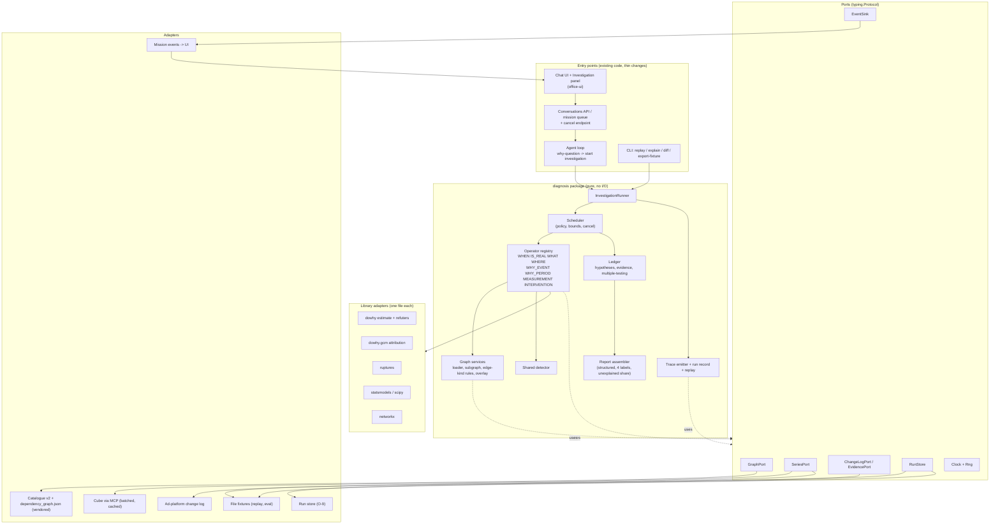
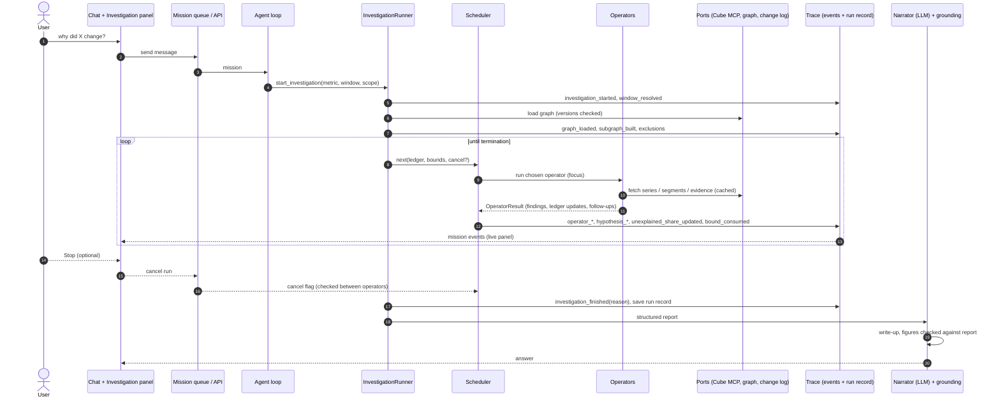
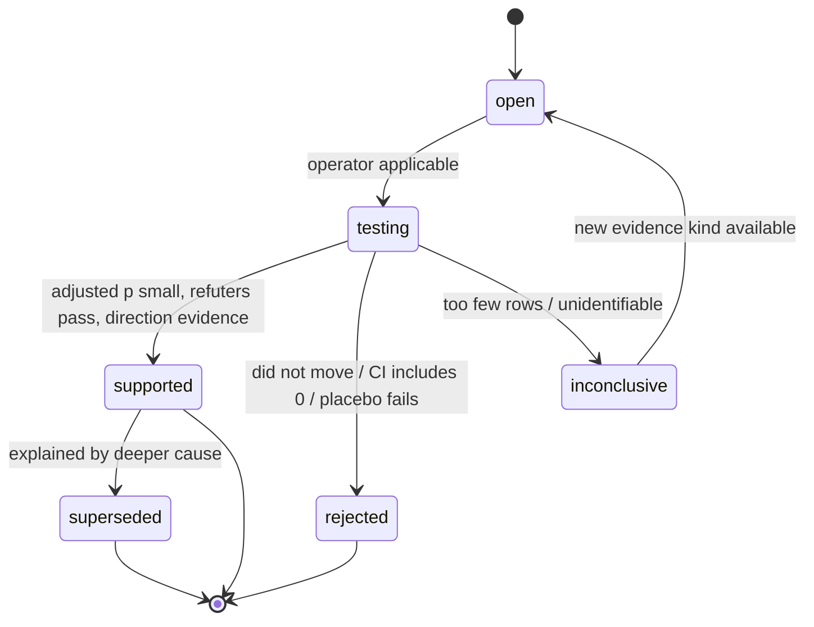
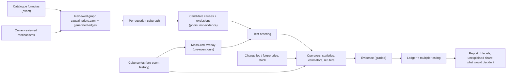
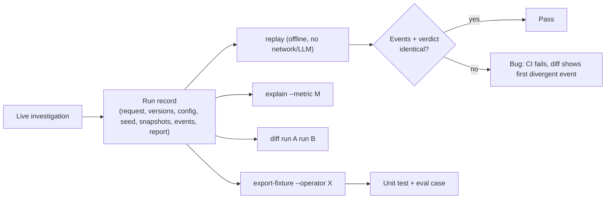

# Diagnosis engine rebuild: master plan (living document)

**File of record after approval:** `/opt/seleric/Seleric_Agent/docs/DoWhy/REBUILD_PLAN_2026-10-15.md` (this plan replaces its content; step S0 below). Companion: `docs/DoWhy/RESEARCH_REPORT_2026-10-15.md` (evidence and sources, frozen).
Created 2026-10-15; revised same day with library docs (§5.5) and architecture (§5.6-5.10). Status: **plan awaiting owner approval**. Nothing built yet.
Contents: §0 how to resume · §1 dashboard · §2 context · §3 decisions · §4 open questions · §5 architecture (5.1 shape, 5.2 trace, 5.3 debuggability, 5.4 graph, 5.5 library docs, 5.6 HLD, 5.7 LLD, 5.8 proposed decisions, 5.9 runtime flow + flowcharts, 5.10 coding practices) · §6 phase checklists · §7 eval · §8 libraries · §9 verification · §10 risks · §11 findings log · §12 session log · §13 paths.

---

## 0. How to use this file across sessions

**Resume protocol (do this at the start of every session):**
1. Read §1 (status dashboard) and the last 3 entries of §12 (session log). 
2. Read §11 (findings log) entries newer than the last session.
3. Open the first unchecked task in the lowest-numbered unfinished phase (§6). Do not start a phase whose predecessor gate (§6 "Gate") is unchecked.
4. Work on branch `gaurav` in `/opt/seleric/Seleric_Agent` only (D-22; no worktree, no other branch). The tree is shared with teammates: stage only your own files by explicit path, never `git add -A`, never touch their uncommitted work, and never build an image from a dirty tree without checking `git status` first.

**Interview rule (owner, 2026-10-15): when execution reaches a decision that cannot be taken from this plan, the code, the data or a standing rule (D-17), do not guess and do not pick silently: interview the owner.**
- Use AskUserQuestion with 2-4 concrete options, a recommended first option, and the evidence that makes the choice matter. Ask before building on either branch, not after.
- Typical triggers: a threshold or penalty with no data-backed default, a business meaning (what counts as a "cause", which metric is the outcome), a licence or dependency addition, a change to a label/output contract, a scope change, a deploy or push, anything irreversible or outward-facing, two plan items that conflict, or a plan assumption that the data contradicts.
- Not triggers (decide, record in §11, continue): naming, file layout inside the agreed package, test structure, anything the plan already rules on.
- Record the answer as the next `D-n` in §3 (or tick the `O-n` in §4) and log it in §12 the same day. If the owner is unreachable, park the item as blocked in §1/§12 and continue with unblocked work; never apply a default to a question the owner has not answered.

**Tracking rule (owner, 2026-10-15): this file is the tracker and must be updated as work happens.**
- After **every** finished task (not only at session end): tick its box with evidence, update the §1 dashboard row, add any new fact to §11, and commit the doc in the same commit as the code/data it describes. A task whose doc update is missing is not done.
- Starting a task: note it in §12 as `in progress` so a crash or handover shows where work stopped.
- Code review/merge is refused if the diff changes a phase's deliverables without touching this file.

**Update rules (every session, before ending):**
- Tick `[x]` only for work that is done **and verified** per §9. Put the evidence (command, run id, commit) after the box: `[x] P1.3 ... (abc1234, tests 12/12)`.
- Add every new fact, surprise, wrong assumption or measurement to §11 as a dated entry. Do not bury them in the checklist.
- Any new business/design decision: stop the item, ask the owner (AskUserQuestion, with evidence), record it in §3 as the next `D-n` and in §12, then continue.
- Append a session entry to §12 (what was done, what is next, blockers). Update the dashboard (§1).
- Never edit §3 rows retroactively; supersede with a new row that names the old one.

---

## 1. Status dashboard

| Phase | Name | Status | Gate passed | Commit / evidence |
| --- | --- | --- | --- | --- |
| S | Setup (branch gaurav, plan file, baselines) | [~] S1-S4 done, S5 partly | [ ] | see §12 |
| 0 | Eval harness + baseline | [~] P0.1, P0.2 done, P0.3 partly | [ ] | `eval/diag/` |
| 1 | Ports, graph adapter, shared detector, trace + run record + replay | [ ] | [ ] | |
| 2 | Operator split | [ ] | [ ] | |
| 3 | Graph-driven candidate planning, explain, diff | [ ] | [ ] | |
| 4 | WHEN, period, drift, weight overlay | [ ] | [ ] | |
| 5 | Ledger, scheduler, deep mode, live panel, cancel | [ ] | [ ] | |
| 6 | RiskLoc (conditional) | [ ] decision pending Phase 0 data | [ ] | |
| 7 | Offline discovery audit | [ ] | [ ] | |
| D | Deploy (hard gate, rollback tag) | [ ] | [ ] | |

Current phase: **0** (S5 `make eval` run still pending). P0.1, P0.2 done; P0.3 partly (mix-shift + new-campaign ops missing). Next: finish P0.3, then P0.4 adversarial cases.

---

## 2. Context and objective

**Why:** "Why did X change" answers must be correct, deep, and honest. Current engine (`causal/diagnosis.py` 2,994 lines + `causal/dowhy_service.py` + `toolsets/diagnosis.py` 1,700 lines) is a sound four-layer design (event reality, exact decomposition, localisation, DoWhy drivers) but: candidates come from lineage heuristics and correlation thresholds, not the reviewed dependency graph (`grep dependency_graph src/` is empty); drivers only for events ≤ 7 days; period comparisons get no drivers; anomaly logic is duplicated four times; the change log is narrative only; one shot per question (no recursion); and nothing is replayable or inspectable. Failures so far (TH-383, near-tautology causes, sign inversions, window pin) were over-confident or shallow answers.

**Objective:** given "metric X moved on window W (scope S)", return the smallest set of explanations the data support, each with an evidence grade, the **unexplained share**, and **what data would decide the rest**. Correct cause when findable; "located, not identified" when not; never a confident wrong cause. A person acts; the engine suggests ranked levers and automates nothing.

**Success is measured, not felt (§7):** top-k hit rate on planted causes AND false-attribution rate on null/hidden/measurement worlds, each against the Phase 0 baseline of today's engine.

---

## 3. Decisions (append-only)

| ID | Ruling | Source |
| --- | --- | --- |
| D-1 | Always deep; no wall-clock target; bounded by evidence plus safety bounds (D-2/D-19) | owner |
| D-2/D-19 | Stop when unexplained share improves < 5 points over 2 consecutive rounds, or all open hypotheses resolved. Safety bounds: depth 4, branching 3, 60 operator runs, 400 `causal_queries`, 20 min wall clock. Hitting a bound is reported as such. Change only by new ruling | advisor default, **accepted by owner 2026-10-15** |
| D-3 | Scheduler is deterministic engine code; LLM only narrates the final structured result | owner + research |
| D-4 | Deep missions run on the mission queue with stage events; own timeout class (current `MISSION_TIMEOUT_S=300` / ~150 s turn cannot hold D-1); agent prompt rule changes to "start investigation, stream stages" | owner + code |
| D-5 | Day-one question shapes: short event, period-vs-period, slow drift, filtered scope | owner |
| D-6 | One global reviewed graph, owner reviews; per-brand data overlay only | owner |
| D-7 | Discovery libs (causal-learn, tigramite) offline audit only; never in answer path | owner |
| D-8 | One shared anomaly detector; migrate diagnosis + exploration; business_state and forecasting get thin adapters, behaviour unchanged | owner |
| D-9 | Build on catalogue v2 behind ports; Cube v3 = new adapter + regenerated graph | owner |
| D-10 | Pricing/inventory: define evidence port now; adapters when views exist in serve/Cube v3 | owner |
| D-11 | Keep 4 labels (`supported_cause`, `likely_contributor`, `correlation`, `insufficient_evidence`); add `unexplained_share`, `what_would_decide_it` | owner |
| D-12 | Acting = report + ranked lever suggestions; no automation | owner |
| D-13 | Big-bang worktree deploy (no shadow run) so the eval is a **hard pre-deploy gate**; rollback image tagged first | owner + advisor |
| D-14 | Eval data: brand 20 only. Truth = injection into real series + independent records + null worlds; unknown real incidents get stability checks, not accuracy | owner + advisor |
| D-15 | Multiple-testing control (Benjamini-Hochberg) over the whole investigation ledger | advisor |
| D-16 | Weight overlays fitted on pre-event windows only; enforced by a test | advisor |
| D-17 | Standing rules: no hardcoded metric names/keywords, no regex in new code; verify with live runs cross-checked in ClickHouse; run only the golden 6 + relevant items (never golden 30) | memory |
| D-18 | Live investigation panel in chat from the moment a question routes to diagnosis: full-detail stream (graph generated/traversed, depth/branch, hypotheses, operators, queries, weights, bounds, unexplained share), WHEN to WHY | owner |
| D-20 | Panel is expandable (collapsed row that expands) with a Cancel/Stop button; stop is cooperative (checked between operators), emits `investigation_cancelled`, returns partial ledger, narration says stopped early | owner |
| D-22 | Work on branch `gaurav` only, in `/opt/seleric/Seleric_Agent`; no worktree, no `diag-v4` branch. Supersedes O-2 and the "worktree deploy" wording in D-13 (the eval gate and rollback tag remain) | owner 2026-10-15 |
| D-21 | Debuggable by design (§5.3): run record, offline deterministic replay, step mode, explain-why-not, no swallowed failures, run diff, fixture export, one correlation id | owner |

## 4. Open questions (owner rulings needed; each names the phase it blocks)

- [x] ~~O-2~~ superseded by D-22: gaurav only, no worktree.
- [ ] **O-3** Long-term graph delivery: vendored `dependency_graph.json` now; image artifact or MCP resource later (blocks D)
- [ ] **O-4** Review cadence/owner for `causal_priors.yaml` changes (blocks Phase 3 sign-off)
- [ ] **O-6** tigramite licence is **GPL-3.0 (confirmed from its repo, 2026-10-15)**. Ruling needed: allowed only as an isolated offline job (separate process/image, never imported by the service image), or not at all (blocks Phase 7). causal-learn is MIT.
- [ ] **O-9** Run-record storage backend (Postgres row + blob in object store, or existing `persistence/` artifact store); verified in P1.1, owner confirms (blocks P1.7)
- [ ] **O-10** Approve the proposed design decisions P-1..P-8 in §5.8 together with this plan (blocks Phase 1)
- [ ] **O-8** Run-record retention (proposed 90 days) and permission to store raw brand series in records under `docs/47_CONVERSATION_DATA_POLICY.md` (blocks P1.7)
- [x] ~~O-1~~ bounds accepted (D-19). [x] ~~O-5~~ expandable + Cancel (D-20). [x] ~~O-7~~ graph = `/opt/seleric/Seleric_Agent_Core/doc/dependency_graph` (explorer titled "Seleric Metric Graph")

---

## 5. Architecture

### 5.1 Target shape

```
ports:      GraphPort  SeriesPort  ChangeLogPort (+ evidence kinds: lever, price, stock, incident)
detect:     one robust detector (median/MAD, reference-aware)
operators:  WHEN (ruptures) | IS_REAL | WHAT (identities, bridge, Shapley) | WHERE (segment splits; RiskLoc iff justified)
            | WHY_EVENT (graph-derived DAG + DoWhy + refuters + intervention evidence)
            | WHY_PERIOD (dowhy.gcm distribution_change on the graph) | MEASUREMENT (co-measure divergence)
graph:      candidates from reviewed edges; r/CV thresholds demoted to data checks that raise a measurement hypothesis
ledger:     hypotheses {status, evidence, tests}; BH over all tests; unexplained share; residual "not in the data"
scheduler:  deterministic; picks next operator from ledger state; D-2 bounds; cooperative cancel
trace:      typed ordered events for everything above (§5.2) -> mission events -> UI; persisted in the run record
output:     structured report -> LLM narrates -> existing grounding check (agent/grounding.py)
```
Existing layer 1-3 maths and the 4-label classification are kept behind operator interfaces and must reproduce today's output before they change (Phase 2 gate).

### 5.2 Trace events (D-18)
Envelope: `investigation_id, seq, ts, depth, branch, parent_id, kind, schema_version, payload`. Kinds: `investigation_started, window_resolved, graph_loaded(graph_version,catalogue_version), subgraph_built(nodes,edges,excluded+reason), node_visited, edge_traversed(kind,sign,lag,tier,prior,overlay), operator_started/finished(inputs,query_count,duration,result_digest), operator_failed(type,msg,traceback,inputs_digest), query_issued(cache_hit), hypothesis_opened/tested/resolved(status,evidence,p_raw,p_bh), refuter_result, exclusion(metric,reason_code,check_value), unexplained_share_updated, bound_consumed, investigation_cancelled, investigation_finished(termination_reason), narration_started`. Transport = existing mission events (`api/async_missions.py`, `conversations/event_mapping_v1.py`, `agent/progress.py::emit_progress`); verify each in P1.1.

### 5.3 Debuggability (D-21) requirements and owner phase
1. Run record (P1): question, resolved window/scope, graph+catalogue versions, subgraph, thresholds+bounds, library versions, seeds, full trace, **fetched series snapshot** with source query + fingerprint. Engine decisions depend on nothing outside it.
2. Offline deterministic replay (P1, hardened P2): `replay <id>`; no network/LLM/Cube; byte-identical events + verdict; divergence fails CI.
3. Step mode (P5): `replay --step`, `--break-on <operator|hypothesis|edge>`; panel "inspect this event".
4. Explain-why-not (P3): `explain <id> --metric M`; every exclusion/prune has a reason code.
5. No swallowed failures (P1): operator exceptions are `operator_failed` events shown in the panel; answer-level fail-soft to `insufficient_evidence` stays.
6. Run diff (P3): `diff <a> <b>`.
7. Fixture export (P2): `export-fixture <id> --operator X`; same format as eval cases.
8. Correlation (P1): `investigation_id` on every log line, Langfuse trace, mission event, artifact.
9. Retention (O-8).

### 5.4 Graph usage and weights
- Per question: **subgraph** = outcome accounting tree + ancestors along mechanism edges (feedback only at lag ≥ 1) + segment dimensions. Uses `confidence, sign, lag_days, tier` from the graph.
- Edge-kind use: composition/ratio_component/declared_input → layers 2-3 (never causes); twin/co_measure/subset/allocation → exclusion rules + measurement hypotheses; mechanism/feedback → candidate-cause DAG.
- Three artefacts, kept separate: reviewed prior strength (YAML); measured per-brand overlay (effect, lag, stability, n, window, timestamp, **pre-event only**, D-16); question-time ranking score (orders tests, never evidence).
- Graph file facts (2026-10-15): 233 metrics, 464 edges (twin 198, composition 76, ratio_component 66, mechanism 37, declared_input 36, co_measure 27, allocation 12, subset 9, feedback 3); ~40 metrics on mechanism edges; ids are catalogue v2 ids.

### 5.5 What the official docs say (read 2026-10-15; each item changes a design choice)

| Library (docs read) | Fact from the docs / source | Consequence for the design |
| --- | --- | --- |
| **DoWhy 0.14 core** (pywhy.org user guide) | Four steps: model → identify → estimate → refute. Identification: backdoor, frontdoor, IV, ID algorithm. Refuters listed: Graph Refutation, Placebo Treatment, Dummy Outcome, Random Common Cause, Data Subsample, **Sensitivity Analysis** (simulation, partial-R² for linear estimators, Riesz for non-linear). Python ≥3.9,<3.14, **MIT**; hard deps include `econml`, `causal-learn ≥0.1.4.4`, `cvxpy`, `numba`, `numpy>2.0` | We use 2 of 6 refuters (+3 in-house). **Sensitivity analysis targets exactly our weak spot (unmeasured confounding)** → evaluate in P4. Container already has dowhy 0.14, causal-learn 0.1.4.8, statsmodels 0.15, scipy 1.15.3, networkx 3.6.1, numba 0.67, Python 3.12 (`econml` shows as not installed: verify what dowhy actually needs at import) |
| **DoWhy GCM `distribution_change`** (source) | `distribution_change(causal_model, old_data, new_data, target_node, invariant_nodes=None, num_samples=2000, difference_estimation_func=auto_estimate_kl_divergence, independence_test=kernel_based, conditional_independence_test=kernel_based, mechanism_change_test_significance_level=0.05, mechanism_change_test_fdr_control_method="fdr_bh", auto_assignment_quality=None, return_additional_info=False, shapley_config=None)`. Attributes the change of the **marginal distribution of the target** (KL by default, not the mean) to upstream nodes via Shapley; fits old/new models itself; tests which mechanisms changed (kernel tests, BH-corrected); random subsampling → **non-deterministic unless seeded**; assumes **same graph structure** in both periods | Usable for period-vs-period if each day is a sample. Days are **not i.i.d.** (weekday, autocorrelation): include weekday as a root node or deseasonalise first, and report it as an assumption. For a *mean* attribution supply a custom `difference_estimation_func`. Seed everything for replay (D-21). Kernel tests are O(n³): fine at n ≈ 30-90 days |
| **DoWhy GCM `attribute_anomalies`** (source) | Needs a fitted `InvertibleStructuralCausalModel` (additive-noise mechanisms so noise is recoverable). Default scorer `MedianCDFQuantileScorer`. Default output is an information-theoretic score on a **log scale, typically ≤ 0**; `attribute_mean_deviation=True` gives deviations. Monte-Carlo Shapley (`num_distribution_samples=3000`, `shapley_config`) | Single-anomalous-day attribution is possible. Contributions are not "percent of change"; the narration layer must map them to the structured report, never quote raw IT scores. Cost scales with node count: keep subgraphs small (we do) |
| **DoWhy GCM generally** (user guide, file list) | Input is a DAG + tabular DataFrame; "causal sufficiency" (no unmodelled confounders); no time-series module in `dowhy/gcm` (files: anomaly*, distribution_change*, falsify.py, confidence_intervals*, whatif.py, unit_change.py, …); **`falsify.py` exists (graph falsification)** | Time dependence must be handled by us (lag columns / weekday nodes). **`falsify_graph` can test the reviewed graph against data → use it in the Phase 7 audit instead of, or before, running discovery** (verify its API in P7). `unit_change.py` / `whatif.py` are candidates for lever "what if" later (not now, D-12) |
| **ruptures** (docs; BSD-2) | Offline change-point detection: Pelt, Binseg, BottomUp, Window, Dynp, KernelCPD; costs L1, L2, Normal, Rbf, Linear, AR, Rank, custom. Pelt: `model`, `min_size`, `jump`, `predict(pen=…)`; avg cost O(C·K·n). **Docs give no rule for choosing the penalty** | Penalty must be **calibrated on the eval suite** (planted onsets), not guessed. Run on the log, deseasonalised series; `min_size` ≈ a week. Wrap behind `ChangePointDetector` so it can be swapped. Tiny dependency: acceptable in the service image |
| **causal-learn** (docs; **MIT**; already installed transitively) | PC, FCI, GES, LiNGAM, CD-NOD, GRaSP, BOSS, Granger. `fci(data, independence_test_method='fisherz', alpha=0.05, depth=-1, background_knowledge=None, max_path_length=-1)` returns a PAG; KCI is cubic in n. **`BackgroundKnowledge.add_node_to_tier(node, tier)`: edges may only point from lower to higher tiers; `add_forbidden_by_node` / `add_required_by_node`** | **Our funnel tiers (0 intervention … 10 profit) map one-to-one to causal-learn tiers**, and `causal_priors` mechanisms map to required edges, co-measures/allocations to forbidden edges: the audit can run constrained discovery with the reviewed graph as background knowledge. Caveat from source: re-adding a node to a tier does not remove it from the old one |
| **tigramite** (repo) | **GPL-3.0**, v5.2. PCMCI (no contemporaneous links, no hidden vars), PCMCI+ (stationarity, no hidden vars), LPCMCI (time-series PAG), RPCMCI, J-PCMCI+; CI tests ParCorr/GPDC/CMIknn; **no sample-size guidance**; numba/numpy soft pins | Licence ruling O-6. Even permitted, all variants assume stationarity, which our regime-shifting brands violate → offline audit only (D-7) |
| **CausalPy** (docs; Apache-2.0) | Bayesian-first (PyMC), also sklearn/OLS. ITS, synthetic control, DiD, IV, etc. Requires **Python 3.12+, PyMC 6, PyTensor 3, ArviZ 1.x, numba**; first sample has a compile delay; a crashed numba worker can look like a **silent hang**; docs state it is **"not meant for automated black-box answers"** | Too heavy and too risky for the answer path. **Implement a small interrupted-time-series operator in-house on statsmodels (OLS + HAC) behind an `InterventionEstimator` Protocol**; keep CausalPy as an optional offline cross-check in the eval harness only |
| **RiskLoc** (paper arXiv:2205.10004 + repo; MIT) | Per leaf needs **actual v and forecast f**; deviation `ds = 2(f−v)/(f+v)`; two-way partition (cutoff from the opposite-side extreme after trimming 5 unique values each end), weights by distance, risk `r1 − r2`, layer-by-layer search, stops when remaining EP < `t_pep · EP(R0)`. Defaults `t_r=0.5`, `t_pep=0.02`. Derived measures: apply `h()` to aggregated fundamentals (paper evaluates with the original EP, extended EP adds ~7% F1). **Assumes anomalous leaves share one sign (conflicting signs cancel)**, forecasts reasonably accurate. Repo is a CLI over CSV, not a package | Our shared detector's per-leaf reference = RiskLoc's f. **Mix shifts (one segment up, another down) violate the same-sign assumption** → run RiskLoc per sign or keep our mix/rate split; P0.9 must test this. For ratio metrics run on numerator and denominator (fundamentals) then apply `h` |
| **PyRCA** (docs) | Modules: `outliers` (StatsDetector), `graphs.causal` (PC, GES, FGES, LiNGAM), `analyzers` (HT, RCD, ε-diagnosis, random walk, Bayesian network), `simulation`. Licence/maintenance not on the docs page | Dev-only cross-check on the eval suite; its `simulation` module may help generate DAG worlds |
| **statsmodels 0.15** (docs) | `multipletests` offers `fdr_bh` (Benjamini-Hochberg: independent / positively correlated tests) and `fdr_by` (arbitrary dependence). `cov_hac` (Newey-West): default `nlags = floor(4(T/100)^(2/9))`, Bartlett; docs say it was **"verified only for nlags=0"**; small-sample correction is "a guess" | Our hypotheses share series so tests are dependent → **default to `fdr_by` unless the eval shows `fdr_bh` holds** (decide in P5.1). The docs independently confirm our earlier Monte-Carlo finding that plain HAC under-covers: keep `max(HC3, corrected HAC)` and keep the ability to swap |

### 5.6 High-level design (HLD)

**Style:** ports-and-adapters (hexagonal). A pure `diagnosis` core (domain types, operators, graph services, ledger, scheduler, trace) depends only on `ports` (Protocols). Everything that touches the world (Cube via MCP, catalogue, change log, mission events, run store, clock, RNG) is an adapter. Third-party analysis libraries sit behind one thin adapter file each. The existing agent loop, grounding check, UI and mission queue are *consumers* of the core, not part of it.



**Responsibilities**
| Component | Owns | Must not |
| --- | --- | --- |
| `InvestigationRunner` | one investigation's lifecycle: build context from request, loop scheduler, assemble report, persist record | call a library or port directly |
| `Scheduler` | choose next operator from ledger state; enforce D-2 bounds; poll cancel flag; emit `bound_consumed` | contain statistics |
| `Ledger` | hypotheses, evidence links, test results, BH/BY correction across the whole run, unexplained share, reconstruction check | fetch data |
| `Operator` | one question (WHEN, IS_REAL, WHAT, WHERE, WHY_EVENT, WHY_PERIOD, MEASUREMENT, INTERVENTION): pure function of its inputs + ports; returns `OperatorResult` + events | mutate the ledger directly (returns proposed updates) |
| `Graph services` | load/validate graph, build subgraph, apply edge-kind policy, read overlay | decide causality (they supply priors) |
| `Trace` | typed events, run record, replay | alter engine behaviour |
| `Report assembler` | structured result for the narrator and the UI | call the LLM |

### 5.7 Low-level design (LLD)

**Package layout (proposed, P-1)** under `src/seleric_swarm/diagnosis/`; existing `causal/diagnosis.py` (2,994 lines) is decomposed into it in Phase 2 and left as a deprecated shim until Gate 5.

```
diagnosis/
  domain/        types.py (Window, Scope, MetricRef, Series), hypothesis.py, evidence.py, report.py, errors.py, config.py
  ports/         graph.py series.py evidence.py events.py runstore.py runtime.py   (Protocols only)
  detect/        detector.py reference.py
  graph/         loader.py subgraph.py edge_policy.py overlay.py version.py
  operators/     base.py registry.py when.py is_real.py what.py where.py why_event.py why_period.py measurement.py intervention.py
  ledger/        ledger.py multitest.py reconcile.py
  scheduler/     scheduler.py policy.py bounds.py cancel.py
  trace/         events.py emitter.py record.py replay.py schema_versions.py
  report/        assemble.py levers.py
  libs/          dowhy_estimate.py dowhy_gcm.py changepoint.py hac.py     (only place third-party analysis libs are imported)
  adapters/      catalogue_graph.py cube_series.py changelog_ads.py mission_events.py runstore_*.py fixtures.py
  cli/           __main__.py replay.py explain.py diff.py export_fixture.py
```

**Core interfaces (sketch; frozen dataclasses / Protocols, fully typed):**
```python
class Operator(Protocol):
    kind: ClassVar[str]
    version: ClassVar[str]
    def applicable(self, ctx: InvestigationContext, focus: Focus, ledger: LedgerView) -> Applicability: ...   # preconditions + cost estimate
    def run(self, ctx: InvestigationContext, focus: Focus, ports: Ports) -> OperatorResult: ...              # pure w.r.t. ports; seeded

@dataclass(frozen=True)
class OperatorResult:
    findings: tuple[Finding, ...]            # facts with evidence basis (identity | statistical | causal)
    proposed: tuple[LedgerUpdate, ...]       # open/test/resolve hypotheses
    follow_ups: tuple[Focus, ...]            # e.g. WHERE -> located segment
    cost: Cost                               # queries, ms
    events: tuple[Event, ...]

class GraphPort(Protocol):
    def load(self) -> Graph: ...                         # nodes, typed edges, tiers, versions
class SeriesPort(Protocol):
    def daily(self, req: SeriesRequest) -> SeriesResult: ...      # value series + source query + fingerprint
    def by_dimension(self, req: SegmentRequest) -> SegmentResult: ...
class EvidencePort(Protocol):
    kind: ClassVar[str]                                  # lever | price | stock | incident
    def events(self, scope: Scope, window: Window) -> Sequence[DatedEvidence]: ...
class EventSink(Protocol):
    def emit(self, event: Event) -> None: ...
class RunStore(Protocol):
    def save(self, record: RunRecord) -> None: ...
    def load(self, investigation_id: str) -> RunRecord: ...
class Runtime(Protocol):
    def now(self) -> datetime: ...
    def rng(self, stream: str) -> numpy.random.Generator: ...   # derived from the run seed
    def cancelled(self) -> bool: ...
```
- `Focus` = (metric/node, scope, window, depth, branch, parent hypothesis). `InvestigationContext` = request, resolved window/scope, graph, subgraph, config (typed, versioned), bounds, seed.
- **Config:** one typed `DiagnosisConfig` (pydantic or frozen dataclass) replacing scattered `DIAG_*` constants in `toolsets/policy_config.py` (kept as defaults source during migration); serialised into the run record.
- **Hypothesis state machine:** `open → testing → {supported | rejected | inconclusive}`; `supported` carries an evidence grade → the 4 labels; any hypothesis can be `superseded` (merged into a parent). The residual hypothesis `not_in_data` is always present and receives the unexplained share.
- **Evidence basis tiers** (kept from the current engine): `identity` (exact accounting), `statistical` (robust tests), `causal` (graph + estimator + refuters), `prior` (graph only, never counted as evidence).
- **Subgraph algorithm:** start at the outcome; add composition/ratio_component parents (accounting tree); BFS backwards over `mechanism` edges to depth *k* (config), over `feedback` edges only with lag ≥ 1; for each candidate node apply `EdgePolicy` (twin/co_measure/allocation/subset → exclusion with reason code or measurement hypothesis; tier order must be non-decreasing toward the outcome at lag 0); attach `confidence`, `sign`, `lag_days`, overlay weight. Output is a `Subgraph` + list of `Exclusion(reason_code, check_value)`; both are emitted as events.
- **Scheduler loop:** see flowchart in §5.9. Next-operator choice = highest `expected_information / cost` among applicable operators, where information = expected reduction in unexplained share + hypothesis uncertainty, computed from ledger state and graph prior strength; ties broken by a fixed deterministic key. **No randomness, no LLM.**
- **Termination:** (a) all non-residual hypotheses resolved, or (b) unexplained share improved < 5 points for 2 consecutive rounds, or (c) a safety bound hit (depth 4, branching 3, 60 operator runs, 400 queries, 20 min), or (d) cancel. The reason is the `investigation_finished` payload.
- **Multiple testing:** every test p-value registered in the ledger; correction applied to the whole family at each reporting step (`fdr_by` default pending P5.1 eval; `fdr_bh` if validated); labels use adjusted p.
- **Reconstruction check:** accepted causes' predicted contributions are summed and compared with the observed change; residual → `not_in_data` share and a `what_would_decide_it` entry (which missing evidence kind would resolve it: price, stock, incident log, finer dimension).
- **WHEN:** log-transform + deseasonalise (reuse detector reference), `ruptures.Pelt` (`model` l2 or rbf, `min_size` ≈ 7 days), penalty from a calibration table fitted on eval onset cases (not a guess); output onset date with a bootstrap interval, and regime boundaries used by WHY_EVENT to exclude other regimes from the estimation sample.
- **WHY_EVENT:** existing time-series DAG estimator (calendar + lag-1 pre-treatment adjusters, `max(HC3, corrected HAC)`, 5 refuters, direction tests) but the candidate set and lag windows now come from the subgraph; plus DoWhy **sensitivity analysis** evaluated as a sixth check (P4).
- **WHY_PERIOD:** `dowhy_gcm.distribution_change` on the subgraph, days as samples, weekday as a root node, seeded, custom `difference_estimation_func` for mean attribution; results mapped to the same 4 labels only if mechanism-change test is significant after correction, otherwise `correlation`/`insufficient_evidence`.
- **INTERVENTION:** for each dated lever in `ChangeLogPort`: interrupted time series with a control set from graph non-descendants (OLS + HAC in `libs/hac.py`); evidence strongest when onset ≈ lever date (WHEN) and effect sign/lag match the edge prior.
- **MEASUREMENT:** compares every co-measure/twin group declared in the graph; divergence beyond the group's tolerance opens a measurement hypothesis (tracking loss, ingest failure) *before* any behavioural cause is accepted.
- **Run record schema (versioned):** `{schema_version, investigation_id, created_at, request, resolved{window,scope}, versions{graph,catalogue,engine,libs}, config, seed, subgraph, snapshots[{series_id, source_query, fingerprint, data_ref}], events[...], report}`; `data_ref` points to compressed blobs; replay uses `adapters/fixtures.py`.
- **Event envelope** as in §5.2, `schema_version` bumps are additive; the UI ignores unknown kinds.

### 5.8 Proposed design decisions (confirm by approving this plan; recorded as D-n once approved)
| ID | Proposal | Why (docs/source) |
| --- | --- | --- |
| P-1 | New package `seleric_swarm/diagnosis/` with the layout above; `causal/diagnosis.py` becomes a deprecated shim until Gate 5 | 2,994-line module cannot be extended safely; hexagonal layout makes v3/Cube swaps adapter-only |
| P-2 | Dependency rule enforced in CI (import-linter or equivalent): `domain` ← `ports` ← `operators/graph/ledger/scheduler/trace` ← `adapters/cli`; only `libs/` imports dowhy, gcm, ruptures, statsmodels, networkx | one-file swap per library; keeps the existing no-catalogue-names test meaningful |
| P-3 | Operators, evidence kinds, edge-kind policies, detectors, estimators and refuters are **registries** (register a class; no scheduler edits) | extensibility: new operator/evidence = new module + fixture + eval case |
| P-4 | Determinism by construction: `Runtime.rng(stream)` derived from the run seed; no `random`/global numpy RNG; wall-clock only via `Runtime.now()` | GCM mechanism tests and ruptures calibration are stochastic or parameter-sensitive; replay (D-21) needs byte-identical results |
| P-5 | CausalPy is **not** added to the service image; in-house OLS+HAC interrupted time series behind `InterventionEstimator`; CausalPy allowed in eval tooling only | docs: Python 3.12+/PyMC 6/numba, silent-hang risk, "not for automated black-box answers" |
| P-6 | tigramite never in the service image; if allowed (O-6), runs in a separate offline job image | GPL-3.0 |
| P-7 | Phase 7 audit = `falsify_graph` (gcm) + constrained causal-learn FCI using graph tiers/required/forbidden edges as background knowledge; PyRCA dev-only | docs: causal-learn tiers map to our funnel tiers; falsification exists in gcm |
| P-8 | Multiple testing default `fdr_by` (arbitrary dependence) until the eval shows `fdr_bh` is safe | statsmodels docs: BH assumes independent/positively correlated tests |

### 5.9 Runtime flow and flowcharts

**Sequence (one deep investigation):**


**Scheduler loop:**


**Hypothesis life cycle:**


**Data and trust flow (what each source is allowed to do):**


**Replay / debug flow:**


### 5.10 Coding practices (apply to every phase; enforced in CI where noted)
1. **Match surrounding code** (comment density, naming, idiom) per repo convention; module docstrings state purpose and the evidence basis, as `causal/diagnosis.py` does.
2. **Types everywhere:** `mypy` strict on `seleric_swarm/diagnosis/`; frozen dataclasses for domain values; `typing.Protocol` for ports; `ruff` clean (`make lint`, `make typecheck`).
3. **Pure core:** no I/O, no globals, no wall-clock, no unseeded RNG in `domain/operators/graph/ledger/scheduler`; I/O only via ports (P-2, P-4). Import contract test in CI.
4. **Small, single-purpose modules** (target < 400 lines per file, functions < 60 lines); one operator per file; no module-level mutable state.
5. **Registries and strategies over `if/elif`:** new operator/evidence/edge-policy/estimator/refuter/detector = new class + registration (P-3). Open for extension, closed for modification of the scheduler.
6. **Config as data:** typed `DiagnosisConfig`, versioned, recorded; no magic numbers in code; every threshold has a name, unit and rationale comment.
7. **Version everything that crosses a boundary:** event, run record, graph, overlay, config: `schema_version` + additive-only changes + migration function for records.
8. **Fail loudly in the trace, softly in the answer:** typed errors in `domain/errors.py`; operator failure → `operator_failed` event + `insufficient_evidence`, never silent.
9. **Library isolation:** third-party analysis libraries imported only in `libs/*` and lazily; each wrapper has a contract test against its Protocol and records the library version in the run record.
10. **Contract tests for ports:** one test suite per Protocol run against every adapter (Cube, file fixture, future Cube-v3), so an adapter swap cannot silently change semantics.
11. **Test pyramid:** pure unit tests per operator from exported fixtures; property tests for invariants (Shapley shares sum to the change, BH monotone, replay idempotent, subgraph acyclic); synthetic-truth tests (known-effect recovery, null → no cause); eval suite as the gate; one live smoke per phase.
12. **Standing rules (D-17):** no hardcoded metric names/keywords, no regex in new code, verify with live runs cross-checked in ClickHouse, never the golden 30.
13. **Concurrency:** CPU-heavy estimation in the existing forkserver pool (`causal/estimate_pool.py`); operators are re-entrant; no shared mutable state across threads; cancel is polled, never `Thread.kill`.
14. **Observability:** structured logs carrying `investigation_id`; every external call a `query_issued` event with cache-hit flag; durations on every operator.
15. **Docs-as-code:** each operator and port has a short README block in its module docstring (inputs, outputs, evidence basis, failure modes, reason codes); this plan's findings log is updated in the same PR.

---

## 6. Phases and checklists

Conventions: IDs `Pn.m`. "Reuse" lists existing code to build on (paths relative to the worktree). Every phase ends with its **Gate**; the gate includes the §9 verification protocol. New tests go under `tests/unit/causal/` (new dir) unless stated.

### Phase S: Setup
- [x] S0 Plan saved to `docs/DoWhy/REBUILD_PLAN_2026-10-15.md` (2026-10-15, replaces the first version; uncommitted in the live dir at the owner's request). Commit it on the new branch once S1 exists.
- [x] S1 Per D-22 work on `gaurav` in the live dir (HEAD d56cc2f). A `diag-v4` worktree was created and removed the same day at the owner's request; nothing from it was kept.
- [x] S2 `uv run --no-sync pytest -q tests/unit -k "diagnosis or time_series or estimate_pool or exploration"` → 70 passed, 637 deselected, 33.7 s (2026-10-15, gaurav d56cc2f). Unit suite is 707 tests in total (engine doc's 819 is stale). Used `--no-sync` so the shared `.venv` is not changed.
- [x] S3 Vendored to `src/seleric_swarm/causal/data/dependency_graph.json` (Core e37eecc, sha256 d973ad1a…) + `PROVENANCE.md` with the `causal_priors.yaml` hash. The graph file has no catalogue version field (see §11). No push to Agent Core.
- [x] S4 Running container `seleric_agent-api-1` uses image id `45fb775f3ba2` (`seleric_agent-api:latest`, created 2026-10-15 14:54 IST, container started 09:26 UTC). Latest rollback tag on host: `rollback-20261015a` (`da2e6e6f8b79`), i.e. the build before the current one. Phase D must tag a new rollback from the then-running image.
- [ ] S5 Confirm how to run live eval: `make eval` (6 questions, `eval/regress/run_regression.py`, results in `eval/regress/results/`) and how the harness in `/tmp/dev/src` approach from memory (`diagnosis-engine.md`) works against the worktree build.
**Gate S:** gaurav test baseline runs; baseline unit-test count recorded in §11.

### Phase 0: Eval harness + baseline (no engine code touched)
Goal: a repeatable suite that scores any engine version; today's engine scored first.
Reuse: `eval/regress/*` (run_regression.py, regression.json, agent6_checks.py), `tests/unit/test_time_series_effect.py` (synthetic-series pattern), `tests/unit/test_diagnosis_live_20261008.py` (recorded live fixtures), `scripts/record_catalogue_fixture.py`.
- [x] P0.1 Case format: `eval/diag/case_format.py` (loader + validator, schema_version 1), cases in `eval/diag/cases/<id>.json` (id = file name), template `eval/diag/cases/_example_spend_cut.json.example`, tests `tests/unit/test_diag_eval_cases.py` (9 passed, ruff clean). Cases carry `kind` (injection|record|null|adversarial|stability), `cause_class` (findable|hidden|measurement|none) with an allowed `expected` outcome, request (event/period/drift), world fixture id + sha256, injections, truth causes with planted shares, `must_not_attribute`, allowed unexplained-share range. Same format `export-fixture` will write (D-21 item 7). Committed 2f81927.
- [x] P0.2 Fixture `eval/diag/fixtures/brand20_daily_2026-10.json` (5.3 MB, sha256 recorded inside): 2026-07-17..2026-10-14 (90 days), 72 of 74 graph-chosen metrics daily (metric set derived from the vendored graph: mechanism/feedback edge endpoints + 1-hop accounting neighbours; the other two, `avg_seconds_to_checkout` and `avg_seconds_to_purchase`, are declared not populated by the semantic layer and are recorded under `unavailable`), segmented by campaign_name / channel / payment_bucket / ad_platform where supported (204 metric×dimension series), 98 source queries logged, catalogue_version `1635beb77932` and graph sha256 stored. Tools: `snapshot.py` (build), `world_fixture.py` (load + sha verify + case pin), `crosscheck.py`. **ClickHouse cross-check: ad_spend, impressions (`serve.fct_paid_media_daily`) and orders (`serve.commerce_orders`, placement cohort, non-test) match on all 90 days, 0 differences.** Tests `tests/unit/test_diag_eval_fixture.py` (3). Still to cross-check when cases need them: net_sales and the funnel/session metrics.
- [~] P0.3 Injection library `eval/diag/inject.py` (pure, seeded by `Runtime`-style stream from the seed; 10 tests, `tests/unit/test_diag_eval_inject.py`). **Done:** `scale` (whole metric or one segment, optional `ramp_days` for slow drift, `until`, `noise_cv`) with `effects` hops that must be mechanism edges of the vendored graph and inside the edge's lag range (else refused); effects land in the same segment when the target has it, else on the total by the pre-onset share of the changed segment; ratio metrics recomputed from `ratio_components` so identities hold; other-dimension segments of changed metrics dropped and reported; `measurement_break` (changes only the measured metric, takes no effects, `real=false`); `Planted` truth returned (path, onset, factor). Covers: spend cut in one campaign, CTR collapse, conversion drop in one channel, slow drift, period shift (level change over a window), null (no injection). **Not done:** COD/prepaid mix shift (needs a volume-moving op that keeps totals and changes a rate) and launch of a low-click campaign (needs a new segment with its own components). Test on the real fixture + graph passes (spend cut → impressions). Design call (not an owner decision): elasticity is a planted parameter in each case, never estimated; the circularity guard is the adversarial P0.4 cases.
- [ ] P0.4 Adversarial cases per §7: cause not in graph/catalogue; mechanism absent or reversed; measurement break (co-measures diverge: tracking loss, ingest 0-row); null injection; false-premise question.
- [ ] P0.5 Independent-record cases from brand 20: 2026-09-14..22 ad outage (spend=0); Amazon SP 0-row ingest 09-14..22 reporting COMPLETED (measurement cause; see memory `amazon-sp-lwa-secret`); AWARENESS-03OCT launch (change log); 2026-10-02 -56% day (unknown cause: stability-only); 30d-vs-30d ROAS case (known split: Meta +89% / Google +43% / unattributed -32%).
- [ ] P0.6 Scorer: top-1/top-3 hit rate (findable worlds), **false-attribution rate** (null/hidden/measurement worlds), correct-"not identified" rate, unexplained-share error vs planted, stability (window shifts ±1-2 days, 80% row subsample, 5 seeds). Reports per tag and overall; written to `eval/diag/results/<engine_version>/`.
- [ ] P0.7 Runner that invokes the engine **offline** on fixtures (no LLM, no network) for fast CI, and an optional live mode through the API for the golden-6-plus-relevant check.
- [ ] P0.8 Score today's engine (`diagnose_metric_change` at `bd8dfde`); commit the baseline numbers and the per-case outputs. Note failures in §11.
- [ ] P0.9 Run the **RiskLoc decision test** (feeds Phase 6): on all cases, how much of the planted change does layer 3 (single-dimension splits) leave unexplained, and does any cross-dimension combination explain it? Record numbers.
**Gate 0:** suite runs end to end offline in CI time budget (target < 10 min, adjust in §11); baseline committed; no case is scored by an unverifiable label.

### Phase 1: Ports, graph adapter, shared detector, trace + run record + replay
Reuse: `causal/diagnosis.py` (`Referencer`, `reference_days`, `_period_shift_z`, `MetricMeta`, `lineage_from_definitions`), `exploration/insights.py`, `services/business_state/detectors.py::robust_zscore`, `forecasting/quality.py`, `agent/progress.py::emit_progress`, `api/async_missions.py` event list, `conversations/event_mapping_v1.py`, `agent/limits.py` (budget counters incl. `causal_queries`), `exploration/space.py`.
- [ ] P1.1 Verify transport: read how `emit_progress`, mission `events`, and `map_mission_event` carry custom event kinds; note limits (payload size, ordering, filtering of "private reasoning fields") in §11. Decide payload size policy (digest + fetch-by-id for big payloads).
- [ ] P1.2 Ports: `GraphPort` (nodes: id, label, view, unit, aggregation, grain, date_axis, tier, same_quantity_group; typed edges), `SeriesPort` (daily series by id × scope × dimension, with source query + fingerprint), `ChangeLogPort`/evidence kinds. Adapters: catalogue-v2/Cube-MCP (wrap `toolsets/diagnosis.py::_fetch_all`/`_prefetch_daily`), file-backed (for replay and eval).
- [ ] P1.3 Graph loader: validates `schema_version` and `catalogue_version`; rejects stale/mismatched; id-rename map hook for Cube v3. Test: stale graph is rejected; unknown id surfaces as an event, not a crash.
- [ ] P1.4 Shared detector module (e.g. `causal/detect.py` or a neutral `analytics/` home): median/MAD + reference-aware; parity-tested against `Referencer` behaviour and `robust_zscore`. Migrate diagnosis layer 1 and `exploration/insights.py`. Thin adapters for `business_state` and `forecasting/quality.py` with unchanged outputs (golden tests before/after).
- [ ] P1.5 Trace schema + emitter (§5.2) with `investigation_id`; wire into the **existing** layers so every current step produces ordered events; `operator_failed` replaces silent downgrade (§5.3 item 5).
- [ ] P1.6 Correlation id on logs, Langfuse (note: use `langfuse_*` metadata, Langfuse 4.16 rejects `tags=`/`session_id=` kwargs; see memory), artifacts.
- [ ] P1.7 Run record persistence + `replay` CLI (offline, seeded). Needs O-8. Test: replay of a recorded fixture reproduces events + verdict exactly.
- [ ] P1.8 Keep the engine-source test that forbids catalogue names (`test_engine_source_hardcodes_no_catalogue_names`); extend it to ports/graph code. No regex in new code (D-17).
- [ ] P1.9 Package skeleton `src/seleric_swarm/diagnosis/` per §5.7 (P-1) with empty-but-typed modules, `py.typed`, and `mypy --strict` configured for the package only.
- [ ] P1.10 Import-contract test in CI (P-2): `domain` ← `ports` ← core ← `adapters/cli`; only `libs/*` may import dowhy, dowhy.gcm, ruptures, statsmodels, networkx. Fails the build on violation.
- [ ] P1.11 `Runtime` port (clock, seeded `rng(stream)`, cancel flag) and `DiagnosisConfig` (typed, versioned); migrate `DIAG_*` constants in `toolsets/policy_config.py` as defaults; config serialised in the run record (P-4).
- [ ] P1.12 Operator / EvidencePort / EdgePolicy / Estimator / Refuter / Detector **registries** (P-3) with a registration test ("a dummy operator registers and is scheduled without scheduler changes").
- [ ] P1.13 Library adapters in `libs/` (`dowhy_estimate`, `dowhy_gcm`, `changepoint`, `hac`) with contract tests and library versions captured for the run record. Lazy imports. Verify what `dowhy` import actually needs in the image (econml showed as not installed).
- [ ] P1.14 Port contract-test suites (GraphPort, SeriesPort, EvidencePort, RunStore) run against the Cube adapter (recorded responses) and the file-fixture adapter.
**Gate 1:** detector parity; stale-graph rejection; trace replayable; replay byte-identical; import contract + mypy strict pass; registration test passes; Phase 0 scores unchanged (no regression) vs baseline.

### Phase 2: Operator split
Reuse: `toolsets/diagnosis.py::_diagnose` (line ~1218, ~450 lines), `causal/diagnosis.py` layers, `causal/estimate_pool.py`.
- [ ] P2.1 Define operator interface `(inputs, ports, ledger_view) -> OperatorResult(+events)`; pure, no I/O (fetching stays behind ports).
- [ ] P2.2 Extract `IS_REAL`, `WHAT`, `WHERE`, `WHY_EVENT` from `_diagnose`/`diagnose()` into `diagnosis/operators/*` (and `detect/`, `report/`) without behaviour change; shared fetch cache preserved; `causal/diagnosis.py` becomes a shim that re-exports until Gate 5. Each file < 400 lines.
- [ ] P2.3 `diagnose_metric_change` stays as a wrapper that runs them in today's order (registered in `agent/local_tools.py::build_local_tools`).
- [ ] P2.4 `export-fixture <id> --operator X`; every operator has one fixture-based unit test.
- [ ] P2.5 Doc fixes noted in the engine doc: tool docstring says 2 weeks, code `_USUAL_MAX_DAYS`=7; remove dead legacy `DoWhyService.estimate` and unused `config/diagnostic_policies.yaml` only if confirmed unused (record in §11).
**Gate 2:** Phase 0 suite output identical to baseline (offline replay); `export-fixture` works for all operators.

### Phase 3: Graph-driven candidate planning, explain, diff
Reuse: `_plan_drivers`, `_plan_dimensions`, `exploration/space.py`, DIAG_* in `toolsets/policy_config.py`.
- [ ] P3.1 Subgraph builder per §5.4; emits `subgraph_built`, `exclusion(reason_code)`.
- [ ] P3.2 Replace hub-score/round-robin candidate choice with graph ancestors (tier order, lag windows, sign); drop the r ≥ 0.95 / CV < 2% **exclusions** and keep them as data **checks** that verify the reviewed co-measure/twin facts and raise a `MEASUREMENT` hypothesis on divergence (e.g. `orders` vs `funnel_purchases`).
- [ ] P3.3 Allocation/co-measure/subset rules enforced from the graph (e.g. allocated product metrics never explain same-product revenue).
- [ ] P3.4 `explain` and `diff` CLIs.
- [ ] P3.5 Owner review of the graph pass (O-4): list edges the eval showed missing/wrong (feeds §11; Core-side changes made in `~/work/agent_core_*` worktrees, separate owner-approved push).
**Gate 3:** fewer false causes on null/measurement worlds; no top-k regression on planted-cause worlds; every exclusion carries a reason code; `explain` + `diff` work.

### Phase 4: WHEN, period, drift, weight overlay
Reuse: `dowhy_service.estimate_time_series_effect`, engine period mode (`957a943` logic: equal-length comparison, ratio-of-sums totals, rank test).
- [ ] P4.1 Add `ruptures` (check licence/version; record in §11). `WHEN` operator: onset date + regime boundaries; regime-safe estimation history (fixes "estimation sample includes abnormal days").
- [ ] P4.2 `WHY_PERIOD` via `libs/dowhy_gcm.py`: `distribution_change(causal_model, old_data, new_data, target_node, …)` on the reviewed subgraph. Docs-derived requirements: GCM has no time-series support (days treated as i.i.d. samples) → add weekday as a root node or deseasonalise first and state the assumption; default statistic is KL of the whole distribution → pass a mean-difference `difference_estimation_func` for "how much did the average move"; seed the run (mechanism test subsamples randomly); keep `mechanism_change_test_fdr_control_method` consistent with P-8; map Shapley output to the 4 labels only when the mechanism-change test survives correction. Also `attribute_anomalies` for single anomalous days (needs invertible additive-noise mechanisms; scores are log-scale ≤ 0, never quote them raw). Compare against the exact ratio-of-sums split on the 30d-vs-30d ROAS case; record in §11.
- [ ] P4.3 Drift handling for multi-week slides (changepoint + trend-aware reference).
- [ ] P4.4 Structured intervention evidence: change-log events as dated interventions via an in-house OLS+HAC interrupted-time-series `InterventionEstimator` (P-5: CausalPy not in the image; allowed in eval tooling as a cross-check). Controls = graph non-descendants of the lever. Decide synthetic-control need from eval, record.
- [ ] P4.7 Evaluate DoWhy **sensitivity analysis** (partial-R² for linear estimators) as an additional refuter for unmeasured confounding; keep only if it improves false-attribution on hidden-cause worlds.
- [ ] P4.8 WHEN penalty calibration: ruptures docs give no penalty rule, so fit the penalty (and `min_size`, cost model) on the planted-onset cases; store the calibration table in the config; record the chosen values and the miss/false-alarm rates in §11.
- [ ] P4.5 Measured-weight overlay (effect, lag, stability, n) fitted on pre-event windows only; **test** that an overlapping window raises (D-16).
- [ ] P4.6 Distributed-lag / adstock candidate for ad spend (engine doc open question 2); keep only if eval improves.
**Gate 4:** period, drift, and filtered-scope worlds pass; 30d-vs-30d ROAS case reproduces the known split; overlay leakage test passes; false-attribution rate not worse than Gate 3.

### Phase 5: Ledger, scheduler, deep mode, live panel, cancel
Reuse: `api/async_missions.py`, `conversations/event_mapping_v1.py`, `agent/progress.py`, `POST /runs/{run_id}/cancel` and `cancel_running_mission` in `api/conversations.py`, `agent/prompt.py`/`prompt_slim.py`, `agent/model_health.py` (patient LLM waits), `causal/estimate_pool.py`, `office-ui/src/components/CausalGraphPanel.tsx`, `DebugPanel.tsx`, `LoopDebugConsole.tsx`, `office-ui/src/api/runEvents.ts`, `chartContract.ts`.
- [ ] P5.1 Ledger: hypotheses (state machine §5.7), evidence links, tests with raw + adjusted p across the whole run (D-15). Correction method per P-8: start with `fdr_by` (statsmodels: arbitrary dependence) and switch to `fdr_bh` only if the eval shows false-attribution does not rise; residual `not_in_data` hypothesis; reconstruction check; `unexplained_share` series.
- [ ] P5.2 Hypothesis generator from the subgraph + observations; always includes null and measurement hypotheses.
- [ ] P5.3 Scheduler: next operator from ledger state; recursion down WHERE (scope to located segment) and WHAT (up the funnel); D-2 termination and bounds; emits `bound_consumed`.
- [ ] P5.4 Cooperative cancel: scheduler checks a cancel flag between operators; wire `cancel_running_mission`/run cancel to it; partial ledger returned; `investigation_cancelled` event.
- [ ] P5.5 Mission-queue integration: own timeout class for deep missions (settings near `config/settings.py` MISSION timeout comments); no LLM in the loop; narration step only at the end (`agent/grounding.py` check retained); survive LLM 429.
- [ ] P5.6 Prompt/tool change: why-question → start investigation and stream; keep `diagnose_metric_change` for shallow/legacy path or remove after Gate (decide, record).
- [ ] P5.7 Output contract: add `unexplained_share`, `what_would_decide_it`, ranked lever suggestions (reuse `_levers`/`_lever_lines`); labels unchanged (D-11).
- [ ] P5.8 UI: collapsed "Investigating" row that expands (D-20); live view = growing graph with current node highlighted, depth/branch hypothesis tree, operator timeline, expandable raw event log, bounds + unexplained-share chart, Stop button, "inspect inputs/outputs" per event; reuse `CausalGraphPanel.tsx`; vitest tests via `make office-ui-test`.
- [ ] P5.9 Step mode: `replay --step`, `--break-on`.
**Gate 5:** termination test (always stops inside bounds, including pathological graphs); cancel test; deep mission survives injected 429; no `seq` gaps in a recorded investigation; UI renders every event kind from a replayed trace; false-attribution rate does not rise vs Gate 4.

### Phase 6: RiskLoc (conditional)
- [ ] P6.1 Read P0.9 numbers; record go/no-go in §3 as a decision.
- [ ] P6.1b Extend P0.9: RiskLoc assumes anomalous leaves share one sign (paper); test mix-shift worlds (one segment up, another down). If it fails there, run it per sign or keep the mix/rate split for those cases. Per-leaf forecast `f` = the shared detector's reference.
- [ ] P6.2 If go: port algorithm (MIT, keep attribution; research code, CLI-only, not pip-installable) as a pure `WHERE` operator; run on numerator and denominator for ratio metrics; benchmark vs layer 3 on the suite and the repo's synthetic generators.
**Gate 6:** beats layer 3 on cross-dimension worlds without raising false attribution; otherwise not shipped.

### Phase 7: Offline discovery audit
- [ ] P7.1 Resolve O-6 (tigramite is GPL-3.0; causal-learn is MIT, already installed transitively via dowhy).
- [ ] P7.2 Nightly job: (a) `gcm.falsify_graph`-style checks of the reviewed graph against data (verify the API in `dowhy/gcm/falsify.py` first); (b) constrained FCI on the campaign/product panel with the graph as background knowledge (`BackgroundKnowledge.add_node_to_tier` from funnel tiers, `add_required_by_node` from mechanisms, `add_forbidden_by_node` from co-measures/allocations; note the tier re-add caveat); (c) PCMCI+ only if O-6 permits, in a separate image, 180-365 days; bootstrap stability; output "proposed edges / disagreements" for owner review.
- [ ] P7.3 PyRCA as dev-only cross-check on the suite.
**Gate 7:** report produced; verified that nothing from discovery is imported by the answer path.

### Phase D: Deploy (hard gate)
- [ ] D1 All gates 0-5 (and 6/7 if included) checked with evidence in §1.
- [ ] D2 Resolve O-3 (graph delivery in image).
- [ ] D3 Full offline suite + live run: the golden 6 and the relevant items only (never golden 30), each cross-checked in ClickHouse (D-17).
- [ ] D4 Tag rollback image of `seleric_agent-api` (naming like `rollback-YYYYMMDDx`); record in §12.
- [ ] D5 Build from the worktree (never the live dir), deploy, smoke-test a short event, a period comparison, a cancel.
- [ ] D6 Update memory index and `docs/DoWhy/*`; commit/push per owner instruction.

---

## 7. Eval design (summary; details in P0)
Truth sources: (1) injection into real brand-20 series; (2) independent-record incidents; (3) unknown real incidents → stability + reconstruction + unexplained share only. Circularity guard cases are mandatory (hidden cause, absent/reversed mechanism, measurement break, null, false premise). Report top-k hit and false-attribution **separately**; gates compare to the Phase 0 baseline.

## 8. Libraries
| Library | Role | Phase | Licence status |
| --- | --- | --- | --- |
| dowhy (+gcm) | WHY_EVENT estimation, refuters; WHY_PERIOD | 2, 4 | MIT, already ≥0.14 |
| statsmodels, scipy, networkx | tests, HAC, BH, graph ops | all | already deps |
| ruptures | WHEN | 4 | BSD-2 (confirmed from docs) |
| CausalPy | eval-tooling cross-check only, not in service image (P-5) | 0/4 | Apache-2.0 (confirmed); needs Python 3.12+, PyMC 6 |
| riskloc | port only if P6 go | 6 | MIT (confirmed; research code, CLI over CSV) |
| causal-learn | offline audit (constrained FCI) | 7 | MIT (confirmed); already installed 0.1.4.8 |
| tigramite | offline audit only, separate image, if permitted | 7 | **GPL-3.0 (confirmed): O-6** |
| pyrca | dev cross-check only | 0/7 | licence not on docs page; verify before adding |

## 9. Verification protocol (applies to every phase gate)
1. Unit tests for the phase pass (`uv run pytest -q tests/unit/...`); engine-source no-hardcoding test passes; no new regex.
2. Phase 0 suite run; compare to previous gate's committed scores; regression = gate fails.
3. Replay check: record one run, replay offline, byte-identical.
4. Live check on the running API with the relevant questions only (golden 6 via `make eval` + the phase's items); numbers cross-checked in ClickHouse (memory rule: verify with live runs).
5. Evidence (commit, run id, score file path) written beside the ticked box and in §12.

## 10. Risks
- Big-bang deploy has no shadow run: the eval gate and rollback tag are the only nets. Never weaken a gate to hit a date.
- Deep recursion multiplies tests; control = D-15 + D-2 bounds. If false attribution rises between Gate 4 and 5, Phase 5 does not ship.
- Graph encodes today's business; other brands may differ (accepted, D-6; Phase 7 detects).
- Hidden causes (promo, creative, stock, price) invisible until adapters exist (D-10); engine must say so.
- Live-dir hazards: a teammate once built the image from the live dir with WIP (memory `diagnosis-engine`); the live tree currently has `docs/DoWhy/rebuild.md` deleted (uncommitted). Don't touch it; don't build from it.
- Shared worktree/branch hygiene: never switch branches in `/opt/seleric/mage-ai`; a push to Agent Core `main` deploys.
- Transfer risk: RCAEval findings come from microservices, not e-commerce.

---

## 11. Findings log (append-only, newest last)

**2026-10-15 (research, see RESEARCH_REPORT):**
- RCAEval / ASE'24 (Pham et al.): discovery F1 0.1-0.54 default; orientation weak; accuracy falls from 10 to 50 nodes; many graph-based RCA methods ≈ random baseline; BARO and NSigma (no graph) among best and fastest; synthetic rankings don't predict real; PCMCI got worse with more data in their runs.
- RiskLoc (Kalander 2022; MIT): localisation only; research code, CLI + CSV, not pip-installable; claims up to +57% F1; `--derived` mode exists (ratio handling unverified). PSqueeze generalises the ripple effect (~10 s/case).
- DoWhy-GCM `distribution_change` (Budhathoki AISTATS'21) and `attribute_anomalies` fit period/anomaly attribution; need a supplied DAG + fitted mechanisms; assume causal sufficiency and i.i.d.; notebook caveat: "isolates which node changed but not why". Time-series support in gcm unverified.
- OpenRCA: best LLM agent ~11% on 335 failures; follow-up (2026, unverified) ~21% exact set → keep LLM out of the loop.
- CausalPy docs: ITS vs CausalImpact vs synthetic control can differ by >10× on the same data → counterfactual choice must be deliberate.

**2026-10-15 (code/data facts):**
- Engine does not consume `dependency_graph.json` (`grep` empty). Candidates by lineage heuristics (`_plan_drivers`), co-measures by r ≥ 0.95 / CV < 2%.
- Anomaly/robust-z logic exists in ≥ 4 places: `services/business_state/detectors.py`, `causal/diagnosis.py` layer 1, `exploration/insights.py`, `forecasting/quality.py`.
- Commit `e37eecc` (dependency graph) is on Agent Core `origin/main` (local `main` was one commit behind); graph = 233 metrics / 464 edges; `explorer.html` titled "Seleric Metric Graph".
- Existing reusable infrastructure: cancel endpoint `POST /runs/{run_id}/cancel`; `agent/progress.py::emit_progress`; mission events list in `api/async_missions.py`; `eval/regress/run_regression.py` + `make eval`; `CausalGraphPanel.tsx`; estimate worker pool; `agent/limits.py` budget counters.
- Live working tree has `docs/DoWhy/rebuild.md` deleted; in git `bd8dfde` only its last 65 lines survive.
- Estimation sample ≈ 55 rows (56-day history) — too small for discovery on ~10 variables.

**2026-10-15 (official docs / source read; details in §5.5):**
- GCM `distribution_change` attributes the change of the target's *marginal distribution* (KL default), Shapley over nodes, fits both periods itself, kernel-based mechanism-change tests with `fdr_bh`, random subsampling (seed it), assumes identical graph structure in both periods. `attribute_anomalies` needs invertible additive-noise SCMs; default scores are log-scale ≤ 0. `dowhy/gcm` has no time-series module; it does have `falsify.py`. → period attribution is feasible but days-as-samples is an assumption we must state; falsification can audit the reviewed graph.
- causal-learn `BackgroundKnowledge` tiers are exactly "edges point from lower to higher tier" = our funnel tiers; MIT; already installed (0.1.4.8). Container: Python 3.12.15, dowhy 0.14, statsmodels 0.15.0, scipy 1.15.3, networkx 3.6.1, numba 0.67.0; ruptures, tigramite, CausalPy, pyrca not installed.
- tigramite is GPL-3.0 (v5.2) and every variant assumes stationarity; docs give no sample-size guidance. CausalPy requires PyMC 6 + Python 3.12+, can hang silently on a numba crash, and says it is not for automated black-box answers.
- ruptures (BSD-2) docs give no penalty-selection rule → calibrate on eval. RiskLoc paper: needs per-leaf forecast, assumes same-sign anomalies, defaults `t_r=0.5`, `t_pep=0.02`, derived measures via `h()` on aggregated fundamentals.
- statsmodels: `fdr_bh` assumes independent or positively correlated tests (`fdr_by` for arbitrary); `cov_hac` is "verified only for nlags=0" and its small-sample correction is a guess → consistent with our earlier Monte-Carlo (plain Newey-West under-covers).
- DoWhy lists a **sensitivity analysis** refuter family (partial-R², Riesz) we do not use.
- Doc-page gaps (not verified): exact DoWhy docs URLs for anomaly attribution moved (404); PyRCA licence/maintenance; time-series use of GCM.

**2026-10-15 (setup):**
- `dependency_graph.json` carries `version: 1` and `generated_by` only; no catalogue version or hash. Consequence for P1.3: the "catalogue_version mismatch" check cannot be a field comparison; derive the catalogue version (hash of the loaded v2 metric ids/formulas) at load time and store it beside the graph in `PROVENANCE.md`, or ask Core to add it to the builder.
- Graph `validation` has `errors` and `warnings` lists; P1.3 should surface them as events, not ignore them.
- `gaurav` moved since the plan was written: bd8dfde → e9b8ed9 (earlier plan, sandbox prompt text, `_chg` rounding in `causal/diagnosis.py`) → 4375c65 → d56cc2f (plan). Only `_chg` touches the engine (percent formatting: 1 decimal under 100%). Baseline P0.8 must therefore be taken at the commit current at the time and its hash recorded, not at bd8dfde.
- The live tree has teammates' uncommitted work (`toolsets/sandbox.py`, new `toolsets/sandbox_child.py`) at 2026-10-15. Not ours; do not stage or build over it.

- Offline eval seam: `causal/diagnosis.py::diagnose(DiagnosisInput)` is pure (series, lineage, segments, drivers, denominators, numerators, bridge candidates, optional baseline_days). Existing tests call it directly with generic ids. Candidate selection (`toolsets/diagnosis.py::_plan_drivers`, `_plan_dimensions`) needs a catalogue context, so the Phase 0 runner has two levels: L1 = `diagnose()` with the planned inputs stored in the fixture (scores layers 1-4), L2 = the tool path with a catalogue snapshot (needed to score Phase 3 planning changes). P0.7 must build both.

- `catalogue_get_metrics` returns `catalogue_version` (now `1635beb77932`) and accepts at most 10 ids per call. This resolves the P1.3 concern: the graph has no catalogue version, but the live catalogue does, so the loader compares the graph's recorded catalogue version (to be added to `PROVENANCE.md`/builder) with the live one. The fixture stores it.
- The semantic layer refuses some metrics outright ("Not populated: ... KNOWN GAP") and a combined query fails entirely if one measure is refused. The snapshot retries one by one. Any production batched fetch (`_prefetch_daily`) should be checked for the same all-or-nothing failure (it falls back to per-metric today, so safe).
- Cube returns no row for a day with zero spend/impressions: `ad_spend` has 87 daily rows against 90 days in ClickHouse (the 3 absent days are zero in ClickHouse). Convention for the eval: an absent day is treated as 0 for additive metrics, exactly as the engine's `missing_as_zero` window logic does.

*(Add new entries below. Format: date, source, fact, consequence.)*

---

## 12. Session log (append-only)

- **2026-10-15 (session 1):** Read engine doc, external report, `rebuild.md` tail, graph commit and files; web research; wrote RESEARCH_REPORT and the first plan; owner interview (4 rounds) → D-1..D-21; owner accepted bounds, requested live causal panel (expandable, Stop button) and debuggability; this master plan written in plan mode. Next: owner approval → S0-S5.
- **2026-10-15 (session 2):** Owner said start. Read plan + memory. Created then removed a `diag-v4` worktree/branch after owner ruled "work in the gaurav branch only" (D-22). Done: S1-S4 (see §6). Not done: S5 (`make eval` exists, writes to `eval/regress/results/latest`; not run yet, it is a live LLM run). Open: O-10 (P-1..P-8 approval) still blocks Phase 1; Phase 0 does not depend on it. Next: P0.1 case format.
- **2026-10-15 (session 1, later):** owner rejected the first exit-plan and asked for (a) official library docs read, (b) architecture: HLD, LLD, runtime flow, flowcharts, modular/extensible coding practices, in the same file. Done: docs read (§5.5), HLD/LLD/flows/practices added (§5.6-5.10), checklist tasks updated (P1.9-P1.14, P2.2, P4.2-P4.8, P5.1, P6.1b, P7.2), proposed decisions P-1..P-8 added for approval (O-10).

---

## 13. Reference paths
- Engine: `src/seleric_swarm/causal/{diagnosis,dowhy_service,estimate_pool,graph_chart}.py`; tool `src/seleric_swarm/toolsets/diagnosis.py`; exploration `src/seleric_swarm/exploration/`; thresholds `toolsets/policy_config.py` (`DIAG_*`).
- Graph: `/opt/seleric/Seleric_Agent_Core/doc/dependency_graph/{dependency_graph.json,DEPENDENCY_GRAPH.md,explorer.html}`; source `catalogue_v2_src/causal_priors.yaml`; builder `scripts/build_dependency_graph.py`; test `tests/test_dependency_graph.py`.
- Docs: `docs/DoWhy/{DOWHY_DIAGNOSIS_ENGINE.md,deep-research-report.md,RESEARCH_REPORT_2026-10-15.md,REBUILD_PLAN_2026-10-15.md}`, `docs/EXPLORATION_MODEL.md`, `docs/audits/2026-10-08_diagnosis_live_replay.md`.
- Memory: `diagnosis-engine`, `diagnosis-rebuild-plan-2026-10-15`, `semantic-v3-rebuild`, `agent-postmortem-2026-10-10-th383`, `feedback-verify-live`, `feedback-no-hardcoding-regex`.
