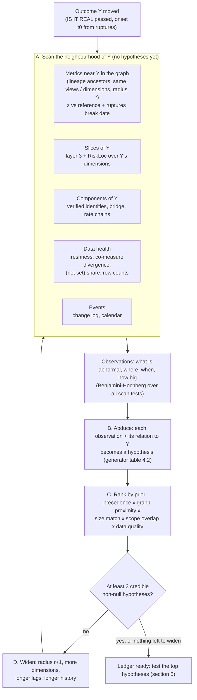
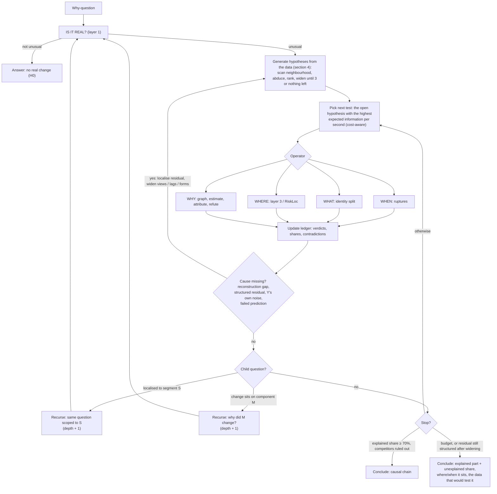

# Seleric Autonomous Diagnostic Engine — Research and Design

As of 2026-10-14, written against `gaurav` / `claude/laughing-tesla-66wt5o` at `454339c` (the two branches are the same commit).
This builds on `docs/DoWhy/DOWHY_DIAGNOSIS_ENGINE.md`, which describes the engine as it is. This document covers:

1. how far the current code is from the goal (a single agent that investigates any "why?" recursively),
2. how RiskLoc decides *where* to look, and where it fits,
3. what ruptures, PyRCA, tigramite and causal-learn each contribute, and what they cannot do on our data,
4. a hypothesis ledger with at least three competing hypotheses per question,
5. whether and how the loop should recurse over *when / where / what / why*,
6. how the causal graph is built, and how a conclusion is reached and defended.

Library descriptions are from the published papers and documentation as known at writing; pin versions and check
the APIs named here before coding against them.

---

## 1. Where the codebase stands against the goal

| Goal requirement | Current state (code) | Gap |
| --- | --- | --- |
| Single agent | Yes. `agent/loop.py`: one PydanticAI agent, Core MCP tools + local helpers | none |
| No fixed workflow / decision tree | The LLM chooses tools freely, but `agent/prompt.py` hard-wires "why → `escalate` + `diagnose_metric_change` in the first turn", and the tool itself runs a **fixed** 4-layer pipeline (event → decomposition → segments → drivers) | The adaptive part is one LLM choosing one big tool. Inside the tool nothing adapts to what it found |
| Recursive investigation | **No.** One call, one report. `explore_data` emits typed `FollowUp`s (`exploration/engine.py`), but nothing walks them; budgets are 10 LLM steps / 20 tool calls / 150 s (`loop.py`) and one diagnosis costs 15–25 s | No investigation state carried between steps, no child questions, no stopping rule other than budget |
| ≥ 3 hypotheses | Candidate drivers come from lineage (`_plan_drivers`, cap 8 + 2×breadth) plus user-named `drivers`. They are metrics, not hypotheses: no data-quality, mix, calendar or "no real change" alternative is stated and tested side by side | No hypothesis ledger, no competing explanations scored against each other |
| WHEN (onset) | Event window is given by the caller. `exploration/insights.py::change_point` finds the single strongest mean shift (Bonferroni t-scan) | No multi-change-point detection; the DoWhy history window can straddle a regime change (listed as a limit in §7.2 of the engine doc) |
| WHERE (localisation) | Layer 3 splits **one dimension at a time** (additive / rate mix-vs-rate / ratio split, Simpson check). `explore_data` uses Adtributor (also one dimension at a time) | No multi-dimensional root cause (e.g. *channel = Meta AND state = Karnataka*). This is what RiskLoc adds |
| WHAT (accounting) | Strong: verified identities, exact Shapley, additive bridge, rate chains | none worth noting |
| WHY (causal) | DoWhy backdoor OLS on a **declared** star DAG per driver, HAC/HC3 interval, five refuters, Granger-style direction tests, rule-based labels | The graph is assumed, not discovered; drivers are estimated one at a time against the outcome; no multi-hop chain (A → B → outcome); no latent-confounder handling; drivers only for windows ≤ 7 days |
| Libraries asked for | `pyproject.toml` has `dowhy`, `statsmodels`, `scipy`, `numpy`, `pandas`. **No** ruptures, PyRCA, tigramite, causal-learn, RiskLoc anywhere in `src/` | all to add |
| Explainable, quantified | Strong: grounding check on every figure (`agent/grounding.py`), evidence rows per metric-day, `CausalArtifact` tiers | keep |

Summary: the parts that measure and decompose a change are sound. What is missing is the investigation around them:
the engine answers one question in one pass, with one assumed graph, and cannot follow up on its own findings.
The right move is to keep layers 1–3 and the DoWhy boundary and add (a) an investigation state, (b) discovery and
localisation operators, and (c) a bounded recursion that the agent drives.

---

## 2. RiskLoc: how it decides where to look

**Paper:** M. Kalander, *RiskLoc: Localization of Multi-dimensional Root Causes by Weighted Risk* (2022/23,
arXiv 2205.10004). The reference implementation (repo `shaido987/riskloc`) also ships Squeeze, Adtributor, HotSpot,
AutoRoot and R-Adtributor implementations, which is useful for benchmarking against our own layer 3.

### 2.1 The problem it solves

An additive KPI (sales, orders, spend) is the sum over **leaf elements**: every combination of dimension values,
e.g. `(channel, campaign, state, device)`. When the total deviates from its forecast, find the smallest set of
**elements** (a leaf or a coarser combination like `channel=Meta ∧ state=KA`, with the other dimensions free)
that explains the deviation. With *d* dimensions there are ∏(|values|+1) candidate elements, so the search has to
be pruned.

### 2.2 The algorithm (at the level needed to adapt it — check exact formulas in the paper)

1. **Deviation per leaf.** Each leaf has an actual *v* and a forecast *f*. RiskLoc uses a relative deviation score
   (the Squeeze-style `d = 2(f − v)/(f + v)`), so small and large leaves are comparable.
2. **Two-way partition: normal vs abnormal leaves.** Normal leaves are assumed to scatter around zero. The cutoff is
   taken from the spread on the *non-anomalous side* (the most extreme deviation in the opposite direction to the
   anomaly). Leaves past the cutoff in the anomaly's direction are abnormal. No threshold is tuned per dataset.
3. **Weighting.** Abnormal leaves are weighted by how far past the cutoff they lie, so a leaf barely over the
   line counts less than one that collapsed. This handles the case Squeeze/HotSpot get wrong: root-cause leaves
   with very different magnitudes.
4. **Risk score per element.** For an element *e* (a set of leaves), the score combines
   - a **purity / risk-ratio** term: how much of *e*'s (weighted) leaf mass is abnormal compared with the leaves
     outside *e*, and
   - a **coverage** term: how much of the total abnormal mass *e* captures.
   An element made entirely of abnormal leaves that also covers most of the abnormal mass scores highest. A broad
   element (all of `channel=Meta`) that mixes normal and abnormal leaves scores lower than the narrower element
   that is purely abnormal.
5. **Layered search with explanatory-power stop.** Search cuboids from 1 dimension upward. In each layer, rank
   elements by risk score; accept the best element when its **explanatory power** (its share of the total
   deviation `Σ(f−v)` over the element ÷ total) passes a threshold. Stop at the first layer that yields one, so
   the answer is the coarsest explanation, not an over-fitted leaf list. Pruning by element support keeps the
   search tractable.

**Why this is "deciding where to look":** the partition (step 2) says *which leaves are broken* without any
per-dataset threshold; the risk score (step 4) says *which description of those leaves is the most specific
and complete*; the layer order (step 5) says *how fine to go*. It turns "where" into a ranked, quantified answer
with a share of the change attached.

### 2.3 How it fits Seleric

| RiskLoc needs | Seleric already has |
| --- | --- |
| Forecast *f* per leaf | `Referencer` in `causal/diagnosis.py`: level-adjusted same-weekday reference per series. Run it per leaf |
| Additive KPI | The catalogue knows aggregation per metric (`MetricMeta`) |
| Leaf table | `metrics_query` with several dimensions at `grain=day`; today's segment cap is 6,000 rows (`toolsets/diagnosis.py`) |

Limits to design around:

- **Additive only.** For a ratio (ROAS, CVR, AOV) run RiskLoc separately on numerator and denominator, then use
  the existing exact ratio split (`_analyse_ratio_dimension`) on the elements it returns. Do not run it on the
  ratio directly.
- **Leaf explosion and sparsity.** Daily leaves for 4–5 dimensions are mostly zeros. Aggregate the event window to
  one value per leaf (sum over event days vs sum over references), and restrict dimensions to the ones the
  existing `space.plan_dimensions` ranks highest (hierarchy first). Fetch leaves for 2–3 dimensions at a time, not
  all of them.
- **Snapshot attributes** (campaign status, the open item in §7.3 of the engine doc) give fake localisations
  here too. They must be excluded before RiskLoc sees them.
- **Noise calibration.** Our layer 3 already flags segments against their own noise; use the same per-leaf noise to
  sanity-check the RiskLoc cutoff on low-volume leaves.

Recommendation: implement RiskLoc as a pure function `localise_multidim(leaves) -> [Element]` beside layer 3
(around 200 lines; the algorithm is simple and porting it avoids a dependency on research code with unclear
packaging). Keep layer 3 as the one-dimension view and use RiskLoc as the WHERE operator when one dimension is not
`localised`.

---

## 3. The libraries: what each one is for

| Library | Licence | Use in Seleric | Do not use it for |
| --- | --- | --- | --- |
| **ruptures** | BSD-2 | WHEN: change points in outcome and driver series | causal claims |
| **tigramite** | **GPL-3.0** | WHY: time-series causal discovery (PCMCI / PCMCI+ / LPCMCI) | short windows with many variables |
| **causal-learn** | MIT | WHY: discovery on panel / cross-sectional data (PC, FCI, GES, LiNGAM) with background knowledge | raw autocorrelated daily series |
| **PyRCA** | BSD-3 | WHY-chain: root-cause ranking on a graph (random walk, hypothesis-testing/CIRCA-style, ε-Diagnosis, Bayesian) | graph discovery on our data (its builders wrap the above) |
| **DoWhy** (already in) | MIT | Identification, estimation, refuters; **`dowhy.gcm`** for anomaly and distribution-change attribution | discovery |

**Licence note:** tigramite is GPL-3.0. Running it inside our own service is not distribution, but if the agent
image is shipped to customers or on-prem, legal needs to review it. The repo has `LICENSE_PLACEHOLDER.md`, so this
has not been settled yet. causal-learn provides a non-GPL alternative (PC with a time-lag design, Granger) if
tigramite is ruled out.

### 3.1 ruptures — WHEN

- Algorithms: `Pelt` (exact, penalised, O(n) average), `Binseg`, `BottomUp`, `Window`, `Dynp` (exact with known
  number of breaks). Cost models: `l2` (mean shift), `l1` (robust), `normal` (mean + variance), `rbf` (kernel, any
  distribution change), `ar` (autoregressive), `linear`.
- **Use 1: event window.** Run `Pelt(model="l1" or "rbf")` on the day-of-week-adjusted outcome (we already
  remove weekday effects in `insights.change_point`). The last break before "now" is the onset. This replaces a
  user-guessed window and decides *short event vs regime shift*: a level that stepped and stayed is a regime
  change (period mode); a spike that returned is an event (driver mode).
- **Use 2: clean estimation windows.** Fit DoWhy only on history inside the current regime, or add a regime dummy.
  This removes the "effect stable over 56 days" assumption the engine doc lists as a limit.
- **Use 3: temporal precedence across metrics.** If driver X has a break at *t₁* and the outcome at *t₂ ≥ t₁* (within
  a plausible lag), that is evidence for the `intervention` direction label, with fewer assumptions than the
  current "≥ 2 abrupt jumps" rule. A break in Y *before* X is evidence against X.
- **Penalty choice.** Penalty ≈ `σ² · log(n)` (BIC-like) on the robust-scaled series. With 56 days, cap at 3
  breaks and require a minimum segment of 5–7 days. Report break dates with a bootstrap or a simple
  before/after test (the existing Bonferroni t-scan can serve as the significance check on each break).

### 3.2 tigramite — WHY (graph discovery on time series)

- **PCMCI** (Runge et al., *Science Advances* 2019): PC-style condition selection per variable (`PC₁`), then a
  momentary conditional independence test (MCI) that conditions on the parents of both ends. It controls false
  positives under autocorrelation, which plain Granger or PC on raw series do not.
- **PCMCI+** (Runge 2020) adds **contemporaneous** links (X[t] → Y[t]), which daily business data needs: spend and
  clicks move the same day.
- **LPCMCI** allows **latent confounders** and returns a time-series PAG (some edges left undirected or marked
  "possibly confounded").
- Conditional-independence tests: `ParCorr` (linear partial correlation; the right default at our sample size),
  `RobustParCorr` (rank-transformed, heavy tails), `GPDC` / `CMIknn` (non-linear, need far more data).
- **Background knowledge**: `link_assumptions` lets us forbid or require links per (variable, lag). This is where
  the catalogue enters (§6.1).

**Sample size is the main constraint.** PCMCI+ with *N* variables and `tau_max` lags tests on the order of
*N² · tau_max* links. With 56 days, 10 variables and `tau_max = 7` there is almost no power, and many false
negatives. To make it usable:

- raise history for discovery to 180–365 days (fetching is batched and cached already; the cost is one bigger
  query per view);
- keep *N* ≤ 8–10 by screening first (existing co-measure exclusions + lineage);
- `tau_max` 2–3 for daily data, with one weekly lag (7) only if the catalogue says the effect is weekly;
- run it on de-seasonalised residuals (the engine's calendar fit), not on raw series;
- **pool across segments** (§3.3) when the per-segment series share a structure.

### 3.3 causal-learn — WHY (panel and cross-sectional discovery)

- `pc` (with `fisherz`, `kci`, ...), `fci` (latent confounders → PAG), `ges` (score-based), `lingam` variants
  (identifies direction with non-Gaussian noise), Granger tools, and `BackgroundKnowledge` (forbidden/required
  edges, tiers).
- **Where it beats tigramite for us:** the data we have in quantity is the **panel**: campaigns × days, or products
  × days, which gives thousands of rows instead of 56. After removing per-unit means (fixed effects) and calendar
  effects, rows are close to exchangeable, and PC/FCI with `fisherz` has real power. Example: 120 campaigns × 56
  days ≈ 6,700 rows to learn the spend → impressions → clicks → purchases → revenue structure, which the
  account-level series alone cannot support.
- Use **FCI** rather than PC as the default: we have unmeasured confounders by construction (promotions, price
  changes, competitor activity), and FCI says so in its output (`o→`, `↔`) instead of drawing an edge that may not
  be causal.
- Use **tiers** from the funnel order (§6.1), not just pairwise forbids.

### 3.4 PyRCA — ranking root causes on a graph

PyRCA (Salesforce, built for AIOps metric graphs) has two halves:

- **Graph builders**: PC, GES, LiNGAM, FCI and Granger wrappers (largely over causal-learn), plus a
  domain-knowledge config with root nodes, leaf nodes, forbidden and required links.
- **RCA analyzers**: `RandomWalk` (walk backwards from the anomalous node along the graph, weighted by
  correlation), `HT` (regression-based hypothesis testing in the style of CIRCA, Li et al. KDD 2022: fit each node
  on its parents on normal data, then score how anomalous each node's *residual* is at the event; the node whose own
  mechanism broke is the root), `EpsilonDiagnosis` (two-sample test per metric), `BayesianInference`, `RCD`
  (root-cause discovery by intervention detection, no prior graph).

**What to take:** the **HT / CIRCA** idea is the most valuable piece, because it directly answers "which node's
mechanism changed" rather than "which node correlates". It is also what `dowhy.gcm.attribute_anomalies` does
with Shapley values over noise terms, and DoWhy is already a dependency. Recommended order:

1. use `dowhy.gcm` (structural causal model on the learned DAG; `attribute_anomalies` for short events,
   `distribution_change` for period comparisons, which removes the "no drivers for windows over 7 days" limit);
2. use PyRCA's `HT` and `RandomWalk` as a second opinion and benchmark; agreement between two methods raises
   confidence, disagreement becomes a stated uncertainty;
3. check PyRCA's maintenance status before depending on it in production; it can stay a dev/eval dependency if
   needed.

---

## 4. Hypotheses: generated by the system, not written in advance

Nobody writes the hypotheses: not the user, not a developer, not the LLM. The engine **looks at the data first**,
collects everything that is abnormal around the outcome, and turns each abnormality into a hypothesis by its
**relation** to the outcome (upstream of it, a component of it, a slice of it, a second measurement of it). The
"families" below are therefore not a list of stories; they are the **kinds of relation** a generator knows how to
read. No metric, dimension or business story is named anywhere in the generator, which keeps the engine's
no-hardcoding rule.

### 4.1 Four steps: scan, abduce, rank, widen



**A. Scan.** Around the onset `t0` (from ruptures), the engine runs cheap, generic tests over a neighbourhood of the
outcome. The neighbourhood is defined by the catalogue graph, not by names: lineage ancestors and descendants up to
radius *r*, metrics in the same views, metrics that share Y's dimensions. Every test returns an **observation**:
`(metric, scope, onset, size, z, relation_to_Y)`. This is what `explore_data` already does (period change, change
point, distribution shift, co-movement, with Benjamini–Hochberg over every test). The scan reuses it, centred on Y.

**B. Abduce.** Each observation becomes a hypothesis through a generator keyed on its relation to Y (4.2). The
hypothesis statement, its predictions and the operator that tests it all come from the generator template.

**C. Rank.** Prior score per hypothesis, all computable from the observation:

| Factor | Meaning |
| --- | --- |
| Temporal precedence | Observation's break date ≤ Y's onset (within the lag the graph allows). A break *after* Y lowers the score; it is more likely an effect |
| Graph proximity | Path length from the observed metric to Y in the prior graph (§6.1); no path → low score, kept as "association" |
| Size match | Could the observed move plausibly produce Y's move? `|historical elasticity × move| / |ΔY|`. A 2% wobble in spend cannot explain a 40% drop in sales |
| Scope overlap | The observation sits in the same slice RiskLoc localised Y to |
| Data quality | Fresh, complete, not a co-measure artefact |

**D. Widen.** If fewer than three credible, non-null hypotheses come out, the engine widens the search: radius
*r + 1* in the graph, more dimensions (`search_breadth`), longer lags, longer history. If it still finds fewer than
three, it says so ("only two things in the data moved before sales did"), rather than inventing a third. The "at
least three" rule is a search requirement, not a quota to fill.

### 4.2 Generators: relation to Y → hypothesis

| Relation of the observation O to Y | Generated hypothesis | Predictions it must meet (automatic) | Test operator |
| --- | --- | --- | --- |
| *(always generated)* | **Null**: Y's move is normal variation | \|z\| < 1.5; no break at t0 | Layer 1 |
| O is a **second measurement** of the same events (co-measure), or a data-health signal fired | **Measurement**: the data, not the business, changed | Co-measures diverge at t0; Y's drop sits in late or `(not set)` rows; freshness warning | Co-measure comparison, freshness |
| O is a **component** of Y (verified identity / bridge / rate chain) | **Accounting path**: Y moved through O | O carries ≥ X% of ΔY in the Shapley split | Layer 2 → spawns child "why did O move?" |
| O is a **slice** of Y (segment or RiskLoc element) | **Localised break** in slice S | Explanatory power of S ≥ threshold; other slices normal | Layer 3 / RiskLoc → spawns child "why did Y move in S?" |
| Y's slices kept their rates but changed **weights** | **Mix shift** | Mix effect > rate effect; Simpson flag | Layer 3 rate split |
| O is an **ancestor** of Y in the prior or learned graph, broke at or before t0 | **Upstream cause**: O → … → Y | Directed path exists; O's break precedes Y's; GCM attribution assigns Y's anomaly to O; refuters pass | ruptures + discovery + DoWhy/GCM |
| O is a **change-log or calendar event** in Y's scope | **Intervention / external event** | Y breaks within the allowed lag after the event; untouched scopes did not break | Event study on the scope vs unaffected scopes |
| O correlates with Y but **no path** in the graph | **Unexplained association** (kept, low prior) | Survives the time-shift placebo | Discovery decides whether a path appears |
| Y is abnormal and **no observed ancestor** is | **Unmeasured cause** (residual) | Nothing in scope explains the share | Always remains as the residual; the answer names the data that is missing |

Each generator also produces the hypothesis's **competitors** automatically: an upstream-cause hypothesis is always
paired with the measurement and null hypotheses for the same scope, and with any other upstream hypothesis that
predicts the same thing (same slice, overlapping dates).

### 4.3 New hypotheses during the investigation

Hypotheses are not fixed after the first scan. Three events trigger a new scan, centred on the new target:

- **Unexplained share stays high** (e.g. > 30% after the accepted causes): rescan with the explained part removed from
  Y (scan the residual), at a wider radius.
- **A prediction fails** (O broke, but in a slice where O did not move, Y also fell): that contradiction becomes
  an observation, and the generator looks for a cause shared by both slices.
- **Recursion** (§5): a child question ("why did orders fall in Meta ∧ KA") runs its own scan and generates its own
  hypotheses in the narrower scope, where different levers (that slice's campaigns, budgets, change log) are visible.

### 4.4 Ledger entry

```text
id, origin                # observation id + generator that produced it (traceable: why does this hypothesis exist?)
relation                  # component | slice | mix | ancestor | event | co_measure | association | residual | null
statement                 # rendered from the template, e.g. "<O> fell from <d> in <scope>, upstream of <Y>"
scope (metric, slice, window), onset
prior                     # score from 4.1 C, with its factors
predictions[]             # from the generator template
tests[]                   # operator, args, result id, verdict (supports / contradicts / inconclusive)
evidence_label            # supported_cause | likely_contributor | correlation | located_only | ruled_out | untested
explained_share           # with interval
status                    # open | supported | ruled_out | superseded | merged
competitors[], children[]
```

### 4.5 When the real reason is not among the hypotheses

The generator can only propose what the data shows. The real cause may be outside it: a metric the catalogue does
not have (stock-outs, site errors, a competitor sale), a slice it did not split by, a lag it did not try, or two
causes acting together. The engine cannot guarantee the cause is in the ledger, so it has to **detect when it is
not**, search further where it can, and otherwise say so. The rule: being confidently wrong is worse than saying
"I don't know".

**1. The unknown is always in the ledger.** Every investigation carries a **residual hypothesis**, "something not
in the data", whose share is the unexplained part of the change, with an interval. It is never removed. Other
hypotheses are not compared only with each other; they have to take share away from the residual.

**2. Signals that the cause is missing.** Each of these is computed, not judged:

| Signal | How it is computed | What it means |
| --- | --- | --- |
| **Reconstruction gap** | Put the drivers' actual event values through the fitted model (the SCM from §6.4) and predict Y for the event days. Gap = actual − predicted, with an interval | The accepted causes do not reproduce the event. This is the main check: an explanation has to reproduce what happened, not just correlate with it |
| **Root noise attribution** | `gcm.attribute_anomalies` gives a large share to **Y's own noise term**, or to a node's noise with no measured parent | The break happened in a mechanism we observe only as an output, so the cause is upstream and not measured |
| **Structured residual** | Take the residual series (Y minus the explained part). Run ruptures and RiskLoc on it | If the residual still breaks at t0, or concentrates in one slice, something specific is missing, and it sits *there* (date + slice). Pure noise in the residual means the explanation is complete |
| **Latent confounding** | FCI / LPCMCI return `↔` or `o→` edges into Y | An unmeasured common cause; the linked metric may be a proxy, not the cause |
| **Size mismatch** | The best hypothesis's move × elasticity covers much less than ΔY | It is real but too small; something else carries the rest |
| **Failed predictions** | A hypothesis predicted Y normal in slices where O did not move, but Y fell there too | O is a co-symptom of a wider cause |
| **Proxy blame** | The best "cause" broke on the same day as Y, in every slice, with no precedence | Both are likely effects of a third thing (the most common wrong answer: blaming the nearest metric that moved) |

**3. Widening when a signal fires.** In this order, cheapest first:

- **Localise the residual:** run RiskLoc on the residual, not on Y. "The unexplained 35% sits in mobile ∧ Android
  from 10-09" narrows where the missing cause is, even before it is named.
- **Widen what is observed:** other catalogue views not yet scanned (inventory, returns, payments, site
  performance, pricing), finer dimensions (SKU, pincode, app version), other entities linked through conformed
  dimensions.
- **Widen the form of the hypothesis:** longer lags and adstock (delayed effects), interactions (two causes that
  matter only together), thresholds (stock at zero, budget cap hit). The generator gets these as extra relation
  types, still without metric names.
- **Recurse on the residual:** treat the residual series as a new outcome and run the scan → generate → test loop
  on it (it counts against the same depth and time limits).

**4. Name what is missing.** If the residual stays structured after widening, the engine does not hand the residual
to the nearest metric. It reports what it can establish and what data would decide the rest:

```text
Explained:   62% — Meta spend cut in Karnataka (supported cause)
Unexplained: 38% [24%, 51%] — starts 2026-10-09, concentrated in Android app orders,
             reproduced by no metric in the catalogue.
Missing data that would test it: app crash / error rate, Android checkout funnel events.
Context to check (not tested): an app release around 2026-10-09.
```

The LLM may add **untested** context candidates here (a release, a festival, a competitor sale), labelled as not
tested. They help the person know where to look and are never counted as causes.

**5. Verdict rules that respect it.** `explained` requires the reconstruction gap's interval to include 0 **and** a
residual with no break and no localisation. A large but structured residual caps the verdict at
`partially_explained`, however strong the accepted causes are. (This tightens §7.)

**6. Measuring it.** Evaluation has to include worlds where the planted cause is **deliberately hidden** from the
engine (the metric is generated but removed from the catalogue). The key number is the **false attribution
rate**: how often the engine names a visible metric as the cause when the true one was hidden. The target is that
it says "unexplained, sits in slice S from date D" instead. Track it next to precision and recall on the worlds where
the cause is visible.

### 4.6 Implementation: starting with zero hypotheses

The investigation does not start from a hypothesis. It starts from **one node in a graph**: the outcome, its scope
and the day the question is about. Everything else is a search outward from that node. The search needs no
hypotheses, only three things the system already has:

1. a **graph of metrics** to walk: the catalogue lineage (`depends_on`), views, conformed dimensions;
2. a **test that needs no hypothesis**, "did this series break near t0, beyond its own normal noise?" (the
   `Referencer` / robust z in `causal/diagnosis.py`, a ruptures break date);
3. a **rule that turns a finding into a hypothesis**, by how the finding is related to the outcome (the generator
   table in 4.2).

Hypotheses are the **output** of the search, not its input. This is the same idea as a fault tree built bottom-up:
you don't list failure modes in advance, you walk backwards from the failed node and keep every upstream node that
also failed first.

#### Step 0: the seed

```python
@dataclass(frozen=True)
class Seed:
    outcome: str                    # catalogue metric id, e.g. resolved by the agent from "sales"
    scope: dict[str, Any]           # filters, brand
    window: tuple[date, date]       # the days asked about (default: yesterday)
```

That is all the user's question supplies. No suspects are needed (a user-named suspect is added as one more node
to visit, nothing else).

#### Step 1: hypothesis-free operators on the outcome itself (ring 0)

These run on the outcome only, and none of them needs a hypothesis. They are layers 1–3 of today's engine,
called separately:

| Operator | Existing code | Produces |
| --- | --- | --- |
| `is_real(Y)` | `Referencer`, `_seasonal_profile`, event z | Is there anything to explain? If not, stop (null) |
| `onset(Y)` | `insights.change_point` → ruptures | `t0` and spike vs step |
| `components(Y)` | `discover_identities`, `discover_rate_chains`, `discover_bridge_tree`, `shapley` | Observations of kind `component` with share of ΔY |
| `slices(Y)` | `_analyse_additive/rate/ratio_dimension`, + RiskLoc | Observations of kind `slice` / `mix` with share of ΔY |
| `health(Y)` | MCP freshness warnings, co-measure pairs (`_lockstep_correlation`), `(not set)` share | Observations of kind `co_measure` / `data_health` |

After step 1 we already have observations like "orders carry 92% of the drop" and "Meta ∧ Karnataka carries 81%",
without having guessed anything.

#### Step 2: walk outward in rings (breadth-first over the metric graph)

```text
ring 1: metrics in Y's lineage (depends_on of Y and of its components), plus metrics in the same views
ring 2: metrics in other views that share Y's conformed dimensions (channel, campaign, product, region, ...)
ring 3: every other catalogue metric that supports Y's scope (screened cheaply, BH-corrected)
```

For every metric visited, run the same hypothesis-free test **in the scope where the outcome moved** (the slice from
step 1, not only the account total):

```python
def scan(node: str, scope: Scope, t0: date, data: Fetched) -> Observation | None:
    """Did this metric break near t0, beyond its own normal noise? No hypothesis needed."""
    z = event_z(data.series(node, scope), event_days, history)       # Referencer, robust z
    brk = ruptures_break(data.series(node, scope), near=t0)          # date or None
    if abs(z) < SCAN_Z and brk is None:
        return None
    return Observation(node=node, scope=scope, onset=brk or t0, z=z,
                       size=delta(node, scope), relation=relation(node, Y, lineage))
```

`relation()` reads the catalogue only: component, ancestor (path through `depends_on` or a funnel tier),
descendant (Y feeds it, so it is an *effect*, discard), co-measure (same events, different system), sibling (same
view, no path), unrelated. The fetch layer that exists today (`_prefetch_daily`: one multi-measure Cube query per
view, cached) makes one ring cost about one query per view.

All scan tests from all rings go through one Benjamini–Hochberg correction (as `explore_data` already does), so
looking at more metrics does not produce more false findings.

#### Step 3: abduce, rank, widen (4.1 B–D)

```python
def generate(obs: list[Observation], Y: Outcome) -> list[Hypothesis]:
    hyps = [null_hypothesis(Y), residual_hypothesis(Y)]                   # always present
    for o in obs:
        if o.relation == "descendant":
            continue                                                      # an effect of Y, not a cause
        hyps.append(GENERATORS[o.relation](o, Y))                         # table 4.2: statement, predictions, test
    for h in hyps:
        h.prior = precedence(h, Y) * proximity(h, Y) * size_match(h, Y) * scope_overlap(h, Y) * quality(h)
    return sorted(hyps, key=lambda h: -h.prior)

def investigate(seed: Seed, budget: Budget) -> Ledger:
    ledger = Ledger(seed)
    obs = ring0(seed)                                                     # step 1
    if ledger.is_null(obs):
        return ledger.conclude("no_unusual_change")
    ring = 1
    while True:
        obs += scan_ring(seed, ring, ledger.where())                      # step 2, in the localised slice
        ledger.add(generate(obs, seed.outcome))                           # step 3
        if ledger.credible_non_null() >= 3 or ring == MAX_RING or budget.spent():
            break
        ring += 1                                                         # widen
    while (h := ledger.next_to_test(budget)) is not None:                 # §5: cost-aware scheduler
        ledger.record(TESTS[h.relation](h, budget))                       # DoWhy / GCM / RiskLoc / event study
        if ledger.cause_missing():                                        # §4.5 signals
            obs += scan_residual(ledger, budget)                          # localise residual, widen
            ledger.add(generate(obs, seed.outcome))
        for child in ledger.children(h):                                  # §5 recursion: slice or component
            if budget.allows(child):
                ledger.attach(child, investigate(child.seed, budget.child()))
    return ledger.conclude()
```

#### Worked example (illustrative, invented figures)

"Why did sales drop yesterday?" No hypotheses supplied.

| Step | What runs | What it finds |
| --- | --- | --- |
| Ring 0, `is_real` | robust z of sales vs usual | −22%, z = −3.4, so there is something to explain |
| Ring 0, `onset` | ruptures | Step change from 10-09, not a one-day spike |
| Ring 0, `components` | identity sales = orders × AOV | Orders carry 94% of the drop: an observation, not yet a cause |
| Ring 0, `slices` | layer 3 + RiskLoc | `channel = Meta ∧ state = KA` carries 78% |
| Ring 0, `health` | freshness, ledger vs tracker | Both agree, data fresh: measurement observation not raised |
| Ring 1 in Meta ∧ KA | scan lineage + same views | Meta spend −55% from 10-08 (ancestor, moved first); clicks −50% from 10-08 (ancestor); sessions −48% (ancestor) |
| Ring 2 in Meta ∧ KA | scan shared-dimension views | Change log: budget edit on 10-08 (event); returns unchanged |
| Generate | relation → hypothesis | H_null, H_residual, H_spend→clicks→orders (ancestor), H_budget-edit (event), H_mix (weak), so ≥ 3 credible, stop widening |
| Test | DoWhy/GCM on the graph, event study | Budget edit → spend → clicks → orders supported; reconstruction leaves 15% [5%, 27%], residual unstructured |
| Conclude | §7 rules | `explained`: chain plus 15% unexplained |

Had ring 1–2 found nothing that moved first, the generator would produce only the null, residual and
slice/component hypotheses. The engine would widen to ring 3, then report "located in Meta ∧ KA from 10-09, orders
fell, no metric in the data moved before it" plus the missing data that would decide it (§4.5).

#### What to build, in order

1. `causal/investigation.py`: `Seed`, `Observation`, `Hypothesis`, `Ledger`, `Budget` (dataclasses, serialisable to
   `v3_artifacts` so a run can be replayed).
2. Split `diagnose()` in `causal/diagnosis.py` into the ring-0 operators above; `diagnose()` keeps calling all of
   them so the current tool and its tests do not change.
3. `causal/neighbourhood.py`: `rings(outcome, lineage, catalogue)` and `relation(a, b, lineage)`, pure functions
   of the catalogue. Unit-test them on the live catalogue snapshot (the existing no-hardcoding test applies).
4. `causal/hypotheses.py`: `scan`, `GENERATORS`, prior factors, `generate`. The scan can call
   `exploration.engine` tests directly (`_change_point`, `_period_change`) with the window centred on t0.
5. The `investigate` loop and an `investigate_metric_change` tool next to `diagnose_metric_change`; switch the prompt
   rule once the eval set (planted causes, hidden causes, pure noise) shows it is at least as accurate.

### 4.7 What the LLM does and does not do

- It does **not** create, choose or judge hypotheses. Generation, ranking and verdicts are deterministic and
  reproducible: the same data gives the same ledger.
- It may **add** a user's suspect ("was it the price change?") as an extra observation to be scanned like any other;
  it gets no prior bonus.
- It may name **untestable** context (a festival, a competitor sale) only as an unmeasured-cause note, never as a
  tested hypothesis.
- It writes the final explanation from the ledger.

## 5. Should it recurse? Yes, bounded, over WHEN → WHERE → WHAT → WHY

### 5.1 The operators

| Question | Operator (deterministic, pure over fetched data) | Exists? |
| --- | --- | --- |
| **IS IT REAL** | event z vs reference; premise check | yes (layer 1) |
| **WHEN** | ruptures on outcome; onset; event vs regime | new |
| **WHAT** | identities, Shapley, bridge, rate chains | yes (layer 2) |
| **WHERE** | layer 3 one-dimension split; RiskLoc multi-dimension | layer 3 yes, RiskLoc new |
| **WHY** | discover graph (tigramite / causal-learn, catalogue priors) → estimate (DoWhy) → attribute (GCM / PyRCA HT) → refute | estimate + refute exist; discovery and attribution new |
| **CONTEXT** | change log, freshness, calendar events | partial |

Today all of these run in a fixed order inside one tool call. The change is to expose them as **separate,
typed operators over one shared investigation state**, so the order depends on what was found.

### 5.2 The loop



**Recursion happens in two directions**, and both are already latent in the engine output:

- **Down the WHERE axis:** layer 3 / RiskLoc says "the drop is in `channel=Meta ∧ state=KA`". The child question is the
  same "why" with that scope as `filters`. In the child, the levers of that segment (its spend, its campaigns, its
  change log) become the candidates. This is the "why often stops at where" open item.
- **Down the WHAT axis:** the identity says "revenue fell because orders fell, AOV held". The child question is
  "why did orders fall", whose identity may say "sessions held, conversion fell", whose child is "why did
  conversion fall" (checkout errors, a price change, a stock-out). Each step moves one level up the funnel.

### 5.3 Who chooses the next step

The goal says "no predefined workflows". A fully free LLM choice is not reliable enough on our model stack
(`gpt-5-mini` at low effort per `agent/model.py`), so split the choice:

- **The generator** (§4) creates and ranks the hypotheses from the data. **The LLM** only adds a user's named suspect
  as one more observation and writes the final explanation.
- **A deterministic scheduler** picks the next operator among those whose preconditions hold (e.g. RiskLoc only for
  an additive metric with ≥ 2 dimensions; discovery only with ≥ 120 rows), ranked by
  `expected_information / estimated_cost`, where expected information is high for a hypothesis that is open,
  untested, and whose test would rule out the most competitors.

So no sequence is fixed: the sequence depends on the ledger state. But every step is a governed, reproducible
operator, and the trace shows why each step was taken.

### 5.4 Bounds

| Bound | Value to start with | Reason |
| --- | --- | --- |
| Depth | 3 | revenue → orders → conversion → (one more) covers the funnel; deeper is usually noise at daily grain |
| Branching | top 2 children per node | the third explanation rarely changes the action |
| Operator calls | ~25 per investigation | |
| Wall time | interactive ≤ 60 s; "deep" mode as an async mission | the current 150 s turn budget cannot hold a 3-deep tree at 15–25 s per diagnosis; `api/async_missions.py` (lease + heartbeat, `recovery` container) already supports long runs |
| Data reuse | shared per-investigation query cache (exists per turn) | children re-read the same views with an extra filter |

A memoised fetch layer (the existing `_prefetch_daily` batching and cache) matters more than any algorithm here:
children mostly re-read the parent's views with one more filter.

---

## 6. How the causal graph is formed

The current engine **declares** one star DAG per driver (calendar, lags → X, Y; X → Y) and unions them for the UI
(`graph_chart.py`). That is safe, because all adjustment variables are pre-treatment, but it cannot represent
A → B → Y, cannot say which of two linked drivers is upstream, and cannot express doubt about a link. The proposed
graph is built in five steps, each of which shrinks what the data has to decide.

### 6.1 Step 1: structure from the catalogue (no data)

| Catalogue fact | Graph consequence |
| --- | --- |
| Verified identity `Y = A · B` or `Y = Σ parts` (layer 2) | **Deterministic edges** A → Y, B → Y, kept **out of** the CI tests. Deterministic relations break faithfulness: PC/PCMCI would delete or misorient other edges around them. Treat Y as a function node and discover on A, B and their causes instead |
| `depends_on`, rate chains | Required or tiered edges |
| Funnel order (spend → impressions → clicks → sessions → add-to-cart → orders → revenue → returns) | **Tiers**: no edge from a later tier to an earlier one at lag 0. This is the "causal order derivable from lineage" in the engine doc's open questions; it can be derived from unit tokens + `depends_on` instead of hand-coding names, keeping the no-hardcoding rule |
| Co-measures (two systems counting the same events) | Merge into one node, or mark as measurement of a latent node; never an edge |
| Date basis (order date vs booked date) | Variables on different bases get a lag constraint, not a lag-0 edge |
| Levers (spend, budget, price, discount: things a person sets) | Root nodes: no incoming edges except from calendar and their own past |

This gives `link_assumptions` for tigramite or `BackgroundKnowledge` for causal-learn.

### 6.2 Step 2: discovery on data

- **Account-level time series:** PCMCI+ (`ParCorr`, `tau_max` 2–3, `pc_alpha` chosen by the built-in AIC
  option, α = 0.01 for MCI), on calendar-residualised series, 180+ days, with Step 1 constraints. Use LPCMCI if
  the PAG output can be handled.
- **Panel (campaign × day, product × day):** FCI from causal-learn with Fisher-z on within-unit-demeaned,
  calendar-residualised rows, with the same tiers. This is where most of the statistical power is.
- **Stability:** repeat on 50–100 block bootstraps (blocks of 7 days, so weekly structure is kept) and keep edges
  that appear in ≥ 60% of runs. The edge frequency becomes the edge weight shown in `CausalGraphPanel`.

### 6.3 Step 3: reconcile into one graph and a set of competing graphs

- Edges both methods find with the same orientation → **confirmed**.
- Edges with undetermined orientation (PAG `o-o`, `o→`) or below the stability threshold → **ambiguous**. Each
  plausible orientation that changes the conclusion becomes a **graph hypothesis** in the ledger (e.g. "G₁: spend →
  clicks → orders" vs "G₂: a promotion drives both spend and orders"). The conclusion must hold in all of them, or
  the answer says it depends on which one is true.
- `↔` (latent confounding) between X and Y → X → Y can only reach `likely_contributor`, never `supported_cause`,
  unless an intervention (a ruptures break in X with no break in other parents, or a change-log entry) supplies
  the identification.

### 6.4 Step 4: estimate and attribute on the graph

- **Effects:** DoWhy `identify_effect` on the reconciled DAG now returns a *real* adjustment set (parents, not "every
  other metric lagged"), and can also give front-door or mediation estimands where the graph allows. Keep the
  existing HAC/HC3 interval and the five refuters; add `dowhy` graph refutation (`refute_graph` / implied
  conditional independence checks) so the graph itself is tested against the data.
- **Attribution of this event:** fit a `dowhy.gcm` structural causal model on normal days (linear / additive-noise
  mechanisms at this sample size), then
  - short event: `gcm.attribute_anomalies(target=outcome, anomaly_samples=event_days)`: Shapley split of the
    outcome's anomaly over the **noise terms** of its ancestors, so the root node whose own mechanism broke gets the
    share, not the nodes that only passed it along;
  - period comparison: `gcm.distribution_change(old=reference_period, new=event_period)`: which node's
    *mechanism* changed between the periods. This removes the current "no drivers for windows over 7 days" limit.
- **Second opinion:** PyRCA `HT` on the same graph. Agreement → stated; disagreement → reported as uncertainty.

### 6.5 Step 5: refute the conclusion, not just the estimate

- Placebo event: run the same attribution on a normal day; it should find nothing.
- Graph perturbation: drop each ambiguous edge; the top root cause should not change.
- Hold-out segment: a cause found at account level should also show in the segments the localisation says were
  affected, and **not** in those that were not. This is a strong check because it uses the WHERE result against
  the WHY result.

---

## 7. How a conclusion is reached and defended

A conclusion is a **chain**, and every link has its own evidence standard (keeping the engine's rule that an
accounting split is never presented as a cause). Illustrative example; the figures are invented:

```text
[IS IT REAL]  sales -18.4% vs usual, z = -3.1                         statistical
[WHEN]        onset 2026-10-09, level step (not a spike)               ruptures break, p < 0.01
[WHAT]        orders -17.9%, AOV -0.6%                                 exact identity, Shapley
[WHERE]       Meta ∧ Karnataka carries 81% of the drop                  RiskLoc, EP 0.81
[WHY]         Meta spend in Karnataka cut 52% on 10-08 (change log)    intervention + GCM attribution 0.74 [0.55, 0.88]
              → clicks → orders                                        graph path, stable in 87% of bootstraps
[RULED OUT]   H1 tracking (ledger and tracker agree), H6 calendar      tests t3, t5
[UNEXPLAINED] 19%
```

**Acceptance rule (proposal):**

| Verdict | Condition |
| --- | --- |
| `explained` | A path from a root node to the outcome where every edge is confirmed or holds in all graph hypotheses; GCM attribution share ≥ 50% with CI excluding 0; direction from an intervention or a ruptures break that precedes the outcome; H0 and H1 ruled out; the hold-out-segment check passes |
| `partially_explained` | As above with share 20–50%, or one ambiguous edge on the path |
| `located_cause_not_identified` | WHEN/WHAT/WHERE are solid but no root node clears the bar. Name the segment and the data that would decide it (e.g. "no campaign-level change log for Karnataka") |
| `insufficient_evidence` | Fewer rows than discovery needs, partial days, or H1 (data issue) cannot be ruled out |

The existing labels (`supported_cause`, `likely_contributor`, `correlation`, `insufficient_evidence`) stay per
edge; the verdict is about the chain. The grounding check (`agent/grounding.py`) keeps working unchanged if each
operator registers its figures in the `Finding.metrics` dictionary like `_finding_metrics` does today.

---

## 8. Data realities that decide what is feasible

| Fact | Consequence |
| --- | --- |
| 56 days of daily history per run today | Enough for layers 1–3 and DoWhy with few covariates; **not** enough for PCMCI+ on 10 variables. Fetch 180–365 days for discovery, and cache the discovered graph per (brand, metric family) for a week instead of re-discovering per question |
| Panel data exists (campaigns, products, states) | Use it for discovery (§3.3); this is the main way to get power |
| Unmeasured promotions, price changes, competitor moves | Prefer FCI / LPCMCI; never let a `↔` edge become `supported_cause` without an intervention |
| Change log exists but only as text lines (`_change_log_lines`) | Make it structured intervention evidence: a dated lever change is the best identification we have, better than any discovery algorithm |
| Lags: ad effects spread over days | `tau_max` 2–3 plus an adstock-transformed spend variable as a candidate node (open question 2 in the engine doc) |
| ~10 drivers tested per run at α = 0.05 | Add Benjamini–Hochberg across the ledger's tests, as `explore_data` already does |

---

## 9. Implementation plan

Order is by value per effort; each step is usable on its own.

| # | Step | Files | Notes |
| --- | --- | --- | --- |
| 1 | **Investigation state + ledger** (dataclasses, persisted per mission in `v3_artifacts`) | new `causal/investigation.py` | Nothing else recurses without it |
| 1b | **Hypothesis generator**: neighbourhood scan (reuse `exploration/engine.py`), relation generators, prior ranking, widening | new `causal/hypotheses.py` | Pure function of observations + lineage; same data → same ledger |
| 2 | **Split `_diagnose` into operators** (`is_real`, `decompose`, `localise`, `drivers`) sharing the fetch cache; keep `diagnose_metric_change` as a wrapper that runs them all | `toolsets/diagnosis.py`, `causal/diagnosis.py` | No behaviour change; regression set must match |
| 3 | **ruptures WHEN operator** + regime-aware DoWhy history | `causal/when.py`, `dowhy_service.py` | Small; fixes a listed limit |
| 4 | **RiskLoc WHERE operator** (ported, pure) | `causal/riskloc.py` | Benchmark against layer 3 and the riskloc repo's synthetic sets |
| 5 | **Catalogue → graph priors** (tiers, deterministic nodes, co-measure merge) | `causal/priors.py` | Pure function of lineage; unit-testable; keeps the no-hardcoding test |
| 6 | **Discovery**: FCI on panel (causal-learn), PCMCI+ on account series (tigramite, if licence OK), bootstrap stability, graph cache | `causal/discovery.py` | Run offline/nightly per brand first; on-demand later |
| 7 | **GCM attribution** (`attribute_anomalies`, `distribution_change`) on the cached graph; PyRCA HT as an eval-only cross-check | `causal/attribution.py` | Lifts the 7-day limit on drivers |
| 8 | **Scheduler + recursion** (preconditions, info/cost ranking, depth/branch/time bounds), exposed as an `investigate` tool; interactive and async "deep" modes | `causal/scheduler.py`, `agent/local_tools.py`, `agent/prompt.py` | Prompt rule changes from "call diagnose" to "open ≥ 3 hypotheses, call investigate" |
| 9 | **Evaluation**: synthetic worlds with a known root cause (planted spend cut in one segment, planted tracking break, planted mix shift, pure noise), **worlds where the cause is hidden from the catalogue (false attribution rate)**, plus the existing `eval/regress` sets | `tests/unit/causal/`, `eval/` | Measure precision of `explained` and how often H1/H0 are wrongly rejected |

Dependencies to add: `ruptures`, `causal-learn`, `tigramite` (after licence review), `pyrca` (dev/eval).
Run discovery and attribution in the existing forkserver pool (`causal/estimate_pool.py`) so they do not block
the event loop.

---

## 10. Short answers to the questions asked

- **RiskLoc, how it decides where to look:** relative deviation per leaf → two-way normal/abnormal split with a
  cutoff taken from the noise on the non-anomalous side → abnormal leaves weighted by distance past the cutoff →
  a risk score per element combining purity and coverage → layered search from coarse to fine, stopping at the
  first element whose explanatory power passes the threshold. In Seleric it is the multi-dimension WHERE
  operator, fed by the existing per-series reference, run on numerator and denominator for ratios.
- **PyRCA, ruptures, tigramite, causal-learn:** ruptures = WHEN (and regime-safe estimation, temporal precedence);
  tigramite = discovery on time series (PCMCI+, LPCMCI); causal-learn = discovery on the campaign/product panel
  (FCI with tiers); PyRCA = root-cause ranking on the graph (HT/CIRCA, random walk), best as a cross-check next to
  `dowhy.gcm` attribution. None is in the codebase today.
- **At least 3 hypotheses:** generated by the system, not written by anyone. It scans the outcome's catalogue
  neighbourhood around the onset, turns every abnormal observation into a hypothesis by its relation to the
  outcome (upstream, component, slice, mix, event, second measurement), ranks them by precedence, graph
  proximity, size match and scope, and widens the search until it has three credible ones or can say there are
  fewer. Null and measurement hypotheses are always added; new hypotheses are generated when the unexplained share
  stays high or a prediction fails. Because the real cause may not be in the data at all, a residual "not in the
  data" hypothesis is always kept, and the engine checks whether the accepted causes reproduce the event
  (reconstruction gap, structured residual, anomaly assigned to the outcome's own noise). If they don't, it
  localises the residual and widens the search. If that still fails, it reports the unexplained share, where and
  when it sits, and which missing data would decide it, instead of blaming the nearest metric that moved.
- **Recursive loop:** yes, bounded (depth 3, 2 children, ~25 operators), recursing down WHERE (scope to the
  located segment) and down WHAT (move up the funnel to the component that moved). The next step is chosen from the
  ledger state, not a fixed order. A 3-deep tree does not fit the current 150 s turn, so it needs an async
  "deep investigation" mode on the existing mission queue.
- **Causal graph and conclusion:** catalogue priors (identities as deterministic nodes, funnel tiers, co-measure
  merges, levers as roots) → discovery (FCI on panel, PCMCI+ on series) with bootstrap stability → reconciled DAG
  plus competing graph hypotheses for ambiguous edges → DoWhy estimation + GCM anomaly / distribution-change
  attribution → refutation of the conclusion (placebo event, graph perturbation, hold-out segments). The
  conclusion is a WHEN → WHAT → WHERE → WHY chain with an evidence standard per link, alternatives ruled out, and
  the unexplained share stated.
