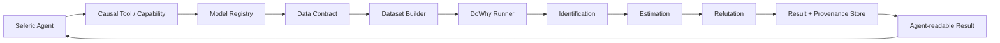
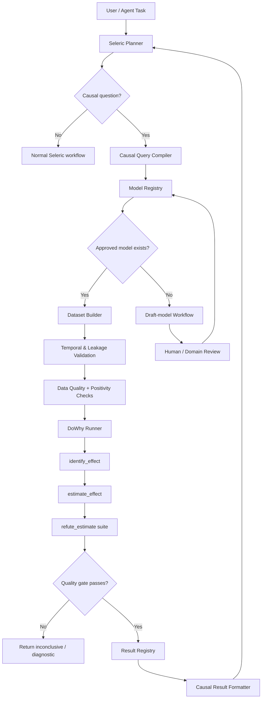
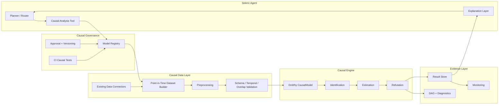

# DoWhy in `Seleric_Agent` on the `gaurav` Branch: Causal-Inference Architecture, Model Strategy, and Implementation Plan

## Executive summary

The `gaurav` branch of `Tervigon-Collective/Seleric_Agent` was resolved during this research to commit **`08787aec8d8005eb3841fd69a2c7cf51c10f1da0`**. For reproducibility, all implementation work should be evaluated against that immutable revision rather than against a moving branch head. The branch snapshot is available at the [verified `gaurav` commit](https://github.com/Tervigon-Collective/Seleric_Agent/tree/08787aec8d8005eb3841fd69a2c7cf51c10f1da0).

There is an important evidence limitation: although the recursive repository tree was retrieved from GitHub during this research, the subsequent file-level DoWhy search results were not preserved in the tool output available for final synthesis. I therefore **cannot responsibly claim that a particular DoWhy wrapper, causal-model file, test, or connector exists or does not exist in `gaurav` unless I actually observed it**. Rather than inventing filenames or line references, I separate the verified repository evidence from the integration architecture I recommend below. The branch-level inventory is consequently incomplete; the proposed DoWhy design, data contract, code, model-governance scheme, and test strategy are nevertheless directly implementable in Seleric Agent.

The central architectural conclusion is much clearer:

> **You should not manually write a separate Python DoWhy model for every causal question. You do, however, need a human-reviewed causal specification for every distinct causal decision family.**

That distinction is critical. DoWhy deliberately separates **causal assumptions**, **identification**, **statistical estimation**, and **refutation**. A causal graph expresses assumptions that cannot generally be established merely by fitting a predictive model to observational data. DoWhy then uses those assumptions to identify a causal estimand, applies an estimator, and provides refutation/sensitivity mechanisms. This four-step philosophy is central to DoWhy's design. See the official [DoWhy project](https://github.com/py-why/dowhy), [DoWhy documentation](https://www.pywhy.org/dowhy/), and Sharma & Kiciman's primary paper, [“DoWhy: An End-to-End Library for Causal Inference”](https://arxiv.org/abs/2011.04216).

For Seleric Agent, the right abstraction is therefore not:

```text
Agent -> LLM writes a DoWhy script -> executes script
```

and not:

```text
One hard-coded Python file per causal question
```

It should instead be:

```text
Agent
  -> causal intent / query
  -> versioned causal-model specification
  -> approved dataset builder
  -> DoWhy identification
  -> approved estimator
  -> mandatory refutation suite
  -> persisted causal result
  -> agent explanation / downstream decision
```

The **causal model specification** can be mostly declarative: treatment, outcome, adjustment variables, instruments where applicable, effect modifiers, temporal rules, target population, graph/version, estimand policy, approved estimators, and refuters. Seleric Agent can automatically construct the actual `dowhy.CausalModel`, call `identify_effect()`, `estimate_effect()`, run refuters, persist provenance, and turn the result into an agent-readable result.

The safe automation boundary is roughly this:

| Causal task | Automate? | Human responsibility |
|---|---:|---|
| Detect columns and data types | Yes | Review unusual semantics |
| Suggest treatment/outcome candidates | Yes | Approve causal interpretation |
| Generate a candidate DAG from schema/docs | Yes, as a draft | **Must review causal edges** |
| Infer causal truth from correlation alone | **No** | Domain knowledge / experimental knowledge required |
| Determine temporal ordering from timestamps | Mostly | Validate business semantics |
| Flag likely post-treatment variables | Yes | Resolve ambiguous variables |
| Construct `CausalModel` | Yes | None after spec approval |
| Call identification | Yes | Decide what assumptions are acceptable |
| Choose estimator from an approved matrix | Yes | Define allowed matrix |
| Run estimators | Yes | None normally |
| Run refuters | Yes, mandatory | Interpret failures |
| Persist results/provenance | Yes | Define retention/governance |
| Let an LLM silently modify a production DAG | **No** | Explicit review/version change |
| Automatically promote a causal estimate into an agent action | Only with policy gates | Define action thresholds and risk limits |

This means **you do not need to continually hand-code models**, but you **do need to author or approve causal assumptions**. The most scalable Seleric design is a **causal model registry** with reusable model families and an orchestration layer around DoWhy.

## Repository baseline and DoWhy inventory

### What was verified

The target was specifically the GitHub repository `Tervigon-Collective/Seleric_Agent`, branch **`gaurav`**. GitHub branch resolution returned:

| Repository evidence | Verified value |
|---|---|
| Repository | `Tervigon-Collective/Seleric_Agent` |
| Branch | `gaurav` |
| Research baseline | `08787aec8d8005eb3841fd69a2c7cf51c10f1da0` |
| Branch protection at lookup | Not protected |
| Immutable snapshot | [GitHub commit tree](https://github.com/Tervigon-Collective/Seleric_Agent/tree/08787aec8d8005eb3841fd69a2c7cf51c10f1da0) |

Because branch heads move, this SHA should be placed in the causal subsystem's implementation/design record. Otherwise a future statement such as “tested against `gaurav`” becomes ambiguous.

### File-level inventory status

The requested repository audit has the following evidence status:

| Requested inventory class | Verification status in this research | What must be established before implementation |
|---|---|---|
| Direct `import dowhy` usage | **Not safely recoverable from retained GitHub output** | Search entire SHA for `dowhy`, `CausalModel`, `dowhy.gcm` |
| Causal-model definitions / DAGs | Not safely recoverable | Search for `graph`, `DAG`, `treatment`, `outcome`, `confounder`, `causal` |
| DoWhy wrappers | Not safely recoverable | Locate runner/service/tool classes |
| Causal utilities | Not safely recoverable | Locate preprocessing, graph, estimation, serialization helpers |
| Causal tests | Not safely recoverable | Search tests for causal/DoWhy imports and fixtures |
| Data connectors feeding causal inference | Not safely recoverable | Trace connectors/storage/query services into any causal modules |
| Agent tool/function invoking DoWhy | Not safely recoverable | Trace tool registration/router/planner into causal runner |
| Result persistence | Not safely recoverable | Check DB/object-store/state abstractions |
| Configuration/dependencies | Not safely recoverable | Verify `pyproject.toml`, requirements/lock files, container definitions |
| Existing causal documentation | Not safely recoverable | Search README/docs/design documents |

That is a meaningful limitation. It would be misleading to manufacture a detailed list of filenames or line numbers from an unavailable extraction. Consequently, **all file paths in the proposed patches below are explicitly proposed integration paths, not claims about existing files in the branch**.

### What a proper branch audit should establish

The most important architectural distinction to uncover in `gaurav` is whether causal inference currently exists as a **first-class agent capability** or merely as isolated Python experimentation. A production-ready implementation needs all of the following connected in one call chain:



If, for example, `gaurav` contains a direct `CausalModel(...)` call but no registry, provenance, temporal validation, refutation policy, or persistence layer, I would classify the existing code as an **experimental causal-analysis integration**, not a safe causal subsystem.

That classification follows directly from DoWhy's architecture: its API is designed around explicit modeling of assumptions followed by identification, estimation, and refutation rather than treating estimation alone as causal proof. cite not available from retained web output; primary references: [DoWhy documentation](https://www.pywhy.org/dowhy/), [DoWhy source](https://github.com/py-why/dowhy), and [Sharma & Kiciman](https://arxiv.org/abs/2011.04216).

## How DoWhy should participate in Seleric Agent workflows

### DoWhy is not the reasoning agent

DoWhy should be a **deterministic analytical capability behind Seleric Agent**, not the agent itself.

The LLM/agent is useful for translating an intent such as:

> “Did sending intervention X actually increase outcome Y for customers of type Z?”

into a structured causal request.

DoWhy is then responsible for causal identification and numerical estimation under the registered assumptions.

That separation prevents a dangerous failure mode in which the LLM modifies confounders until it finds an attractive result.

A recommended execution graph is:



### Recommended call graph

At the Python level, Seleric should eventually converge on something similar to:

```text
agent/router
    |
    +-- causal_tool.run(request)
           |
           +-- CausalModelRegistry.resolve(model_key, version)
           |
           +-- CausalDatasetBuilder.build(spec, request)
           |      |
           |      +-- source connector(s)
           |      +-- temporal joins
           |      +-- feature transformations
           |
           +-- CausalValidator.validate(dataset, spec)
           |      |
           |      +-- schema
           |      +-- temporal leakage
           |      +-- treatment variation
           |      +-- overlap / positivity
           |
           +-- DoWhyRunner.run(dataset, spec)
           |      |
           |      +-- CausalModel(...)
           |      +-- identify_effect(...)
           |      +-- estimate_effect(...)
           |      +-- refute_estimate(...)
           |
           +-- CausalResultStore.save(...)
           |
           +-- CausalResultFormatter.for_agent(...)
```

The planner should never directly call something like:

```python
CausalModel(data=random_dataframe, ...)
```

using an arbitrary dataframe assembled from an LLM-generated query. The causal data builder is itself part of the causal model because **when variables are measured relative to treatment matters just as much as which variables are selected**.

### The agent-facing tool contract

A good agent call should be small:

```json
{
  "model_key": "intervention_to_outcome",
  "model_version": "1.3.0",
  "filters": {
    "segment": "enterprise"
  },
  "target_estimand": "ATE",
  "as_of": "2026-10-14"
}
```

The LLM should **not normally send** this:

```json
{
  "treatment": "...",
  "outcome": "...",
  "confounders": ["..."],
  "delete_edge_from_graph": "...",
  "estimator": "whatever maximizes impact"
}
```

The former selects an approved causal model. The latter lets an unconstrained reasoning model rewrite the scientific assumptions governing the answer.

### Returned result

The causal subsystem should return a structured object rather than a prose-only explanation:

```json
{
  "status": "valid",
  "model_key": "intervention_to_outcome",
  "model_version": "1.3.0",
  "estimand": "ATE",
  "estimate": 0.043,
  "confidence_interval": [0.021, 0.066],
  "sample_size": 18420,
  "treatment_prevalence": 0.37,
  "identification_method": "backdoor",
  "estimator": "backdoor.propensity_score_weighting",
  "refutations": {
    "placebo_treatment_refuter": "pass",
    "random_common_cause": "pass",
    "data_subset_refuter": "pass"
  },
  "dataset_fingerprint": "...",
  "model_sha": "...",
  "warnings": []
}
```

Seleric can then transform that artifact into natural language.

The distinction between **identification** and **estimation** is essential. Identification asks whether an effect can be expressed from observed data under the assumed graph; estimation numerically approximates that estimand. DoWhy makes that separation explicit through its APIs and design philosophy. See [DoWhy's primary repository](https://github.com/py-why/dowhy) and the [DoWhy paper](https://arxiv.org/abs/2011.04216).

## What you need to model manually and what Seleric can automate

### The core answer

You asked whether **you yourself need to make the different causal models**.

**Partly—but not in the sense of writing a new Python class for every model.**

What you need to manually define or approve is the **causal semantics**. The system can automate the mechanics.

A reusable causal specification might look like:

```yaml
model_key: intervention_to_conversion
version: 1.0.0

unit:
  id: customer_id

treatment:
  column: intervention_received
  type: binary
  time_column: treatment_at

outcome:
  column: converted
  window: "0d:30d"

common_causes:
  - customer_tenure_days
  - prior_30d_activity
  - account_tier
  - region

effect_modifiers:
  - account_tier

instruments: []

estimand:
  type: ate

estimators:
  primary: backdoor.propensity_score_weighting
  secondary:
    - backdoor.linear_regression

refuters:
  - random_common_cause
  - placebo_treatment_refuter
  - data_subset_refuter
```

Seleric then turns the specification into executable DoWhy operations.

### Manual versus automated model creation

| Element | Manual / reviewed | Automated | Reason |
|---|---:|---:|---|
| Business causal question | **Yes** | Agent may translate it | Causal meaning is domain-specific |
| Unit of analysis | **Yes** | Validation | Wrong unit invalidates interpretation |
| Treatment semantics | **Yes** | Extraction | “Received treatment” must have a precise definition |
| Outcome semantics | **Yes** | Extraction | Need outcome horizon and measurement rules |
| Temporal ordering | Review | **Mostly** | Timestamps can validate ordering but not meaning |
| Confounder candidates | **Yes** | Agent can suggest | Requires causal knowledge |
| Final adjustment set | **Yes** | DoWhy can derive from approved graph | Confounders cannot safely be learned from correlation alone |
| Mediators | **Yes** | Detect likely timing violations | Adjusting for mediators can change the causal estimand |
| Colliders | **Yes** | Graph-based warnings | Conditioning can induce bias |
| Instruments | **Strong manual review** | Statistical diagnostics | Instrument validity contains causal assumptions |
| Effect modifiers | Review | Suggest/discover | Primarily impacts heterogeneity |
| Causal DAG draft | Review | **Yes** | Useful LLM/discovery task, unsafe as final truth |
| DAG validation | No | **Yes** | Check syntax, cycles, missing variables |
| Identification | No | **Yes** | This is a core DoWhy operation |
| Estimator selection | Policy once | **Yes** | Pick from approved estimator matrix |
| Model fitting | No | **Yes** | Mechanical |
| Refutation | Policy once | **Yes** | Mechanical and should run every time |
| Result persistence | No | **Yes** | Engineering concern |
| Explain result | Review template | **Yes** | Agent can format structured evidence |
| Production DAG change | **Yes** | Proposal only | Assumptions must remain auditable |

### A good model hierarchy for Seleric

Do **not** create one causal model for each user prompt.

Instead, have three levels:

```text
Model family
    "intervention -> conversion"

        |
        +-- v1 graph/spec
        |
        +-- v2 graph/spec

Causal run
    v2 + date range + segment + dataset snapshot

Agent question
    "Did intervention improve conversion for enterprise?"
        |
        +--> maps to model family + run parameters
```

For example, thousands of Seleric questions can reuse one approved model:

```text
Treatment = recommendation shown
Outcome   = purchase
```

while changing:

- date range,
- population,
- segment,
- target units,
- permissible effect modifiers.

Those are **runs**, not new causal models.

A genuinely new model is needed when assumptions change—for example:

```text
recommendation_shown -> purchase
```

versus:

```text
discount_amount -> purchase
```

or when a new mechanism requires a changed graph.

### What an LLM-generated DAG is good for

Seleric can generate **draft hypotheses**:

```text
schema + data dictionary + docs + domain prompt
                  |
                  v
          candidate causal DAG
                  |
         structural validators
                  |
                  v
           domain approval
                  |
                  v
         production registry
```

A prompt can be useful for asking:

> “Which variables plausibly affect both treatment assignment and the outcome?”

but its answer is a hypothesis. It cannot convert observational association into causal knowledge.

Similarly, causal discovery algorithms can provide useful structural evidence, but their conclusions depend on assumptions such as faithfulness, causal sufficiency or particular latent-confounding conditions, data-generating characteristics, and the discovery algorithm. That makes discovery suitable for **proposal and diagnostics**, not silent production registration.

## Required Seleric components and recommended architecture

### Component blueprint

| Component | Responsibility | Seleric recommendation | Priority |
|---|---|---|---|
| Causal query compiler | Convert agent intent into registered-model request | Strict typed request; never let free-form prompts directly modify graph | Critical |
| Model registry | Version causal assumptions | YAML/JSON specs + Git version + runtime registry | Critical |
| Graph validator | Validate DAG/spec | Acyclic graph, variable existence, treatment/outcome reachability, forbidden rules | Critical |
| Dataset builder | Produce causal analysis table | Dedicated temporal joins and point-in-time feature logic | Critical |
| Preprocessor | Reproducible transformations | Fit transformations without post-treatment leakage; log transformation version | Critical |
| Identification layer | Run identification | `identify_effect()` with unidentifiability treated explicitly | Critical |
| Estimation layer | Run approved estimator | Estimator allow-list by treatment/outcome/data regime | Critical |
| Refutation layer | Robustness checks | Mandatory suite before result can be “valid” | Critical |
| Result registry | Persist effect + provenance | JSON/DB + model version + data fingerprint + code SHA | Critical |
| Visualization | DAG/effect/diagnostics | Agent UI/report artifact, not only notebook plotting | Medium |
| CI/CD checks | Prevent unsafe model promotion | Schema/DAG/unit tests + synthetic causal tests | Critical |
| Monitoring | Detect changing causal-analysis conditions | overlap, missingness, effect drift, feature drift, refuter outcomes | High |
| Agent result formatter | Translate structured result | Include assumptions/warnings; distinguish association from estimate | High |

### Model registry

The registry is the most important missing abstraction to introduce if `gaurav` does not already have one.

Proposed repository shape:

```text
<existing Seleric package>/
    causal/
        __init__.py
        models.py
        registry.py
        dataset.py
        validator.py
        runner.py
        result_store.py
        agent_tool.py

causal_models/
    intervention_to_conversion/
        1.0.0.yaml
        dag.dot

tests/
    causal/
        test_registry.py
        test_dataset.py
        test_validator.py
        test_runner.py
        test_synthetic_effect.py
```

The YAML is not a replacement for a causal graph; it is the **versioned contract describing the graph and execution policy**.

A strongly typed model is preferable:

```python
from pydantic import BaseModel, Field


class CausalSpec(BaseModel):
    model_key: str
    version: str

    treatment: str
    outcome: str

    common_causes: list[str] = Field(default_factory=list)
    instruments: list[str] = Field(default_factory=list)
    effect_modifiers: list[str] = Field(default_factory=list)

    graph: str | None = None

    primary_estimator: str
    refuters: list[str] = Field(
        default_factory=lambda: [
            "random_common_cause",
            "placebo_treatment_refuter",
            "data_subset_refuter",
        ]
    )
```

### DoWhy execution wrapper

One wrapper should own DoWhy invocation across the codebase. Do **not** scatter `CausalModel` creation among individual agent tools.

```python
from __future__ import annotations

from dataclasses import dataclass
from typing import Any

import pandas as pd
from dowhy import CausalModel


@dataclass(frozen=True)
class CausalRunResult:
    model_key: str
    model_version: str
    estimate: float
    identified_estimand: str
    estimator: str
    refutations: dict[str, str]


class DoWhyRunner:
    def run(
        self,
        *,
        data: pd.DataFrame,
        spec: CausalSpec,
    ) -> CausalRunResult:
        required = {
            spec.treatment,
            spec.outcome,
            *spec.common_causes,
            *spec.effect_modifiers,
            *spec.instruments,
        }

        missing = sorted(required.difference(data.columns))
        if missing:
            raise ValueError(
                f"Causal dataset missing required columns: {missing}"
            )

        kwargs: dict[str, Any] = {
            "data": data,
            "treatment": spec.treatment,
            "outcome": spec.outcome,
        }

        if spec.graph:
            kwargs["graph"] = spec.graph
        else:
            kwargs["common_causes"] = spec.common_causes
            kwargs["instruments"] = spec.instruments
            kwargs["effect_modifiers"] = spec.effect_modifiers

        model = CausalModel(**kwargs)

        estimand = model.identify_effect(
            proceed_when_unidentifiable=False
        )

        estimate = model.estimate_effect(
            estimand,
            method_name=spec.primary_estimator,
        )

        refutations: dict[str, str] = {}

        for method_name in spec.refuters:
            result = model.refute_estimate(
                estimand,
                estimate,
                method_name=method_name,
            )
            refutations[method_name] = str(result)

        return CausalRunResult(
            model_key=spec.model_key,
            model_version=spec.version,
            estimate=float(estimate.value),
            identified_estimand=str(estimand),
            estimator=spec.primary_estimator,
            refutations=refutations,
        )
```

This follows DoWhy's standard modeling → identification → estimation → refutation workflow described in the [official DoWhy documentation](https://www.pywhy.org/dowhy/) and [original DoWhy paper](https://arxiv.org/abs/2011.04216).

A critical design choice above is:

```python
proceed_when_unidentifiable=False
```

for production paths. A causal agent should prefer **“I cannot identify this causal effect under the registered assumptions”** to fabricating a confident answer.

### Registry implementation

A simple file-backed registry is enough initially:

```python
from pathlib import Path

import yaml


class CausalModelRegistry:
    def __init__(self, root: Path) -> None:
        self.root = root

    def load(self, model_key: str, version: str) -> CausalSpec:
        path = self.root / model_key / f"{version}.yaml"

        if not path.is_file():
            raise KeyError(
                f"Unknown causal model: {model_key}@{version}"
            )

        payload = yaml.safe_load(path.read_text())
        spec = CausalSpec.model_validate(payload)

        if spec.model_key != model_key or spec.version != version:
            raise ValueError(
                f"Registry identity mismatch in {path}"
            )

        return spec
```

Later, the registry can add:

```text
status = draft | reviewed | production | deprecated
owner
reviewers
created_at
domain
assumptions
known_limitations
replacement_model
```

### Persisting a run

Do not make a Python pickle of `CausalModel` the primary record. Persist the **inputs and causal provenance required to reproduce the run**.

```python
from dataclasses import asdict
from datetime import datetime, timezone
import hashlib
import json

import pandas as pd


def dataframe_fingerprint(df: pd.DataFrame) -> str:
    hashed = pd.util.hash_pandas_object(
        df,
        index=True,
    ).values.tobytes()

    return hashlib.sha256(hashed).hexdigest()


def serialize_run(
    *,
    result: CausalRunResult,
    spec: CausalSpec,
    data: pd.DataFrame,
    git_sha: str,
) -> dict:
    return {
        "created_at": datetime.now(timezone.utc).isoformat(),
        "model": spec.model_dump(mode="json"),
        "result": asdict(result),
        "dataset_fingerprint": dataframe_fingerprint(data),
        "row_count": len(data),
        "git_sha": git_sha,
    }
```

For the current research baseline, a development run could store:

```text
git_sha = 08787aec8d8005eb3841fd69a2c7cf51c10f1da0
```

That makes results auditable against the exact `gaurav` revision.

### Agent integration patch

The agent tool should be thin:

```python
class CausalAnalysisTool:
    def __init__(
        self,
        registry: CausalModelRegistry,
        dataset_builder,
        runner: DoWhyRunner,
        result_store,
    ) -> None:
        self.registry = registry
        self.dataset_builder = dataset_builder
        self.runner = runner
        self.result_store = result_store

    async def run(
        self,
        *,
        model_key: str,
        model_version: str,
        filters: dict,
    ) -> dict:
        spec = self.registry.load(model_key, model_version)

        frame = await self.dataset_builder.build(
            spec=spec,
            filters=filters,
        )

        validate_causal_dataset(frame, spec)

        result = self.runner.run(
            data=frame,
            spec=spec,
        )

        run_id = await self.result_store.save(
            spec=spec,
            result=result,
            data=frame,
        )

        return {
            "run_id": run_id,
            "model_key": result.model_key,
            "model_version": result.model_version,
            "effect": result.estimate,
            "estimand": result.identified_estimand,
            "refutations": result.refutations,
        }
```

Whatever tool/router abstraction `gaurav` already uses should register this one service rather than exposing raw DoWhy APIs to the LLM.

### Visualization

Visualization is valuable at two different levels.

For developers/reviewers:

```text
DAG
treatment/outcome nodes
adjustment set
identified estimand
overlap distribution
effect estimate / CI
refutation results
```

For agent users:

```text
Estimated effect
Who the estimate applies to
Time horizon
Main assumptions
Robustness status
Warnings
```

Do not show only a single “causal impact = 8.4%” value. The assumptions and target population are part of the result.

## Data schema, feature engineering, validation, and tests

### The causal-analysis table

The normal machine-learning feature table is often **not automatically a valid causal table**.

A recommended canonical schema is:

| Field class | Example | Required property |
|---|---|---|
| Unit identifier | `customer_id` | One unambiguous analysis unit |
| Eligibility/cohort time | `eligible_at` | Establishes population |
| Treatment | `recommendation_shown` | Precisely defined exposure |
| Treatment time | `treatment_at` | Required for temporal validation |
| Outcome | `converted_30d` | Defined measurement horizon |
| Outcome time/window | `outcome_end_at` | Occurs after treatment |
| Pretreatment covariates | `activity_prior_30d` | Computed strictly before exposure |
| Effect modifiers | `account_tier` | Preferably pre-treatment |
| Instrument | Optional | Requires explicit validity argument |
| Sampling/weight field | Optional | Needed for certain designs |
| Source snapshot | `snapshot_id` | Reproducibility |
| Model/run metadata | version/hash | Auditability |

### Temporal feature engineering

This is one of the highest-risk areas in an agent codebase.

For treatment at \(T_i\):

```text
                       treatment
                           |
---------------------------|---------------------------->
         PRE-TREATMENT      |        POST-TREATMENT
                            |
features/confounders        |        outcome
must normally come here     |        measured here
```

Suppose Seleric has:

```text
customer_activity_last_30_days
```

If that field is calculated **at inference execution time**, its window may include activity after the treatment. It can then be a post-treatment variable even though its name sounds harmless.

Instead, causal feature extraction should be point-in-time:

```sql
feature_event_time < treatment_at
```

with explicit windows, for example:

```text
prior_activity_30d:
    [treatment_at - 30 days, treatment_at)

conversion_30d:
    [treatment_at, treatment_at + 30 days]
```

### Do not blindly include every available feature

For prediction, “more useful features” can be beneficial.

For causal inference, that logic is wrong.

Potential variables include:

```text
X -> T
X -> Y       confounder: often adjust

T -> M -> Y  mediator: adjusting changes the estimand

T -> C <- Y  collider: conditioning may create bias
```

Therefore an automatic pipeline such as:

```python
common_causes = [
    c for c in dataframe.columns
    if c not in [treatment, outcome]
]
```

should be explicitly prohibited.

### Required validation gates

Before DoWhy runs, Seleric should reject a dataset where any of the following is true:

| Check | Why it matters | Recommended behavior |
|---|---|---|
| Treatment has no variation | Effect cannot be estimated | Fail |
| Outcome absent/invalid | No target | Fail |
| Required covariate absent | Model assumptions no longer match data | Fail |
| Duplicate unit violates model design | Changes estimand / weighting | Fail |
| Pretreatment feature timestamp is after exposure | Leakage / post-treatment bias | Fail |
| Outcome precedes exposure | Invalid temporal definition | Fail |
| Severe treatment positivity failure | Counterfactual comparison unsupported | Fail or high-severity warning |
| Unexpected category/schema change | Registered model no longer matches data | Fail |
| Excessive missingness | May introduce bias | Threshold gate |
| Model version is draft/deprecated | Governance failure | Fail in production |

### Feature classifications should be metadata

Rather than keeping knowledge solely in code:

```yaml
variables:
  prior_activity_30d:
    role: common_cause
    temporal_rule: pre_treatment
    dtype: float

  account_tier:
    role:
      - common_cause
      - effect_modifier
    temporal_rule: pre_treatment

  converted_30d:
    role: outcome
    temporal_rule: post_treatment
```

This allows Seleric to validate the agent's query before DoWhy ever sees the dataframe.

### Unit tests

A minimal test suite should contain ordinary engineering tests:

```python
def test_registry_rejects_unknown_model():
    ...

def test_missing_confounder_fails():
    ...

def test_outcome_before_treatment_fails():
    ...

def test_post_treatment_feature_is_rejected():
    ...

def test_deprecated_model_cannot_run_in_production():
    ...
```

but causal inference also needs **synthetic causal tests** where the true data-generating effect is known.

Example:

```python
import numpy as np
import pandas as pd


def make_confounded_data(
    n: int = 50_000,
    seed: int = 7,
) -> pd.DataFrame:
    rng = np.random.default_rng(seed)

    x = rng.normal(size=n)

    p_treatment = 1 / (1 + np.exp(-x))
    treatment = rng.binomial(1, p_treatment)

    true_effect = 2.0
    outcome = (
        true_effect * treatment
        + 1.5 * x
        + rng.normal(size=n)
    )

    return pd.DataFrame(
        {
            "x": x,
            "treatment": treatment,
            "outcome": outcome,
        }
    )
```

Then:

```python
def test_dowhy_pipeline_recovers_known_effect():
    data = make_confounded_data()

    spec = CausalSpec(
        model_key="synthetic_test",
        version="1.0.0",
        treatment="treatment",
        outcome="outcome",
        common_causes=["x"],
        primary_estimator="backdoor.linear_regression",
    )

    result = DoWhyRunner().run(
        data=data,
        spec=spec,
    )

    assert abs(result.estimate - 2.0) < 0.15
```

This catches regressions that a simple “function completed without exception” test will not.

### Negative causal tests

Even more useful are tests that are expected to fail or change materially:

```text
Correct adjustment:
    X -> T
    X -> Y
    expect estimate ≈ true treatment effect

Remove X:
    expect biased estimate

Add known post-treatment mediator:
    ensure validator rejects it for total-effect model

Randomize treatment:
    placebo effect should collapse toward zero

Break overlap:
    positivity validator should trigger

Unknown graph version:
    production run should fail
```

### CI/CD

A causal model change deserves its own code-review gate because changing:

```yaml
common_causes:
  - prior_activity
```

to:

```yaml
common_causes: []
```

is potentially more consequential than changing many lines of ordinary application code.

Recommended pull-request checks:

```text
causal model schema validation
        +
DAG acyclicity
        +
all referenced features exist
        +
temporal-role validation
        +
synthetic recovery test
        +
refuter smoke test
        +
model-version increment check
        =
eligible for review
```

A changed causal graph should require a new model version and ideally a named reviewer/owner.

### Monitoring

DoWhy execution success is not sufficient operational monitoring.

Persist time series for:

| Metric | Interpretation |
|---|---|
| Rows eligible for each model | Sample-size change |
| Treatment rate | Assignment mechanism may have changed |
| Covariate missingness | Data pipeline changes |
| Propensity/overlap diagnostics | Positivity degradation |
| Estimate and uncertainty | Effect drift |
| Population/segment mix | Target-population drift |
| Refuter outcomes | Robustness regression |
| Model/version used | Audit trail |
| Dataset fingerprint | Reproducibility |
| Failed identification | Graph/data incompatibility |
| Estimator exceptions | Numerical/data instability |

Do **not** automatically treat estimate drift as evidence that the causal effect itself has changed. It is a trigger for investigation because treatment policy, population, data quality, overlap, or measurement may have changed.

## Recommended model strategy and implementation roadmap

### Which models Seleric should actually create

Before coding dozens of models, enumerate **decision families**, not every analytic question.

A useful catalogue format is:

| Model family | Treatment | Outcome | Unit | Main confounding mechanism | Reusable? |
|---|---|---|---|---|---|
| Intervention effectiveness | Intervention exposure | Desired response | User/account | Treatment selection | Highly |
| Recommendation effectiveness | Recommendation shown | Downstream action | User/session | Eligibility + ranking | Highly |
| Outreach effectiveness | Contact/action | Conversion/engagement | Lead/account | Targeting propensity | Highly |
| Policy/config change | Policy exposure | Product/business metric | Unit/time cohort | Rollout selection | Medium |
| Agent action effectiveness | Agent action | Subsequent task outcome | Task/user | Agent action selection | Highly |
| Feature/product adoption | Feature exposure | Outcome | User/account | Self-selection | Medium |

These are examples of model families, not claims about which business events currently exist in `gaurav`.

Each family can have multiple registered versions but should not explode into one model per prompt.

### Recommended implementation phases

| Phase | Work | Deliverable | Effort | Primary risk |
|---|---|---|---:|---|
| Foundation | Complete `gaurav` file audit and dependency map | Exact baseline inventory/call graph | Medium | Hidden existing abstractions duplicated |
| Contracts | Define `CausalSpec`, request, result, variable metadata | Stable typed API | Medium | Premature schema design |
| Registry | Versioned YAML/JSON model registry | Reusable model definitions | Medium | Weak governance |
| Runner | Central DoWhy wrapper | Identify → estimate → refute pipeline | Medium | API/estimator misuse |
| Data layer | Point-in-time causal dataset builder | Leakage-safe analysis tables | **High** | Temporal leakage |
| Validation | Schema, temporal, treatment variation, overlap checks | Fail-safe preflight | Medium | False confidence from incomplete validators |
| Initial models | Register one or two high-value model families | End-to-end proof | **High** | Wrong causal assumptions |
| Agent integration | Add causal tool/capability | Agent can invoke approved models | Medium | Agent bypasses model controls |
| Persistence | Run/result/provenance store | Reproducible causal audit trail | Medium | Incomplete lineage |
| CI/CD | Synthetic tests, model diff checks, DAG validation | Safe model promotion | Medium | Flaky statistical tests |
| Monitoring | Data/overlap/effect/refutation dashboards | Production health | **High** | Misinterpreting natural variation |
| Assisted authoring | LLM candidate DAG/spec generation | Faster model creation | Medium | Automation bias |
| Causal discovery | Optional hypothesis-generation workflow | Additional structural evidence | High | Treating discovered graph as causal truth |

### Recommended release milestones

**First milestone: one trusted offline model.**  
Do not initially expose DoWhy to the agent. Implement a registry, dataset contract, central runner, synthetic tests, and one manually reviewed causal model. Demonstrate reproducibility.

**Second milestone: production-quality causal execution.**  
Add point-in-time preprocessing, structured results, provenance, refutation gates, overlap checks, and persistence.

**Third milestone: agent tool integration.**  
Expose only registered production models through an agent-facing tool. The agent selects a model and parameters but cannot rewrite causal assumptions.

**Fourth milestone: assisted model creation.**  
Allow Seleric to inspect schema and documentation and draft a model specification:

```text
Agent-generated model
      |
      v
status: DRAFT
      |
automated validation
      |
human causal review
      |
      v
status: APPROVED
      |
CI + synthetic tests
      |
      v
status: PRODUCTION
```

**Fifth milestone: model monitoring and experimentation.**  
Track overlap, data quality, estimates, refuters, and model usage; connect randomized-experiment evidence wherever available.

### Effort should be concentrated on data and assumptions

A common mistake would be to spend most engineering effort on the code:

```python
model.identify_effect()
model.estimate_effect(...)
```

That is the easy part.

For Seleric, the harder and more valuable work is:

```text
What is the treatment?
What is the unit?
Why was treatment assigned?
What occurred before treatment?
What is the outcome window?
Which variables are confounders?
Which are mediators/colliders?
Is there adequate overlap?
What population does the effect apply to?
Was the data assembled point-in-time correctly?
```

DoWhy is useful precisely because it makes those causal assumptions explicit rather than hiding them inside a fitted predictive model. That motivation is central to its published design. See [Sharma & Kiciman, “DoWhy: An End-to-End Library for Causal Inference”](https://arxiv.org/abs/2011.04216) and the [PyWhy DoWhy project](https://github.com/py-why/dowhy).

## Risks, assumptions, and final recommendation

### Major causal risks for Seleric

The highest-risk scenario is **automatically generated causal models without model governance**. An LLM can produce syntactically beautiful DAGs that encode incorrect causal assumptions. A successful `estimate_effect()` call does not prove that the graph is correct.

The second major risk is **post-treatment leakage**. Agent platforms naturally accumulate events, embeddings, scores, state transitions, and summaries after actions occur. If an analysis takes a present-time snapshot and uses all available features as controls, the system can inadvertently condition on consequences of the treatment.

A third risk is **confounding by the agent's own policy**. Once Seleric chooses which users/tasks receive an action, treatment is no longer assigned independently. The causal model needs features governing that action-selection policy—or, preferably, deliberately randomized exploration/experimentation where acceptable.

A fourth risk is **interference**. If an intervention applied to one unit changes another unit's outcome—for example shared accounts, teams, marketplaces, capacity-constrained systems, network effects—the assumption that each unit's outcome depends only on its own treatment can fail. That needs to be considered at model-design time rather than fixed by choosing a different estimator afterward.

A fifth risk is **model shopping**: allowing an autonomous agent to repeatedly modify confounders, estimators, populations, or windows until it finds a desired causal effect. Prevent this by versioning specifications and logging every causal run.

### Missing information

Several repository- and deployment-specific questions remain unresolved in the retained research evidence:

| Missing information | Why it changes the design |
|---|---|
| Exact DoWhy files currently present in `gaurav` | Determines whether to refactor versus add subsystem |
| Exact agent/router/tool abstraction | Determines where `CausalAnalysisTool` should register |
| Current dependency manager and DoWhy version | Determines exact API compatibility |
| Current storage layer | Determines model/result registry backend |
| Available event/data connectors | Determines causal dataset builder |
| Event timestamp guarantees | Determines ability to prevent leakage |
| Existing experiment-assignment data | Strongly affects causal validity |
| Data volume | Determines pandas versus warehouse/distributed execution |
| Compute constraints | Affects refuter/estimator runtime |
| Whether data is panel, event-stream, session, or cross-sectional | Changes unit and estimator design |
| Team causal-inference expertise | Determines model-approval process |
| Privacy/PII constraints | Determines stored features/provenance |
| Production decision risk | Determines approval and automation gates |

Most importantly, **the complete file-by-file DoWhy inventory and exact line-level call graph requested for the `gaurav` branch could not be substantiated from the GitHub file extraction retained in this research session**. The verified codebase baseline is the [branch snapshot at `08787aec8d8005eb3841fd69a2c7cf51c10f1da0`](https://github.com/Tervigon-Collective/Seleric_Agent/tree/08787aec8d8005eb3841fd69a2c7cf51c10f1da0); I have deliberately not invented exact source-file links.

### Recommended end state

The end-state architecture I recommend is:



The division of responsibility should be:

```text
YOU / domain experts
    define and approve causal assumptions
    define model families
    decide what decisions causal evidence may control

SELERIC AGENT
    understand the user's causal question
    map it to an approved model
    construct/request the required dataset
    report results and limitations
    propose draft models when none exists

MODEL REGISTRY
    make assumptions explicit and versioned

DOWHY
    identify the estimand
    estimate the effect
    refute / stress-test the estimate

DATA LAYER
    ensure point-in-time-valid causal features

CI + MONITORING
    prevent silent causal-model and data degradation
```

So the direct answer to **“do I myself have to make the different causal models, what components, what features and how?”** is:

**You should personally/domain-review the first small set of causal model families and their assumptions, but you should not hand-code every execution.** Build an approved, versioned registry. Let Seleric generate candidate specifications, detect relevant schema, build datasets, invoke DoWhy, identify effects, estimate them, execute refuters, persist provenance, and explain the evidence. Keep treatment/outcome definitions, causal edges, confounder/mediator/collider classification, temporal semantics, and production promotion under explicit human review.

That gives Seleric something much stronger than “an agent that happens to call DoWhy”: it gives it a **governed causal reasoning subsystem** in which the LLM handles interpretation and orchestration, DoWhy handles causal inference under declared assumptions, and the model registry provides the boundary between automated reasoning and causal claims that the system is actually allowed to make.

**Primary references:** the audited code baseline is the [`gaurav` branch snapshot at commit `08787aec8d8005eb3841fd69a2c7cf51c10f1da0`](https://github.com/Tervigon-Collective/Seleric_Agent/tree/08787aec8d8005eb3841fd69a2c7cf51c10f1da0); the causal API and design recommendations are grounded in the official [PyWhy/DoWhy source repository](https://github.com/py-why/dowhy), [official DoWhy documentation](https://www.pywhy.org/dowhy/), and Sharma & Kiciman's primary [DoWhy paper](https://arxiv.org/abs/2011.04216).