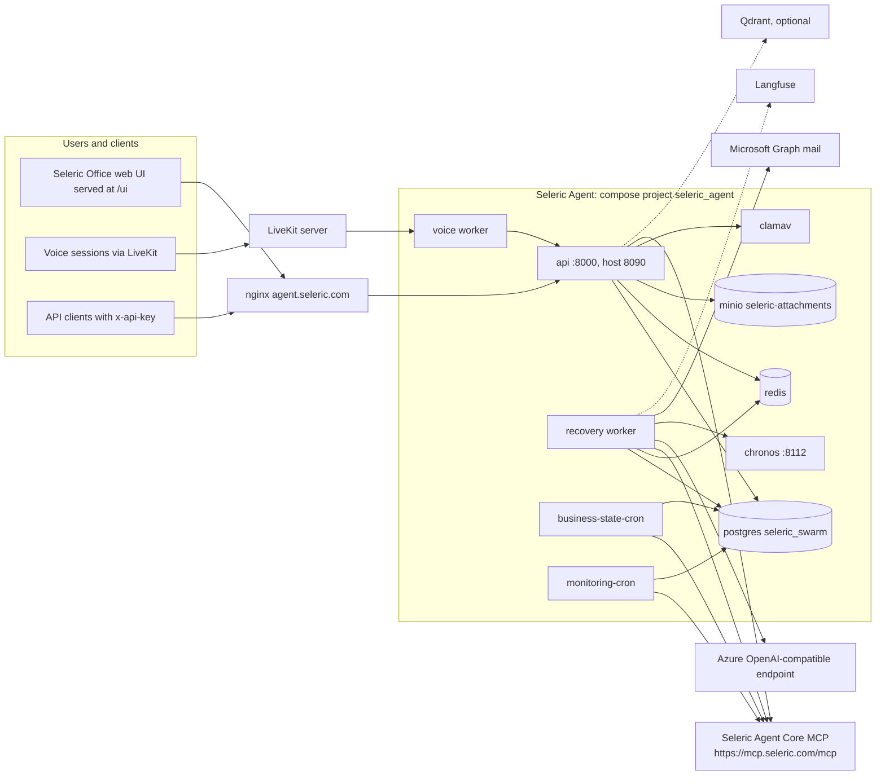

# 2. System context

## 2.1 Position in the platform

## 2.2 Containers (observed with `docker ps`, 2026-11-11)

| Container | Role |
|-----------|------|
| `seleric_agent-api-1` | FastAPI application; healthy; host port 8090 |
| `seleric_agent-recovery-1` | Executes queued runs (the API does not) |
| `seleric_agent-business-state-cron-1` | Domain-health snapshots and forecast scoring loop |
| `seleric_agent-monitoring-cron-1` | Hourly target monitoring for brand 20 |
| `seleric_agent-voice-1` | LiveKit voice worker (enabled: `VOICE_ENABLED=true`) |
| `seleric_agent-chronos-1` | Chronos-2 CPU forecast service |
| `seleric_agent-postgres-1`, `-redis-1`, `-minio-1`, `-clamav-1` | State, cancellation and events, attachments, malware scanning |
| `seleric-mcp-mcp-1` | Seleric Agent Core (separate compose project) |

## 2.3 Dependencies

| Dependency | Used for | Failure effect |
|------------|----------|----------------|
| Seleric Agent Core (`SELERIC_MCP_URL`, `SELERIC_MCP_TOKEN`) | All business numbers and catalogue knowledge | Tools return errors to the model; the answer states the data could not be fetched; `/readyz` reports MCP |
| Azure OpenAI-compatible endpoint | Model calls (loop, helper, voice) | Mission fails with a classified, chat-safe failure text |
| Postgres | Conversations, runs, artifacts, monitoring state | `/readyz` fails; no work |
| Redis | Cancellation flags and event notification | Required when the backends are `redis` (deployed) |
| MinIO and ClamAV | Attachment storage and scanning | Uploads cannot reach READY |
| Chronos | Forecast engine | Forecast ladder falls back to ETS, then to a refusal with reason codes |
| Langfuse | Tracing | Best-effort; never fails a mission |
| Microsoft Graph | Sending approved email | Email reported as not set up or failed; nothing else affected |
| LiveKit | Voice | Voice only |
| Qdrant | Optional catalogue embedding search | Optional |

## 2.4 What the service does not do

- It does not hold business data or definitions; metrics and dimensions come from the Core catalogue at run time.
- It does not write to ads platforms or other business systems; its only outbound write is approved email.
- It does not query ClickHouse or Cube directly.
