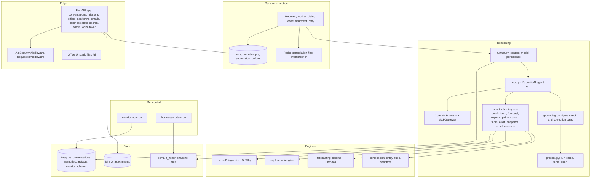

# 3. High-level design

## 3.1 Purpose and scope

**Purpose.** Let a business user ask a question in plain language and receive a short, correct, evidence-backed answer with the right visual, without the model ever producing a number that the data did not.

**In scope**

1. A conversation API: threads, messages, runs, memories, attachments, feedback, search, events (server-sent).
2. Durable, leased execution of runs by a separate worker, with retries, cancellation and recovery.
3. One reasoning loop (PydanticAI) over the Core MCP tools and local analysis tools.
4. Deterministic verification of the figures in each answer, and deterministic selection of the visual.
5. Analytical engines: diagnosis, exploration, composition, forecasting, entity audit, sandboxed Python.
6. Approval-bound email.
7. Business-health snapshots and target monitoring with an Ops/Monitoring API and UI.
8. The Office web UI and a voice channel.

**Out of scope:** the data platform, the metric catalogue and the Cube model (Mage AI platform and Agent Core), dashboards, any write to business systems other than email.

## 3.2 Logical architecture

## 3.3 Deployment architecture

Services of the compose project `seleric_agent` (`docker-compose.yml` plus a host-local `docker-compose.override.yml`):

| Service | Command / image target | Network and ports | Notes |
|---------|------------------------|-------------------|-------|
| `api` | `seleric-migrate && seleric-api`; target `runtime` | host `0.0.0.0:8090` → container 8000 (override) | Health: `GET /readyz` every 15 s |
| `recovery` | `seleric-recover --executor seleric_swarm.api.conversations:build_submission_executor --interval 5` | internal | Executes runs; `stop_grace_period` is `RUN_STOP_GRACE_PERIOD` (default 9 minutes), above the 480 s drain timeout |
| `business-state-cron` | loop: `python -m seleric_swarm.services.domain_health.scheduler`; `python -m seleric_swarm.forecasting.score --if-due`; sleep 60 | internal | Volumes `domain_health`, `forecast_reports` |
| `monitoring-cron` | loop: `python -m seleric_swarm.services.monitoring.runner --brand 20`; sleep until 5 minutes past the next hour | internal | Same image as business-state-cron |
| `voice` | `seleric-voice start`; target `voice-runtime`; profile `voice` | internal | Deployed running |
| `postgres` | `postgres:16` | `127.0.0.1:5434` (override) | No pgvector extension installed |
| `redis` | `redis:7-alpine` | not published (override) | |
| `minio` | `minio/minio:RELEASE.2025-04-22T22-12-26Z` | internal | Bucket `seleric-attachments` |
| `clamav` | `clamav/clamav:1.4` | internal | |
| `chronos` | `chronos/Dockerfile`, own compose file | `seleric_agent-chronos-1:8112` | CPU inference |

The API also joins the networks `laya_default` and `seleric-mcp` (the latter is the Agent Core project's network).

## 3.4 Quality attributes and mechanisms

| Attribute | Requirement | Mechanism |
|-----------|-------------|-----------|
| Numeric faithfulness | Every figure in an answer is supported | `grounding.py` classifies each figure as measured, derived (one arithmetic step) or unmatched; one corrective pass; residual failures ship with an "unverified" note |
| Bounded cost and latency | A turn cannot loop forever | `AGENT_MAX_STEPS` 10 model steps, `AGENT_MAX_TOOL_CALLS` 20, `AGENT_TURN_BUDGET_S` 150 s soft; tools are withdrawn when a budget is spent; `MISSION_TIMEOUT_S` 420 s hard |
| Durability | A worker crash does not lose a run | Run and attempt rows in Postgres; lease 60 s, heartbeat 15 s, fenced by a version counter; up to 3 attempts with exponential back-off |
| Responsiveness | Answers start quickly | Streaming of answer tokens; per-model cooldowns skip a failing model instantly; a stalled stream is redone unstreamed |
| Safety | No unreviewed outbound action | Email approval bound to a content hash; read-only data tools; scoped identity |
| Isolation | Users see only their threads | Principal (workspace, user) on every conversation route; ownership checks |
| Observability | Failures diagnosable later | Request ids, activity events per run, per-mission trace and stats, Langfuse, admin diagnostics and replay routes |
| Recoverability of switches | Behaviour changes without deploy | Environment variables; YAML policies |

## 3.5 Principal design decisions

| # | Decision | Reason (from the code) |
|---|----------|------------------------|
| D1 | One reasoning loop, not a graph of specialist agents | Ported from the earlier test agent's shape: user → model ⇄ tools → answer; fewer hand-offs, lower latency |
| D2 | The model never fetches evidence ids across calls for heavy analyses; diagnosis and exploration are single composite tools that fetch and compute | Passing hundreds of ids through the model corrupted them |
| D3 | Figure verification is deterministic code, not a critic model | Reproducible and free of model latency |
| D4 | Visuals are chosen from the shape of the result by code | No model call, no added latency, labels and units agree with the table builder |
| D5 | Metrics, dimensions and views are never named in code | They come from the live catalogue snapshot; `scripts/lint_semantic_literals.py` enforces this |
| D6 | The API enqueues, a separate worker executes | Runs survive API restarts; concurrency and drain are controlled in one place |
| D7 | Attempts are leased and fenced by a version | A late worker cannot overwrite the result of the attempt that replaced it |
| D8 | Per-model health cooldown in the fallback chain | `FallbackModel` restarts at the first model on every request; without cooldown a rate-limited model made a ~10 s answer take 60–120 s |
| D9 | Email approval is bound to the exact content | Any edit voids the approval; a draft is handed to the transport at most once |

## 3.6 Deployed configuration snapshot (2026-11-11)

| Setting | Deployed value |
|---------|----------------|
| `APP_ENV` | `production` |
| Persistence / cancellation / event notifier / blob / scanner | `postgres` / `redis` / `redis` / `minio` / `clamav` |
| Run execution | `RUN_LEASE_S` 60, `RUN_HEARTBEAT_S` 15, `RUN_MAX_ATTEMPTS` 3, `RUN_RETRY_DELAY_S` 5 |
| Mission and model timeouts | `MISSION_TIMEOUT_S` 420; `AGENT_LLM_TIMEOUT_S` 240; `AGENT_LLM_WAIT_BUDGET_S` 90; `LLM_TIMEOUT_S` 15 |
| Models | `AZURE_OPENAI_MODELS = ["gpt-5-mini", "gpt-4o-code"]` (fallback chain in this order); helper model `Llama-4-Maverick-17B-128E-Instruct-FP8` |
| Reasoning effort | `AGENT_REASONING_EFFORT` low; `AGENT_ESCALATED_EFFORT` medium; `AGENT_WRITEUP_EFFORT` low |
| Agent switch | `V3_AGENT_ENABLED=true` |
| API authentication | `API_KEY` set; `RATE_LIMIT_ENABLED=false` |
| Voice | `VOICE_ENABLED=true`, speech-to-text and text-to-speech provider `azure` |
| Email | Graph credentials and sender are set |
| Tracing | `LANGFUSE_TRACING=true`, `LANGSMITH_TRACING=false` |
| Business-state refresh in the API process | `BUSINESS_STATE_REFRESH_ENABLED=0` (the cron container owns refreshes) |
| MCP | `SELERIC_MCP_URL` set; `/readyz` reports provider `mcp` with 20 capabilities |

Live volumes in the deployed database: 1,294 runs (1,281 completed, 10 cancelled, 3 failed), 930 threads, 2,588 messages, 5 memories. The `vector` extension is not installed (only `plpgsql`), so memory retrieval is lexical.

## 3.7 Known limitations (verified)

1. API rate limiting exists in code (`RATE_LIMIT_ENABLED`, per-minute limit) but is off in the deployment.
2. The `POST /v1/threads/{id}/messages` route rejects any `execution_mode` other than `development`; `POST /v1/missions` accepts only `read_only` mode and `development` execution mode.
3. Memory vector retrieval is unavailable without pgvector; the migration continues with lexical retrieval by design.
4. `config/diagnostic_policies.yaml` and `config/experiment_registry.yaml` are not read by any Python file in `src/`.
