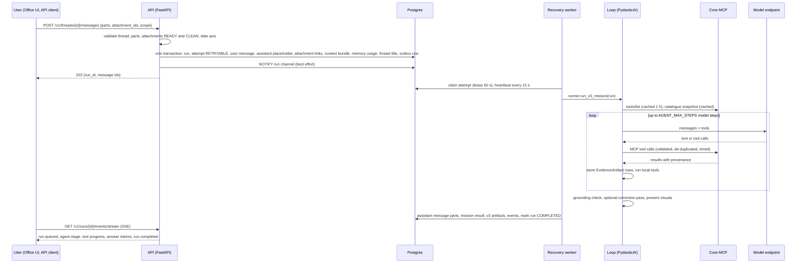
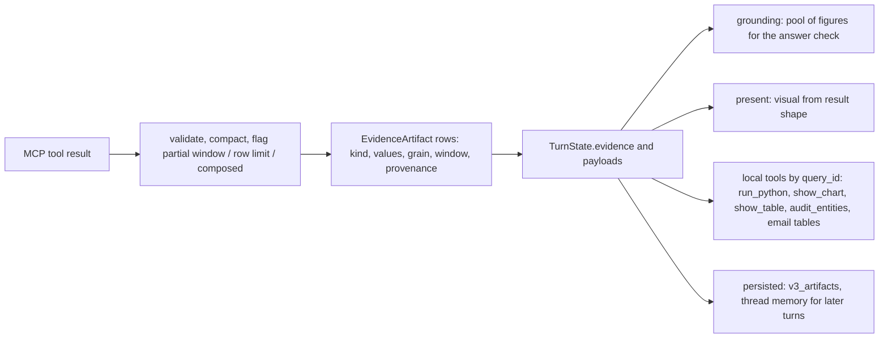
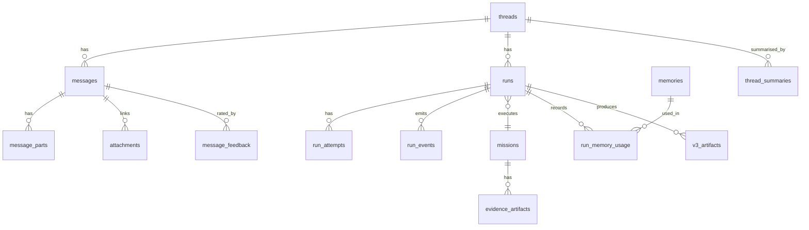
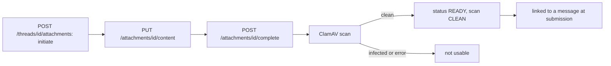
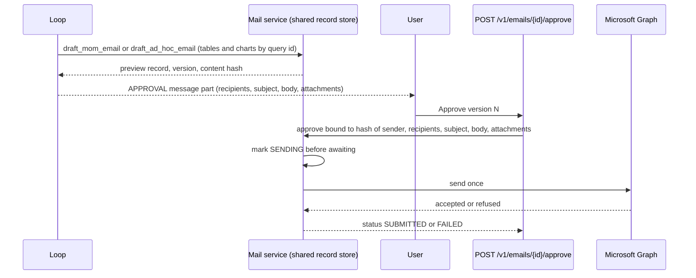

# 4. Data flow

## 4.1 End-to-end flow of one question

## 4.2 Inputs assembled for the loop (`agent/runner.py`)

| Input | Source | Notes |
|-------|--------|-------|
| `question` | Concatenated non-empty `TEXT` parts of the user message | |
| `history` | The thread's last turns as (role, text), excluding the question being asked | `_history` |
| `memories` | Active memories selected for the run by `ContextBuilder` (`phase6-v1`) | Recorded in `run_memory_usage` |
| `thread_summary` | Extractive summary of earlier turns | `thread_summaries` table |
| `workspace_notes` | `scope.workspace_config` from the request | |
| `prior_queries`, `prior_payloads` | Queries and compact payloads of earlier turns of the thread | `_thread_memory`; lets figures quoted earlier be grounded now |
| `system_prompt` | `prompt.system_prompt(catalogue_snapshot, now, server_guide)` | Section 6.6 |
| `tool_defs` | `tools/list` of the MCP server, cached for an hour per gateway | `_tool_definitions` |
| `catalogue_snapshot` | Live catalogue cache warmed and snapshotted by `CatalogueBootstrap`; fail-open (an empty snapshot leaves the model to the catalogue tools) | `_catalogue_snapshot` |
| Time zone and `as_of` | `scope.timezone` (default `Asia/Kolkata`), `scope.as_of`; the anchor is the mission's calendar day, not UTC now | `_as_of_datetime` |
| Date axis | `scope_date_axis(scope)` | passed to tools as the requested axis |

## 4.3 Evidence flow

- `write_evidence` limits stored points (`max_points`) and flags when evidence was cut (`_flag_evidence_cut`); the model sees a `query_id` in every MCP result, while the rows stay server-side.
- Datasets from `build_dataset_query` are paged into evidence with `load_dataset` / `load_dataset_rows` and re-shaped as a query payload (`dataset_as_query_payload`) so charts and tables treat them like any other result.

## 4.4 Answer assembly

1. The loop returns text. Metric ids that slipped into prose are replaced by catalogue labels; long decimals are rounded; Indian digit grouping is applied (`answer_text.py`).
2. `grounding()` yields per-figure findings; `problems()` turns them into sentences; at most one correction run follows; `lost_substance()` keeps the original if the rewrite drops verified content; remaining issues append `unverified_note` and set the limitation `UNVERIFIED_FIGURES`.
3. If evidence exists and no limitation applies, `present.attach()` adds parts: `KPI_GRID`, `TABLE`, `CHART` according to result shape.
4. The runner writes the assistant message with typed parts (`TEXT`, `TABLE`, `CHART`, `KPI_GRID`, `SOURCE`, `WARNING`, `APPROVAL`, `AGENT_STATUS`, ...), a mission result, V3 artifacts, and activity events; the placeholder message created at submission is replaced.
5. `LoopResult.status` is `failed` when the answer is empty, `partial` when a limitation exists (`ANSWER_TRUNCATED`, `DEGENERATE_OUTPUT`, `EXECUTION_LIMIT_EXCEEDED`, `UNVERIFIED_FIGURES`), otherwise `completed`.

## 4.5 Conversation data

Full column lists are in chapter 10.

## 4.6 Memory flow

On every submitted user message, `MemoryCandidateExtractor.extract(message, thread)` produces candidates and `MemoryService.ingest_candidates` stores them. The `memories.status` column defaults to `PENDING_CONSENT`, and a database constraint allows `ACTIVE` only when `consented_at` is set; the other statuses are `CANDIDATE`, `SUPERSEDED`, `ARCHIVED`, `DELETED`. Users manage them through `/v1/memories*` (pin, confirm, move scope, archive, delete). `ContextBuilder` selects memories for a run and records the selection (`run_memory_usage`). Scopes are `THREAD`, `USER`, `PROJECT`, `EPISODIC`; episodic events are stored in `episodic_events`. Retrieval is lexical (generated `search_vector` column, `ts_rank` with `websearch_to_tsquery`); the optional `embedding vector(1536)` column exists only when pgvector is installed, which it is not.

## 4.7 Attachment flow

A message may reference only attachments of the same thread that are `READY` and `CLEAN` and not yet linked. Limits: `ATTACHMENT_MAX_SIZE_BYTES` 25 MiB; `ATTACHMENT_ALLOWED_MIME_TYPES` (default: JSON, PDF, CSV, plain text, JPEG, PNG, WebP). Blobs live in MinIO bucket `seleric-attachments` (or local disk).

## 4.8 Email flow

## 4.9 Scheduled data flows

### Domain-health snapshots (`business-state-cron`)

`services.domain_health.scheduler` resolves, per domain, the metrics listed in `config/domain_health_profiles.yaml` through the semantic port (MCP), applies `business_state_profiles.yaml` features and the judge (`judge.py`), and writes JSON snapshots under `SELERIC_DOMAIN_HEALTH_DIR` (volume `domain_health`). The loop calls the scheduler every 60 seconds; the scheduler decides what is due. The agent reads the latest snapshot through `business_snapshot`; `GET /v1/monitoring/state` and `POST /v1/business-state` serve it.

### Target monitoring (`monitoring-cron`)

`services.monitoring.runner --brand 20` reads `monitor.metrics`, `monitor.targets_current`, `monitor.known_periods`, fetches series through the semantic layer, evaluates each metric against its floor/target/ceiling (`evaluate.py`), and writes `monitor.evaluations`, `monitor.findings` and `monitor.finding_events`. It never touches ClickHouse.

### Forecast scoring

`python -m seleric_swarm.forecasting.score --if-due` (once a day, driven by the business-state loop) compares stored forecast artifacts (`v3_artifacts`) with days that have since matured and writes reports into the `forecast_reports` volume (`SELERIC_REPORTS_DIR`).
