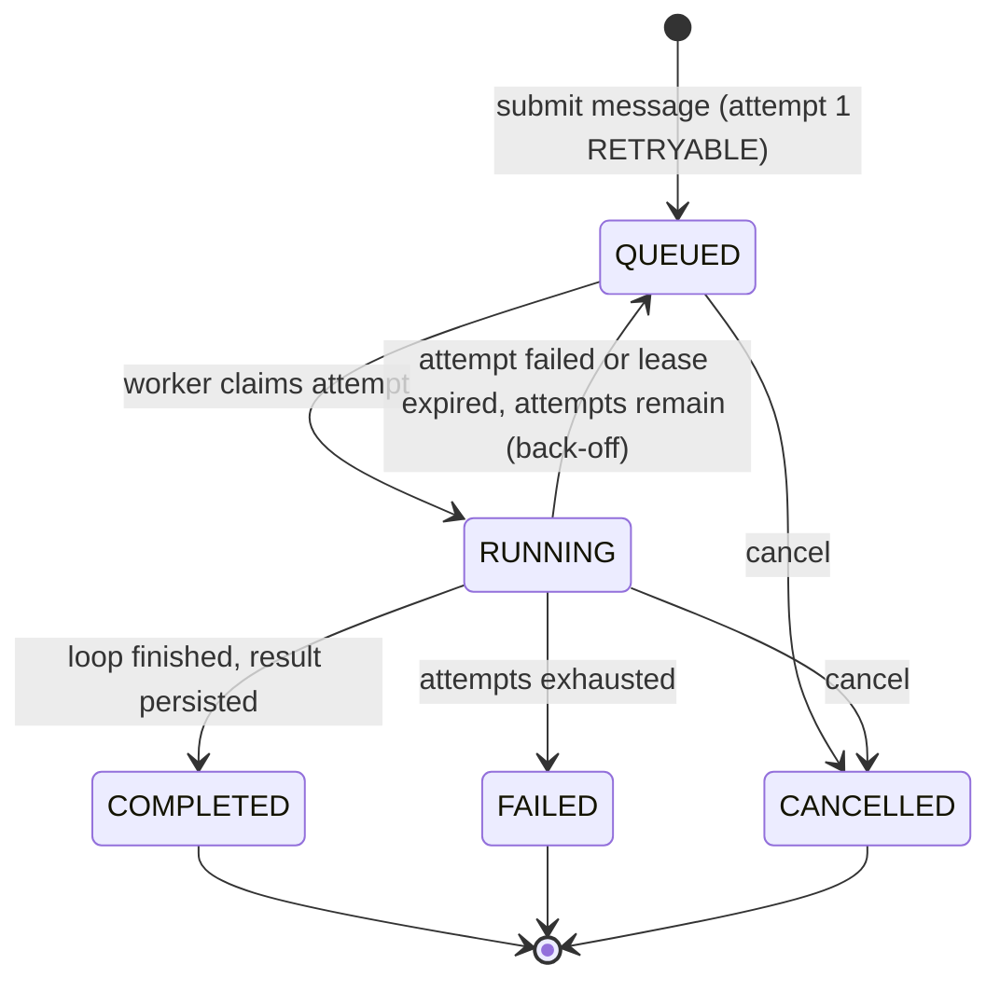
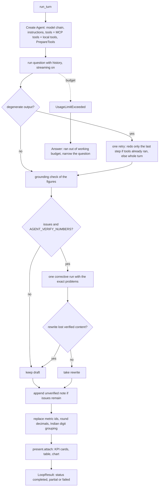

# 5. Workflows

## 5.1 Run lifecycle



Enumerations (`conversations/contracts.py`): `RunStatus` = QUEUED, RUNNING, WAITING, COMPLETED, FAILED, CANCELLED. `RunAttemptStatus` = RUNNING, RETRYABLE, COMPLETED, FAILED, CANCELLED.

## 5.2 Submission

1. `POST /v1/threads/{thread_id}/messages` (HTTP 202).
2. Checks in order: thread owned by the caller and `ACTIVE` (409 otherwise); `execution_mode` is `development` (400); optional `parent_message_id` belongs to the thread (422); at least one non-empty `TEXT` part (400); each attachment belongs to the thread, is `READY` and `CLEAN`, and is not yet linked (409/422); the requested date axis in `scope` is valid (422).
3. The context bundle (history, memories, summary) is built and a mission row is seeded as running (503 if it cannot be persisted).
4. One database transaction creates the run (`max_attempts` from settings), attempt 1 as `RETRYABLE`, the user message, an assistant placeholder message with an `AGENT_STATUS` part "Working…", the attachment links, the run metadata (`context_bundle`, `submission` with query, time zone, `as_of`, date axis, request id, execution mode, placeholder id), memory usage records, the thread title (first 80 characters of the query when the title is empty or "Untitled conversation"), and a `submission_outbox` row.
5. Memory candidates are extracted, the `run.queued` event is emitted, and the run is dispatched: the durable queue sends a Postgres `NOTIFY` so a listening worker starts immediately; polling remains the fallback.

## 5.3 Claim, lease, heartbeat, retry

```mermaid
sequenceDiagram
  participant W as Recovery worker
  participant DB as Postgres
  participant X as Executor (runner)
  loop every --interval seconds, or on NOTIFY
    W->>DB: SELECT runnable attempt FOR UPDATE SKIP LOCKED (RETRYABLE, or lease expired); set worker_id, lease_expires_at = now + RUN_LEASE_S, version + 1
    W->>X: execute run in a free slot (up to run_max_concurrency)
    loop every RUN_HEARTBEAT_S
      W->>DB: heartbeat: extend lease only if lease_expires_at > now and version matches
    end
    alt success
      X->>DB: mark attempt and run COMPLETED, emit terminal event
    else retryable error
      W->>DB: transition_failed_attempt: next attempt RETRYABLE after delay
    end
  end
  Note over W,DB: recover_expired() turns RUNNING attempts with an expired lease into retryable or failed
```

- Retry delay: `RUN_RETRY_DELAY_S × 2^(attempt-1)` plus uniform jitter up to `RUN_RETRY_JITTER_S`.
- A cancelled run's expired attempt is moved to `CANCELLED` instead of being retried.
- Concurrency: `run_max_concurrency` (4) missions per worker. Before 2026-10-07 each poll waited for its whole batch; dispatch now claims as many runnable attempts as there are free slots without waiting for running ones.
- Shutdown: on SIGTERM the worker stops claiming and lets running missions finish for up to `run_drain_timeout_s` (480 s); the container's `stop_grace_period` is 9 minutes by default.
- The terminal event is emitted only after the compare-and-set of the terminal state succeeds; every state change is fenced by the attempt `version`.

## 5.4 Cancellation

1. `POST /v1/runs/{run_id}/cancel` records the cancellation (`runs.cancel` with a terminal `run.cancelled` event; 409 if the run is not cancellable) and replaces a pending "Working…" placeholder with "Run cancelled.".
2. The cancellation flag for the run's mission id is set (`cancellation.request(run.mission_id)`; Redis when `CANCELLATION_BACKEND=redis`, deployed).
3. The loop checks the flag before every model request (`PrepareTools.prepare` raises `MissionCancelledError`) and local tools accept an `is_cancelled` callable.
4. The legacy mission route `POST /v1/missions/{id}/cancel` marks a running mission cancelled (best effort).

## 5.5 Streaming progress to clients

`GET /v1/runs/{id}/events` returns stored activity events; `GET /v1/runs/{id}/events/stream` (and `/v1/threads/{id}/events/stream`) serve the same as server-sent events. A Redis notifier wakes streaming readers when new events are appended (`EVENT_NOTIFIER_BACKEND=redis`). Event types seen in the code include `run.queued`, `agent.stage`, `agent.revising` (with reason `grounding` or `degenerate`), tool progress events, answer-token events from `AnswerStream`, `run.cancelled` and terminal events. Events carry a visibility (`USER`, `ADMIN`, `INTERNAL`).

## 5.6 One turn inside the loop



Budgets: the PydanticAI `UsageLimits` are `request_limit = AGENT_MAX_STEPS + 6` and `tool_calls_limit = AGENT_MAX_TOOL_CALLS + 8` (hard backstops); the soft budget (`_Budget`) withdraws the tools and tells the model to answer from the evidence once steps, tool calls or `AGENT_TURN_BUDGET_S` are spent.

## 5.7 Email approval

1. The model calls `draft_mom_email` or `draft_ad_hoc_email`; recipients are an explicit well-formed address or a name in `config/email_contacts.yaml` (otherwise the agent asks); `EMAIL_ALLOWED_DOMAINS` (default `seleric.ai`) restricts free addresses.
2. A preview record is stored in the shared record store; the UI renders an `APPROVAL` card.
3. The user approves through the card (`POST /v1/emails/{id}/approve`) or by spoken or typed approval via `send_email`. `send_email` refuses a version the user has not seen (produced by the same run), a stale version, another user's draft, and a cancelled run.
4. `send` marks the record `SENDING` before awaiting the transport; retries return the current record; a definite refusal (`FAILED`) may be retried with the same approval; an unknown outcome (timeout) is never retried automatically; `SUBMITTED` means the provider accepted the message, not that it was delivered.

## 5.8 Voice session

1. The browser calls `POST /v1/voice/token`; the API mints a LiveKit JWT scoped to one room derived from a thread the caller owns, with the principal as participant metadata.
2. The `seleric-voice` worker joins the room. Its conversational voice model is instructed (in `voice/worker.py`) to answer small talk itself and to call the tool `ask_seleric` with the user's complete question for anything analytical, then speak the result; email requests also go through `ask_seleric`, and spoken confirmation words ("send", "yes", "go ahead") trigger approval of an already shown draft.
3. `voice/projection.py` gives the voice model a short projection (last turns, durable preferences), never tool payloads or evidence.
4. `SpeechQueue` plays one utterance at a time: answers keep their order, status chatter is dropped when something is speaking, and the user can talk over speech, which drops the rest and everything queued.
5. The worker is a client of the same conversation API (`SELERIC_API_URL`), including `POST /v1/runs/{id}/cancel`.

The module docstring of `voice/worker.py` still describes "Phase 0: echo only"; the code and prompts it contains implement the conversational agent.

## 5.9 Scheduled jobs

| Job | Container | Cadence | Output |
|-----|-----------|---------|--------|
| Domain-health scheduler | `business-state-cron` | loop of 60 s; the scheduler decides what is due | JSON snapshots in `domain_health` volume |
| Forecast scoring | `business-state-cron` | `--if-due`, once a day | reports in `forecast_reports` volume |
| Target monitoring | `monitoring-cron` | hourly, about 5 minutes past the hour (`sleep 3600 - now%3600 + 300`) | `monitor.evaluations`, `monitor.findings`, `monitor.finding_events` |
| Catalogue → Qdrant sync | manual (`scripts/sync_catalogue_to_qdrant.py`) | | optional vector index |
| Business-state backfill | manual (`scripts/backfill_business_state.py`) | | |

## 5.10 Deployment

There is no CI/CD pipeline that deploys this repository: `Jenkinsfile.eval` runs static gates only (`uv sync --extra dev`, lint, tests, validation); its own header states that the live evaluation is not a Jenkins stage because it needs the running stack. The compose project is built and started on the host.

```bash
cd /opt/seleric/Seleric_Agent
docker compose build api
docker compose up -d api recovery business-state-cron monitoring-cron   # voice: --profile voice
```

`monitoring-cron` reuses the image `seleric_agent-business-state-cron:latest` (`pull_policy: never`), so rebuild or recreate `business-state-cron` before `monitoring-cron`. `seleric-migrate` runs at API start and applies pending SQL migrations.

## 5.11 Evaluation

`make eval` runs `eval/regress/run_regression.py eval/regress/test_agent6.json eval/regress/results/latest 1`: a fixed question set replayed against the deployed API on port 8090, with numbers cross-checked in ClickHouse. Run only the questions relevant to a change. Static gates: `make lint`, `make typecheck`, `make test`, `make validate`, `make office-ui-test`.

## 5.12 Troubleshooting

| Symptom | Likely cause | Check |
|---------|--------------|-------|
| `202` returned, nothing happens | Recovery worker not running or cannot claim | `docker compose ps recovery`; `runs` and `run_attempts` rows |
| Run stuck `RUNNING` | Lease not expired yet, or worker lost | `run_attempts.lease_expires_at`; `recover_expired` runs in the worker |
| Answer says data could not be fetched | MCP unreachable or token wrong | `/readyz` checks `provider` and `mcp` |
| Failed run with a generic message | Provider error classified by `_user_facing_agent_failure` | Mission `failure_detail` (exception types and HTTP status codes only) and `GET /v1/admin/runs/{id}/diagnostics` |
| "unverified" note on an answer | Figures not found in tool results | Run trace; usually a derived figure computed without `run_python` |
| Upload never becomes READY | Scan not completed | ClamAV container; `attachments.scan_status` |
| No forecast | Policy gate, too little history, Chronos down | Reason codes in the forecast artifact; `CHRONOS_BASE_URL` |
| Monitoring panel empty | `monitoring-cron` not running or `monitor` schema not migrated | Cron logs; migrations 016–018 |
