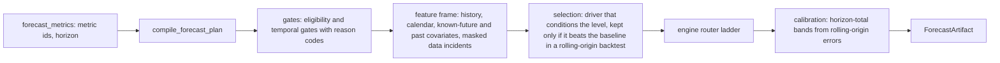

# 7. Analytical engines

All engines are pure calculation over series that a toolset has already fetched through the certified Core path. Nothing in the engines names a metric, dimension, value or business threshold; the catalogue supplies lineage and structure.

## 7.1 Diagnosis: "why did it change?" (`toolsets/diagnosis.py`, `causal/diagnosis.py`, `causal/dowhy_service.py`)

**Division of labour.** The toolset `diagnose_metric_change` plans candidates from catalogue metadata (the outcome's `formula.depends_on`, ratios built on it, segments by dimension), fetches about two months of daily history per candidate through the same path as `metrics_query`, writes evidence, and passes the series to the engine. Fetching and calculation are one tool call because handing hundreds of evidence ids through the model corrupted them.

The engine reports four layers separately so an arithmetic decomposition is never presented as a behavioural cause:

| Layer | Question | Method |
|-------|----------|--------|
| 1. Event | Is the change real? | The event is compared with the same weekday in recent weeks (outlier weeks skipped), judged against a robust day-of-week plus trend fit (`fit_calendar`, Huber). `Referencer` builds level-adjusted same-weekday references; `SeasonalProfile` measures normal deviation on a log scale with median/MAD over windows that touch no abnormal day. A change inside normal variation is reported as such |
| 2. Decomposition (what changed) | Which accounting parts moved? | Candidates from catalogue lineage in both directions, accepted only when the data verify them day by day (`Y = k × Π X_i^e_i` with constant `k`); additive bridges found by `discover_bridge_tree` (signed sums of up to six terms, meet-in-the-middle over random projections, each accepted only if it reproduces the metric on every history day); the change is split with exact, order-independent **Shapley values** (`shapley`); approximate rate chains (`metric ≈ k × rate × base`) are reported as approximate |
| 3. Localisation (where) | Which segments? | Segment decomposition over catalogue dimensions: additive metrics split exactly; a rate splits into a mix effect and a within-segment rate effect (where Simpson's paradox shows); a ratio of two sums splits exactly; each dimension's segment-specificity is compared with the specificity a normal day shows, and identifier-like dimensions are ignored |
| 4. Drivers (why) | Which upstream candidates, with what evidence? | DoWhy on an explicit time-series DAG (`estimate_time_series_effect`): calendar and lagged pre-treatment variables only, HAC intervals, refuters plus temporal-precedence tests. Contribution = effect × how far the driver itself moved from its reference |

Driver classification is rule-based and conservative: `supported_cause` (identified effect, confidence interval excludes 0, every refuter passes, the driver moved at the event in the explaining direction, and past driver values predict the outcome while the reverse does not); `likely_contributor` (same, but direction rests on an assumption); `correlation` (adjusted effect indistinguishable from 0, a placebo refuter fails, or the outcome feeds back into the driver); `insufficient_evidence`. A driver in lockstep with the outcome's own unit count is treated as a measurement of the same events, not a cause (`unit_count_metric`, `_lockstep_correlation`). `DoWhyService` requires a registered causal question; any failure raises `DoWhyUnavailable` so the caller falls back to a metadata-only audit.

Output: `DiagnosisReport` with a headline, exact bridge lines reconciled to the total, narrative sentences in the outcome's own units, and the driver findings.

## 7.2 Exploration: "what is worth knowing?" (`toolsets/exploration.py`, `exploration/`)

`space.py` plans the subspace (metrics × dimensions) from catalogue metadata; `engine.py` runs a batch of hypothesis tests:

| Test | Scope |
|------|-------|
| `period_change` | each metric's window against the previous window, judged against window-to-window moves in its own history |
| `trend`, `change_point` | each metric's fetched daily history |
| `distribution_shift` | each additive metric × dimension: Adtributor explanatory power plus surprise over the window change |
| `outstanding` | one segment far larger than the rest predict |
| `co_movement` | day-to-day changes across metrics, skipped for pairs the catalogue already relates (lineage or the same units measured twice) |

Every test yields a p-value under its own null; Benjamini–Hochberg across **all** tests (not only the reported ones) holds the false-discovery rate at `EXPLORE_FDR` (0.10, a constant in `toolsets/policy_config.py`); survivors must clear a practical-size floor and are ranked by `kind prior × impact × significance`. Each insight carries typed `follow_ups` (a registered tool and arguments) so a later turn can drill into the segment or diagnose the move. All insights are observations except co-movement, which is an association; none is a cause. `_dedupe` keeps one insight per movement.

## 7.3 Composition (`toolsets/composition.py`)

`break_down_metric` walks a metric's catalogue `formula.composition` tree (for example net profit = contribution margin − ad spend), fetches every line in one query per period on the metric's own view and basis, and checks the reconciliation itself, so breakdowns, waterfalls and period bridges never mix bases.

## 7.4 Forecasting (`toolsets/forecasting.py`, `forecasting/`, `chronos/`)

- **Policies:** `config/forecast_policies.yaml` (defaults: daily grain, `context_days` 1,095, `min_history_days` 120, `cutoff_lag_days` 2, `max_horizon_days` 90, quantiles 0.1/0.5/0.9, provisional `folds` 4 with engine `chronos-2-small`), `forecast_features.yaml`, `calendar_in.yaml` (Indian calendar effects), `data_incidents.yaml` (known outages masked), `prediction_policies.yaml`, `skeptic_policies.yaml`, `model_registry.yaml`.
- **Ladder (`engines.py`):** approved bundle engine (preferred) → provisional univariate Chronos with calendar → ETS if an approved ETS model id exists → `ForecastUnavailable` with reason codes. `SeasonalNaiveEngine` is the baseline. Chronos runs as the separate service in `chronos/` (`CHRONOS_BASE_URL`).
- **Quality machinery:** `backtest.py` (offline rolling-origin backtest and bundle promotion, writes `reports/forecasting/<date>/<target>.json|.md` and proposes a YAML bundle for human approval), `bakeoff.py` (feature-set bake-off: calendar vs none, then each candidate past covariate, then a second covariate; a feature stays only if it lowers held-out error), `calibration.py`, `gates.py`, `score.py` (scores stored forecasts against matured days; run daily by the cron).
- Only the `ForecastArtifact` supplies numbers to the answer.

## 7.5 Domain health and business state (`services/domain_health`, `services/business_state`)

`business_state` computes per-metric features (period delta, rolling means, anomaly detectors in `detectors.py`) over daily series according to `config/business_state_profiles.yaml`. `domain_health` resolves the metrics of each domain (`config/domain_health_profiles.yaml`, overridable by users through the monitoring API) into snapshots and judges the latest value (`judge.py`): change is reported in the unit that fits the metric's shape (percent for additive metrics, percentage points for ratios, absolute for signed ones); severity requires the move to go the metric's bad way, and a metric without `direction_bad` can only be watched, never alerted; the band accounts for weekday seasonality and does not go below zero for metrics that cannot be negative.

## 7.6 Target monitoring (`services/monitoring`)

`evaluate()` is pure: one metric, one day, against a band (`floor`, `target`, `ceiling`).

| Concept | Rule |
|---------|------|
| `MetricDef` | `metric_id`, `direction_bad` (`up`, `down`, `both`, `none`), `eval_window` (`day` or `trailing_7d_pooled`), `kind` (`catalogue` or `ratio` with numerator, denominator, weight ids), `settles_after_days` |
| Pooled ratios | A ratio is judged on pooled parts (sum of numerator over sum of denominator across the window), never on an average of daily ratios |
| Status | `classify`: for `down` metrics `below_floor` then `below_target`; for `up` metrics `above_ceiling` then `above_target`; for `both`, floor and ceiling; the good side of a one-way metric is reported as info, never as a breach; `ok`, `untrusted`, `no_data` also exist |
| Severity | `severity_of`: hard breach of the bad side is `critical`, soft breach `warning`, good side `info`; `both` metrics give `warning`; a day explained by a recorded known period is lowered to `info` and carries `explained_by` |
| Provisional data | Days younger than `settles_after_days` before the latest data day are `provisional` |
| Trust gate (`GateConfig`, `config/monitoring.yaml`) | `bulk_return`: a day whose closed returns exceed `return_max_share` (0.25) of that day's gross sales; metrics that settle late are untrusted that day. `spend_collapse`: spend below `spend_min_share` (0.25) of the median of the prior `spend_lookback_days` (14) days with at least `spend_min_history_days` (7) of history; reported on its own and does not set business metrics aside because the fall in orders that follows is real. Days already flagged are excluded from the baseline so a long outage does not become its own normal |
| Pooling | `pooling.window_days` 7 |

Persistence: tables of schema `monitor` (chapter 10): `metrics`, `target_versions`, `evaluations`, `findings`, `finding_events`, `labels`, `known_periods`. The runner reads `monitor.metrics`, `monitor.targets_current`, `monitor.known_periods`; writes evaluations, findings and finding events. API: `/v1/monitoring/*` (chapter 9).
